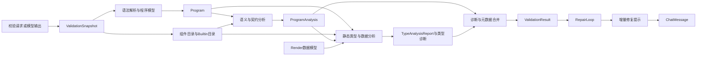
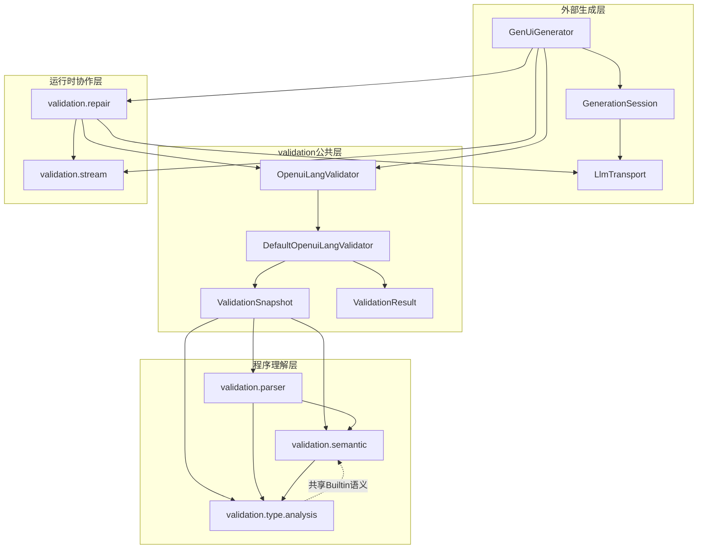
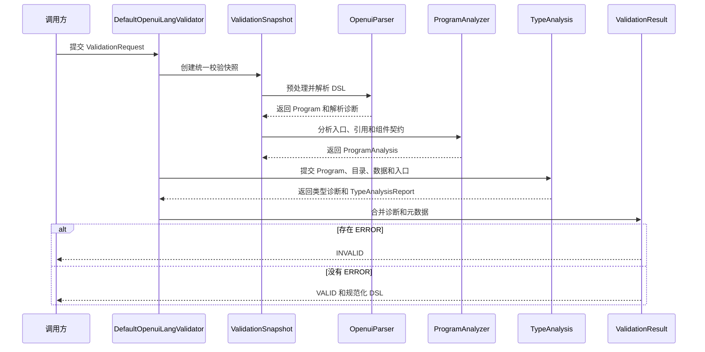
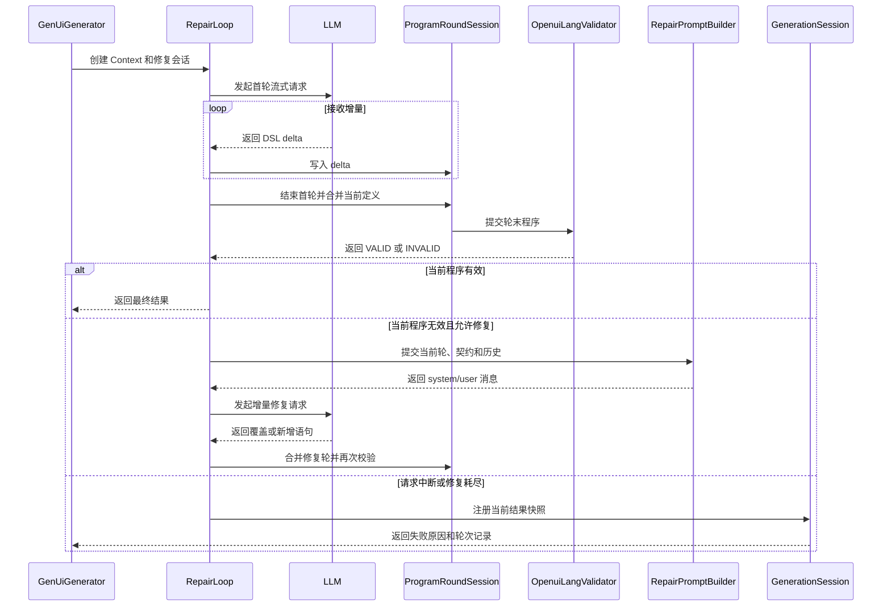
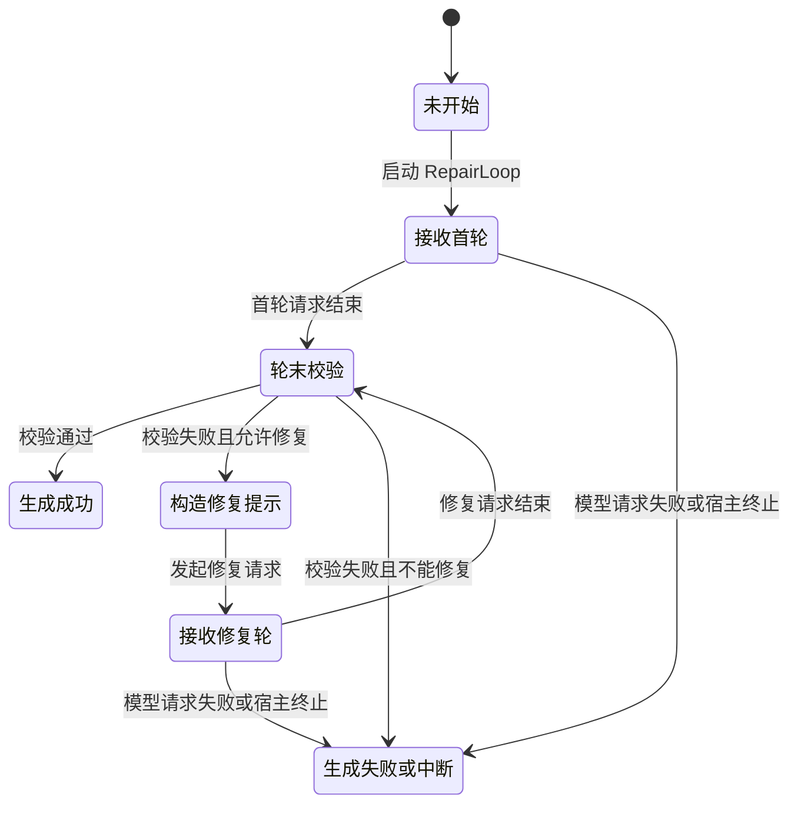
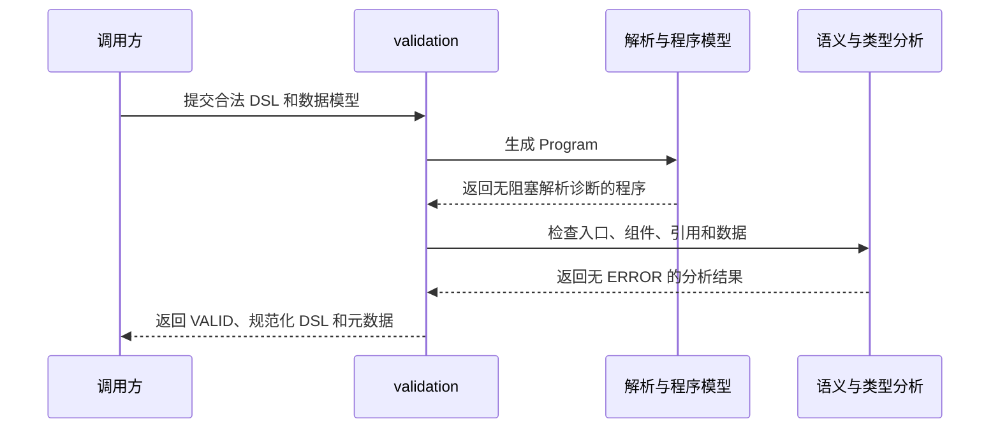
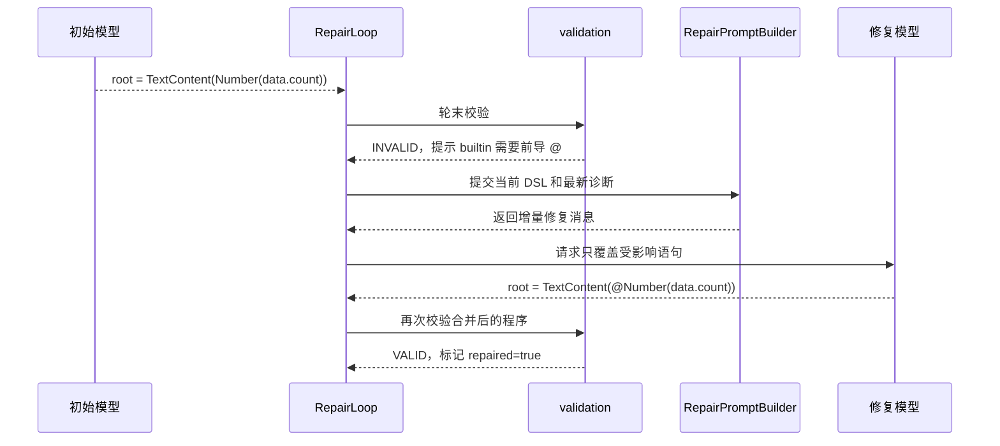
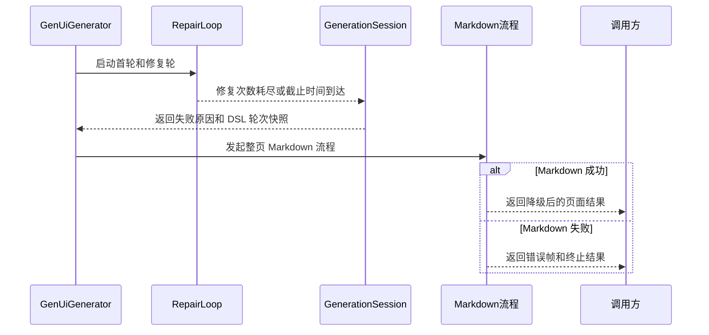

# validation 模块总体架构说明书

## 1. 模块定位

`validation` 把 OpenUI Lang 文本转换成可分析、可校验、可继续修复的程序结果。它同时服务两类调用：

- 一次性校验：调用方直接提交 `ValidationRequest`，获得 `ValidationResult`。
- 流式生成：模型逐轮输出 DSL，系统在每轮结束时校验当前程序；校验失败时由 `RepairLoop` 组织增量修复。

当前实现的主链路是：

```text
文本或模型输出
  → 程序解析
  → 语义与契约分析
  → 静态类型与数据分析
  → 诊断合并
  → 校验结果
  → （流式失败时）增量修复提示与下一轮模型请求
```

同步校验不调用模型。流式生成中的模型请求由 `GenUiGenerator` 和 `LlmTransport` 管理，`validation` 提供程序理解、轮次状态、校验和修复提示能力。

## 2. 六个职责模块

| 模块 | 核心职责 | 主要结果 |
| --- | --- | --- |
| 公共 API 与编排 | 建立同一次校验的快照，按固定顺序执行解析、语义分析和类型分析，合并结果 | `ValidationResult` |
| 语法解析与程序模型 | 清洗模型文本，构建 token、AST、语句和程序模型 | `Program` |
| 语义与契约分析 | 选择入口，解析引用，检查组件存在性、参数数量和契约结构 | `ProgramAnalysis` |
| 静态类型与数据分析 | 推导表达式事实，检查组件参数、builtin 签名和数据路径 | `TypeAnalysis.Result`、`TypeAnalysisReport` |
| 流式程序状态 | 跨 delta 和跨修复轮维护当前定义，在轮末提交统一校验 | `RoundEndResult` |
| 增量修复提示 | 组织修复轮，筛选当前诊断，编排 Prompt，并保存异常快照 | `RepairLoop`、`ChatMessage` |

这六个模块共享两条规则：

1. 同一个语句 ID 重复出现时，后定义覆盖前定义；首次出现顺序保留。
2. `BuiltinAnalysis` 是共享的 builtin 语义内核，统一处理参数角色、binder 作用域、模板延迟检查和特殊返回语义。它同时被契约加载、语义分析和类型分析使用。

## 3. 核心运行链路

### 3.1 一次性校验

`DefaultOpenuiLangValidator` 接收 `ValidationRequest` 后创建 `ValidationSnapshot`。快照绑定程序文本、契约、builtin 目录、数据模型和入口偏好，保证后续分析使用同一组输入。

解析阶段产生 `Program`。语义阶段产生 `ProgramAnalysis`，其中包含入口、当前语句视图和语义诊断。类型阶段通过入口信息分析当前可达定义，返回确定的类型诊断和 `TypeAnalysisReport`。默认校验器最后合并诊断，并将覆盖摘要写入 `ValidationMetadata.extra`。

`UNPROVEN` 表示证据不足，不会自动生成错误。数据路径缺失、空组件槽位等产品规则可以直接生成错误诊断，因此最终状态仍以 `ValidationIssue` 的严重程度为准。

### 3.2 流式生成与修复

当前流式职责分成两层：

- `GenUiGenerator` 和 `GenerationSession` 负责调用级生命周期、截止时间、取消、输出帧和 Markdown 降级。
- `RepairLoop` 负责首轮生成、修复轮、跨轮程序合并、轮末校验、修复次数限制和结果快照。

`RepairLoop` 每轮只在模型请求结束后调用校验器。当前轮无效时，`RepairPromptBuilder` 根据当前有效 DSL、最新诊断、契约边界和有限历史生成两条 `ChatMessage`，然后发起下一轮流式请求。

首轮修复允许启动一次。后续修复同时受 `maxAttempts` 和调用级截止时间限制。模型请求中断时，已完成轮保留校验结果，正在接收的轮只保留原始输出和当前定义，不产生虚假的校验结论。

## 4. 关键数据模型

| 数据模型 | 关键字段 | 作用 |
| --- | --- | --- |
| `ValidationRequest` | `dsl`、`contract`、`rootName`、`externalRefs`、`dataModel` | 描述一次独立校验的输入上下文 |
| `ValidationSnapshot` | `normalizedDsl`、`program`、`catalog`、`builtins`、`dataModel`、`analysis` | 固定同一次校验使用的程序、契约和入口事实 |
| `Program` | `statements`、`diagnostics`、`incomplete` | 保存全部声明、解析诊断和流式补闭合标记 |
| `ProgramAnalysis` | `issues`、`entryId`、`rootResolved`、`statementCount` | 保存语义诊断和入口选择结果 |
| `TypeAnalysisReport` | `Obligation`、`Entry`、三态统计、完整性 | 记录类型检查要求、结论和是否触发内部限制 |
| `ValidationResult` | `status`、`normalizedDsl`、`issues`、`metadata` | 向调用方提供最终校验结果 |
| `ProgramRoundSession` | 当前定义、轮次原始文本、扫描状态、契约版本 | 维护跨 delta、跨轮的程序状态 |
| `RoundEndResult` | `currentDefinitions`、`rawOutput`、`validationResult`、`elapsedMs`、`endReason` | 保存一轮完成或中断后的状态 |
| `RepairLoop.Context` | 原始提示、用户需求、契约、数据模型、`maxAttempts` | 固定一次修复会话的上下文 |
| `ChatMessage` | 消息角色、消息内容 | 表示最终发送给修复模型的 system/user 消息 |

### 典型输入输出

一次有效校验：

```text
输入：
  dsl = root = TextContent(data.title)
  dataModel = {"title": "设备列表"}
  contract = 包含 TextContent

输出：
  status = VALID
  normalizedDsl = root = TextContent(data.title)
  issues = []
  metadata.rootName = root
```

一次需要修复的流式轮次：

```text
首轮输出：
  root = TextContent(Number(data.count))

轮末结果：
  status = INVALID
  issues = [缺少 builtin 前导 @]

修复 Prompt：
  当前 DSL + 最新诊断 + 增量修复规则

修复轮输出：
  root = TextContent(@Number(data.count))
```

## 5. 精简版 4+1 架构视图

### 5.1 逻辑视图



`Program` 是解析、语义分析和类型分析之间的共同程序模型。`ProgramAnalysis` 先提供入口和语义事实，`TypeAnalysis` 再复用这些事实完成可达性和数据检查。

### 5.2 开发视图



逻辑模块和源码包不是一一对应关系。`BuiltinAnalysis` 位于类型分析实现中，但承担跨模块共享职责；`RepairLoop` 位于修复包中，连接轮次状态、校验器和模型传输。

### 5.3 过程视图

#### 同步校验



#### 流式修复



#### 状态转换



### 5.4 场景视图

#### 场景一：同步校验合法程序



#### 场景二：缺少 builtin 前导符的增量修复



#### 场景三：修复耗尽后的整页降级



## 6. 关键设计决策

### 6.1 当前定义与完整程序分离

`Program` 保留全部语句和解析诊断，`currentById()` 提供同名后定义覆盖后的当前视图。流式会话使用同样的 last-wins 规则，因此修复轮只需覆盖受影响的语句，不必重写整页。

### 6.2 语义分析和类型分析保持并列

语义分析回答“入口、引用和组件结构是否成立”。类型分析回答“已成立的表达式是否满足数据和参数要求”。两者共享 `Program`、目录和入口信息，但输出不同类型的诊断，因此保持两个分析阶段。

### 6.3 builtin 规则集中到共享内核

`Each`、`Render`、`Switch`、`Sort`、`Filter` 等 builtin 同时影响引用作用域和类型推导。`BuiltinAnalysis` 集中这些规则，避免语义分析、类型分析和契约加载各自维护一套参数角色定义。

### 6.4 类型分析使用内部完整性标记

当前类型分析不再接收可配置的 `AnalysisBudget`。分析会话使用固定的结构限制，并通过 `AnalysisCompleteness` 记录是否发生截断。受限分析仍可返回已证明错误，但 `TypeAnalysisReport.analysisComplete()` 会明确反映结果不完整。

### 6.5 修复轮与外部生成生命周期分离

`RepairLoop` 负责程序、轮次和提示；`GenerationSession` 负责调用级截止时间、取消和输出所有权；`GenUiGenerator` 负责最终 Markdown 降级。这样修复逻辑可以通过自定义 `LlmTransport` 独立测试。

## 7. DFX 设计

| 关注点 | 当前设计 |
| --- | --- |
| 可靠性 | 每轮模型请求结束后才执行轮末校验；中断轮不生成校验结论；当前 DSL 和最新诊断优先于历史 |
| 可诊断性 | 语义、类型和解析诊断统一进入 `ValidationResult`；类型覆盖报告单独记录三态结论和完整性 |
| 性能 | 解析和分析在调用线程内同步执行；类型分析通过固定结构限制控制展开规模；Prompt 历史最多保留相关的最近三轮 |
| 可扩展性 | 普通组件和 builtin 通过契约扩展；特殊 builtin 语义集中在 `BuiltinAnalysis`；修复指导通过 `RepairGuidance` 路由 |
| 可测试性 | 解析、语义、类型分析和 Prompt 构造保持纯输入输出；`RepairLoop` 支持注入 `LlmTransport` 验证轮次和异常快照 |

