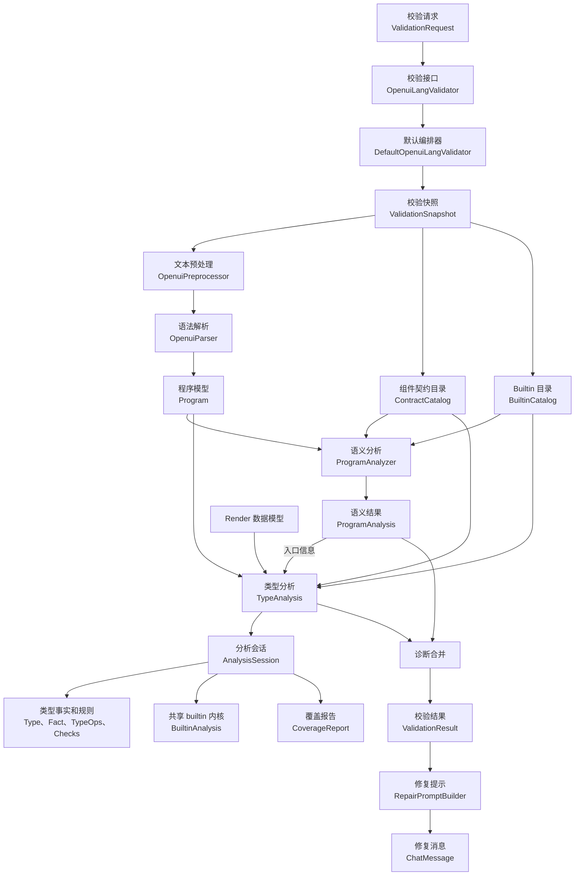
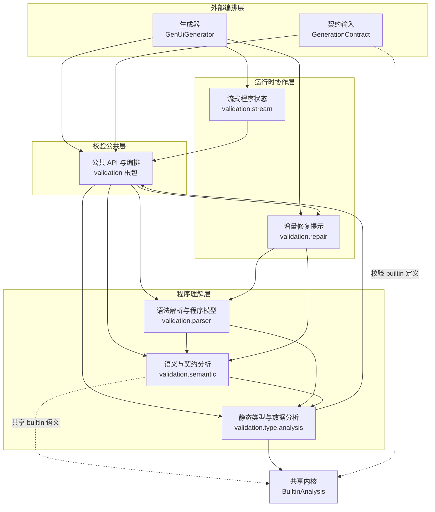
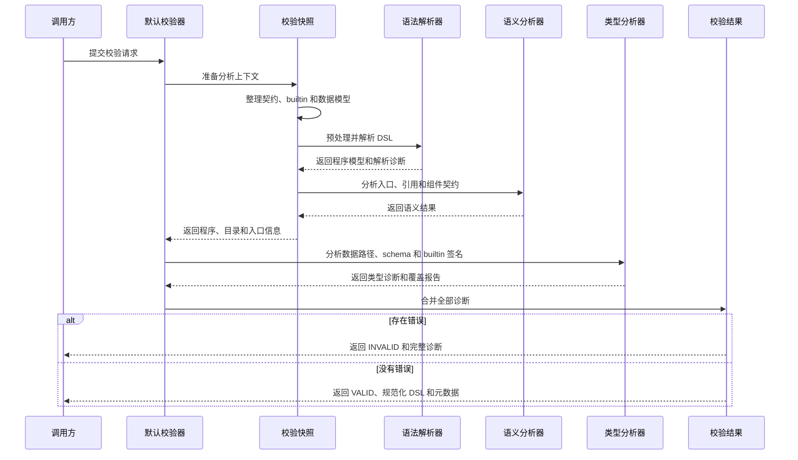
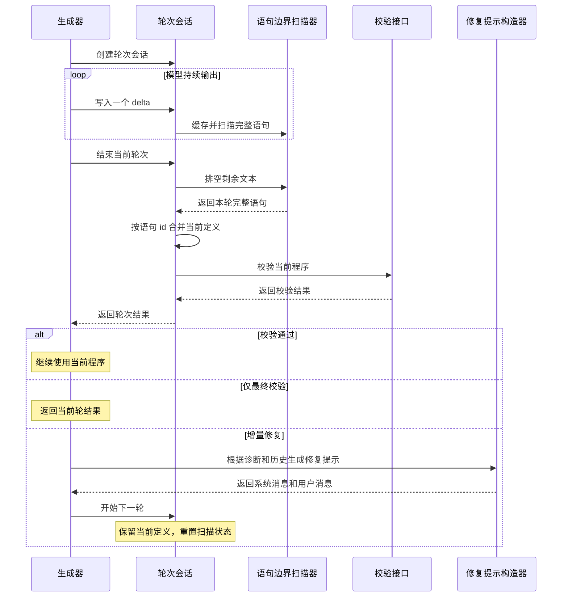
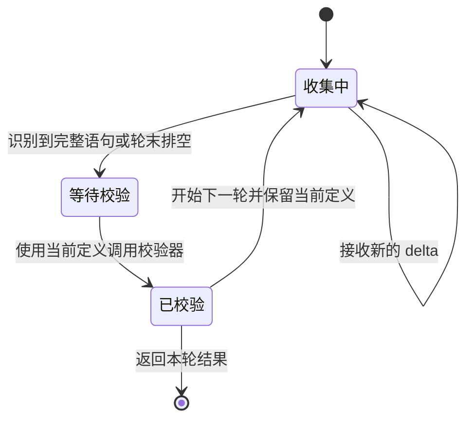
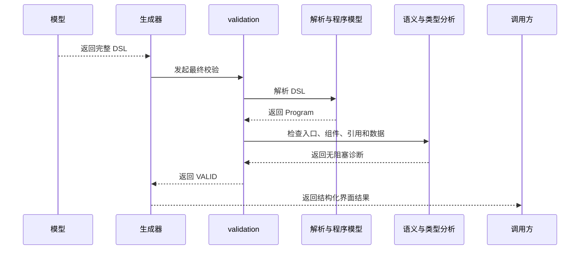
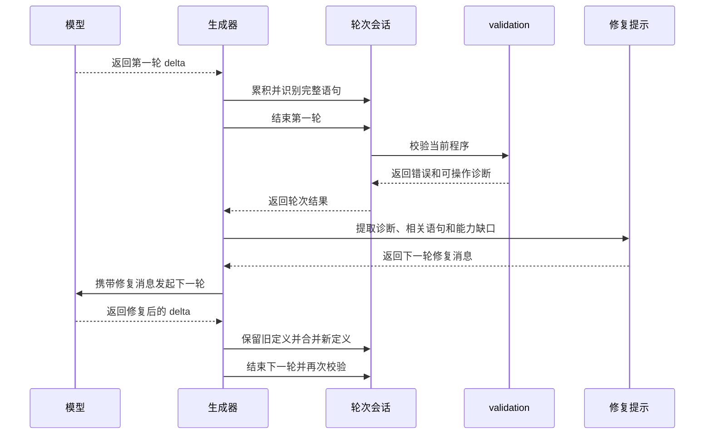
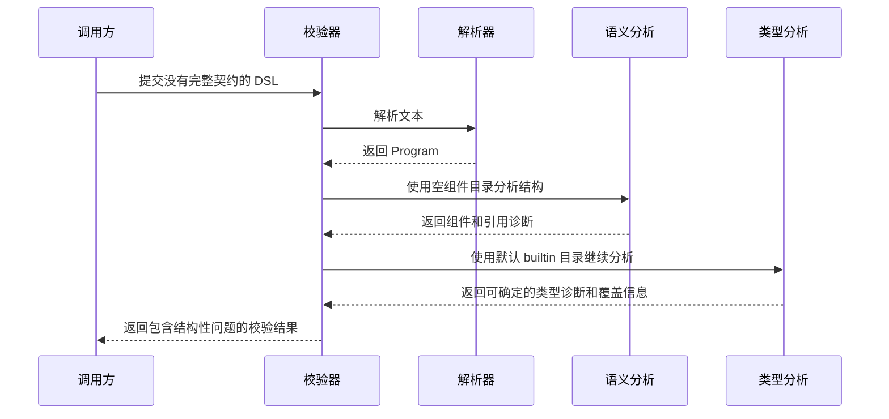

# validation 模块总体架构

`validation` 负责把 OpenUI Lang 文本转换成可判断、可继续修复的程序结果。它连接一次性校验、流式生成和增量修复三个场景。

模块不只是语法检查器，也不负责调用模型。它先建立程序模型，再分别完成语义分析和静态类型分析，最后把结果交给外部生成器决定是否修复或降级。

## 架构结论

`validation` 可以分成六个职责模块：

1. 公共 API 与编排。
2. 语法解析与程序模型。
3. 语义与契约分析。
4. 静态类型与数据分析。
5. 流式程序状态。
6. 增量修复提示。

六个模块共享一个程序版本规则：同一个语句 id 出现多次时，后出现的定义覆盖先出现的定义，但首次出现顺序保留。单次校验由 `Program.currentById()` 提供当前程序，跨轮生成由 `ProgramRoundSession` 延续同一规则。

`BuiltinAnalysis` 是跨模块共享的 builtin 语义内核。它位于类型分析实现中，但同时被语义分析和契约加载使用，负责参数角色、binder 作用域、模板延迟检查和特殊返回类型。

模块边界可以概括为：

- `OpenuiLangValidator` 提供一次校验接口。
- `GenUiGenerator` 决定何时校验、是否继续修复，以及失败后如何降级。
- `validation` 负责解析、分析、程序状态和提示数据，不负责模型请求。

## 精简版 4+1 架构视图

### 逻辑视图：从文本到可修复结果

逻辑视图关注核心对象和它们之间的责任关系。`Program` 是解析、语义分析和类型分析之间的共同程序模型；`ProgramAnalysis` 和 `TypeAnalysis` 是并列的两类分析结果。

逻辑上，语义分析先确定“程序引用了什么、入口是什么、组件是否满足契约”，类型分析再确定“数据是否满足组件和 builtin 的要求”。两者共享程序模型，但不共享同一类诊断。

### 开发视图：逻辑模块和代码分层

开发视图说明逻辑模块在代码中的组织方式。源码包表达实现位置，逻辑模块表达职责边界，两者不是严格的一一对应关系。

这不是一条严格的“解析器到语义再到类型”的单向继承链。类型分析会复用语义模块的目录和引用工具，语义分析也会使用类型包中的 builtin 语义内核。公共层负责组装结果，外部生成器负责模型循环。

### 过程视图：一次校验、流式轮次和错误处理

#### 一次校验

解析错误会进入程序模型的诊断集合，解析器会尽量继续处理其他语句。语义错误和类型错误在默认校验器中统一合并。`UNPROVEN` 表示信息不足，不会自动等同于失败；数据路径无法解析等专门场景有更严格的错误政策。

#### 流式轮次

`ProgramRoundSession` 只负责缓存文本、维护当前定义和在轮末调用校验器。它不发模型请求，也不决定 Markdown 降级。增量修复循环和最终降级由 `GenUiGenerator` 控制。

#### 流式状态

### 场景视图：典型业务协作

场景视图关注跨模块协作，不重复列出每个类的内部方法。

#### 场景一：模型生成完整且合法的界面

#### 场景二：模型生成结果需要增量修复

#### 场景三：契约不完整但仍需给出结构性诊断

## 对外入口和核心数据

### `ValidationRequest`

`ValidationRequest` 把一次分析需要的上下文放在一起：

| 输入 | 作用 |
| --- | --- |
| `dsl` | 待校验的 OpenUI Lang 文本 |
| `contract` | 当前生效的组件、builtin 和能力契约 |
| `rootName` | 入口选择的首选名称 |
| `externalRefs` | 由运行环境提供的外部引用名称 |
| `dataModel` | Render 使用的数据模型 |
| 分析预算 | 限制类型分析的工作量 |

### `ValidationResult`

`ValidationResult` 向调用方提供：

- `status`：`VALID` 或 `INVALID`。
- `normalizedDsl`：预处理后的 DSL。
- `issues`：语法、语义和类型诊断。
- `metadata`：语句数量、入口名称和覆盖摘要。

### `AnalysisSession`

`AnalysisSession` 是一次类型分析的可变工作区。它保存符号、词法环境、诊断、覆盖统计和预算计数。分析结束后只通过结果对象向外暴露信息。

### `ProgramRoundSession`

`ProgramRoundSession` 是流式生成的跨轮状态容器。它保存当前有效定义和本轮扫描状态。开始下一轮时，当前定义保留，扫描器和轮次计时重置。

## 关键设计取舍

### 语义分析和类型分析保持并列

语义分析回答“程序引用了什么、入口是什么、组件是否满足契约”。类型分析回答“数据能否满足组件和 builtin 的要求”。两者共享 `Program`，但输出不同的事实，因此保持并列更容易定位问题。

### builtin 规则集中到共享内核

Each、Render、Switch、Sort、Filter 等 builtin 同时影响引用作用域和类型推导。如果两套分析各自实现这些规则，参数位置和 binder 语义容易漂移。`BuiltinAnalysis` 把规则集中到一个内核中。

### 流式校验集中在轮末

单个 delta 通常不是完整语句。每个 delta 都做完整分析会产生大量无效中间状态，也会让修复策略过早介入。轮末统一校验可以让程序状态和诊断保持一致。

### 当前实现的两个阅读注意点

1. `contract == null` 不等于只做语法校验。实现仍会运行语义和类型分析，只是组件目录为空，builtin 使用默认目录。
2. `BuiltinAnalysis` 位于类型分析实现中，但同时服务语义分析和契约加载。阅读依赖关系时，应把它理解为共享 builtin 语义内核。

## 本文范围

本文给出总体职责和宏观 4+1 视图。后续分模块文档再展开类级关系、核心算法、异常路径和设计评估；最终整合文档再汇总完整架构视图。
