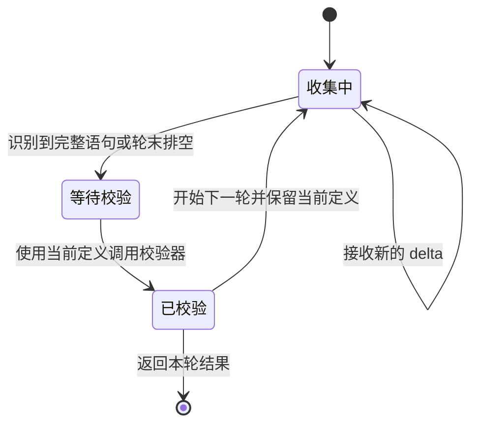
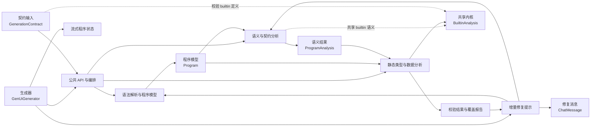

# validation 模块划分

本划分按责任和调用边界建立，不按源码目录机械切分。六个逻辑模块共同组成 `validation`，但处理不同的数据形状和生命周期。

## 六个逻辑模块

| 逻辑模块 | 核心职责 | 主要输入 | 主要输出 |
| --- | --- | --- | --- |
| 公共 API 与编排 | 整理一次校验请求，串联解析、语义分析和类型分析 | DSL、契约、入口名称、外部引用、数据模型、分析预算 | `ValidationResult` |
| 语法解析与程序模型 | 预处理文本，解析语句和表达式，建立程序模型 | DSL、解析模式、builtin 目录 | `Program`、解析诊断 |
| 语义与契约分析 | 选择入口，解析引用，检查组件和结构约束 | `Program`、组件目录、builtin 目录、外部引用 | `ProgramAnalysis`、语义诊断 |
| 静态类型与数据分析 | 推导数据形状，解析数据路径，检查 schema 和 builtin 签名 | `Program`、组件目录、builtin 目录、数据模型、入口、预算 | 类型诊断、`CoverageReport` |
| 流式程序状态 | 缓存 delta，识别完整语句，跨轮维护当前程序 | 模型 delta、合并契约、校验器、数据模型 | `RoundEndResult`、当前定义文本 |
| 增量修复提示 | 把诊断、能力缺口和历史转换成修复消息 | 当前轮结果、历史轮次、用户上下文、契约 | `ChatMessage` 列表 |

`BuiltinAnalysis` 是一个跨模块共享内核。它位于类型分析实现中，但同时被语义分析和契约加载使用。它负责 builtin 的参数角色、binder 作用域、模板延迟检查和特殊返回类型。

## 模块之间的责任边界

### 公共 API 与编排

这个模块是一次性校验的入口。`DefaultOpenuiLangValidator` 按固定顺序组织快照、解析、语义分析、类型分析和结果合并。

`ValidationSnapshot` 是边界适配器。它从完整契约中整理出校验需要的组件 schema、builtin 目录和能力缺口。提示词专用的信息不进入一次校验的核心数据。

这个模块不负责模型调用、重试、增量修复循环或 Markdown 降级。那些策略属于外部生成器。

### 语法解析与程序模型

解析模块把文本转换成程序模型，顺序如下：

```text
模型文本
  → 文本预处理
  → 词法和语句切分
  → 表达式解析
  → Program
```

`OpenuiPreprocessor` 提供最终解析和流式解析两种模式：

- `FINAL` 保留未闭合结构，让正式校验报告语法问题。
- `STREAMING` 尝试补齐尾部括号和字符串，帮助轮次扫描器识别当前完整语句。

`OpenuiParser` 负责解析编排。它不把组件表达式物化成渲染元素，也不检查组件契约。

`Program` 保存源码顺序、语句定义和解析诊断。只有在读取当前程序时，才按语句 id 应用后定义覆盖前定义的规则。

### 语义与契约分析

`ContractCatalog` 把合并契约转换为组件目录。目录记录组件是否存在、位置参数顺序、必填参数、默认值和嵌套 schema。

`ProgramAnalyzer` 负责：

- 建立当前程序的符号表。
- 按优先级选择入口。
- 解析组件引用和语句引用。
- 检查未知组件、保留名称、无法解析的引用和不可渲染的根。
- 调用 `ComponentContractValidator` 检查参数数量、必填参数、默认值和封闭对象属性。
- 使用 `BuiltinAnalysis` 识别 Each、Render 等 builtin 的 binder 作用域。

这个模块只回答程序结构和契约问题，不负责传播数据类型。

### 静态类型与数据分析

`TypeAnalysis` 为一次分析创建独立的 `AnalysisSession`。类型分析可以看成四层：

| 层次 | 主要对象 | 作用 |
| --- | --- | --- |
| 数据形状 | `Type`、`Types`、`Fact`、`Expectation` | 表达可能值、观察事实、信息损失和组件要求 |
| 推导与传播 | `AnalysisSession`、`TypeOps`、`DataPathResolver`、`SnapshotFacts` | 遍历可达语句，解析数据路径，合并事实和词法环境 |
| 规则求值 | `Checks`、`SchemaCompiler`、`SignatureInference` | 将 schema 和 builtin 类型表达式转成可检查的要求 |
| 特殊语义与覆盖 | `BuiltinAnalysis`、`AnalysisBudget`、`CoverageReport` | 处理特殊 builtin，限制工作量，记录分析覆盖情况 |

类型检查有三个结果层次：

- `MATCH`：已有信息满足要求。
- `MISMATCH`：已有信息与要求冲突。
- `UNPROVEN`：信息不足，无法证明满足或冲突。

通用规则的 `UNPROVEN` 主要用于覆盖统计。数据路径无法解析、组件需要非空数据等情况有更严格的错误政策。

### 流式程序状态

`StatementBoundaryScanner` 只负责从 delta 中识别完整语句。`ProgramRoundSession` 负责：

1. 缓存当前轮文本。
2. 在轮末排空扫描器。
3. 将完整语句合并到当前定义。
4. 用当前定义调用校验器。
5. 在下一轮保留已有定义，只重置本轮扫描状态。

它不负责模型传输，也不决定最终降级策略。



### 增量修复提示

`RepairPromptBuilder` 将当前结果转换成模型下一轮可执行的修复指令：

1. 选择当前仍然可处理的诊断。
2. 找出相关语句和能力缺口。
3. 摘要有限的历史轮次。
4. 渲染系统消息和用户消息。

`RepairHints` 同时服务两处：

- 语义分析把它用于生成诊断中的提示。
- 修复提示构造器把它用于生成下一轮指令。

`StatementRelations` 根据当前有效程序计算语句之间的上下游关系。整个提示模块只生成消息，不发起模型调用。

## 依赖方向



图中的实线表示主要执行或数据流。虚线表示共享规则或交叉依赖。逻辑顺序上，语法解析先产生 `Program`，语义分析和类型分析再围绕同一个程序工作；实现上，类型分析会复用语义模块的目录和引用工具。

## 为什么这样划分

### 每个模块都有独立的输入和输出

解析模块输出 `Program`，语义模块输出 `ProgramAnalysis`，类型模块输出类型诊断和覆盖报告，流式模块输出轮次结果，提示模块输出消息。模块之间传递数据对象，而不是共享整套可变状态。

### 分析顺序和职责边界分开

语义分析先确定入口、引用和组件结构。类型分析再使用这个入口检查数据。这是执行顺序，但不意味着类型分析是语义分析的子模块。两者回答不同问题。

### 生成器策略和校验业务分开

`GenUiGenerator` 决定是否修复、何时重试和失败后如何降级。`validation` 只提供校验能力、程序状态和提示数据。这样，同步校验可以独立使用，不需要引入模型调用。

### 共享状态被限制在两个位置

- `AnalysisSession` 保存一次类型分析的临时状态。
- `ProgramRoundSession` 保存跨轮生成的当前程序。

其余模块通过不可变结果或纯函数传递数据，读者可以从输入追踪到输出。

## 逻辑模块与源码包的关系

源码包主要表示实现位置，逻辑模块表示职责边界。两者不是一一对应关系：

| 实现区域 | 逻辑归属 | 说明 |
| --- | --- | --- |
| `validation` 根包 | 公共 API 与编排 | 请求、结果、默认校验器和生成策略配置 |
| `validation.parser` | 语法解析与程序模型 | 预处理器、解析器、AST、程序和 builtin 目录 |
| `validation.semantic` | 语义与契约分析 | 组件目录、入口、引用和诊断提示知识 |
| `validation.type.analysis` | 静态类型与数据分析 | 类型推导、数据路径、规则求值和覆盖统计 |
| `validation.stream` | 流式程序状态 | delta、语句边界和跨轮当前定义 |
| `validation.repair` | 增量修复提示 | 诊断筛选、关系分析和消息渲染 |
| `core.contract` | 外部契约输入 | 为校验提供组件 schema、builtin 和能力缺口 |
| `core.llm` | 外部编排方 | 驱动模型轮次、修复循环和最终降级 |

## 当前仍需在详细设计中确认的点

- `BuiltinAnalysis` 是否在类关系图中单独绘制为共享内核。
- `ValidationIssueReducer`、`RepairHints` 和 `RepairGuidance` 是否应继续作为一个“诊断到提示”协作组描述。
- `contract == null` 时，实际行为与旧注释中的“仅语法校验”不同。详细文档需要以实际行为为准。
