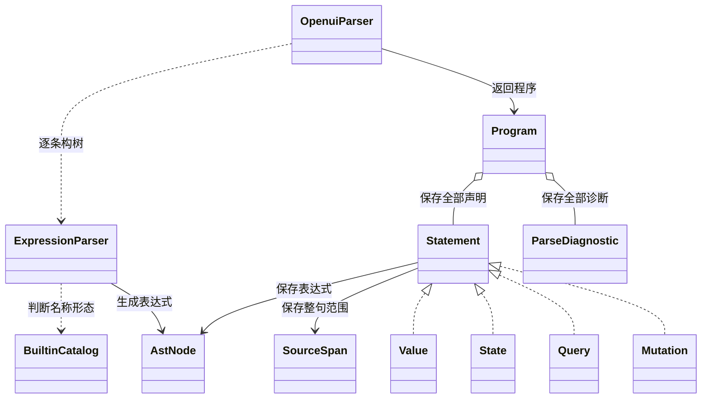
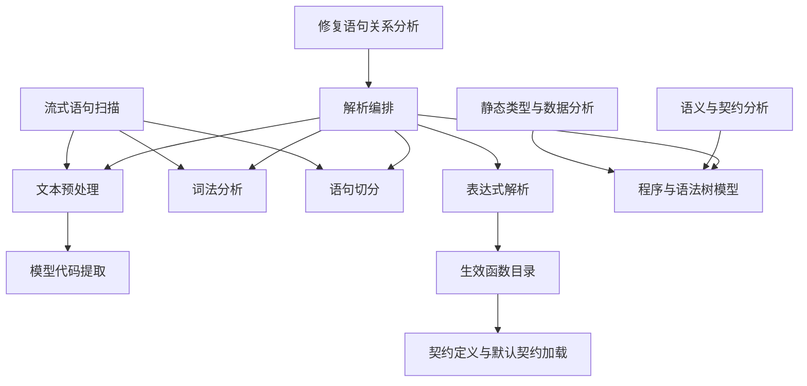
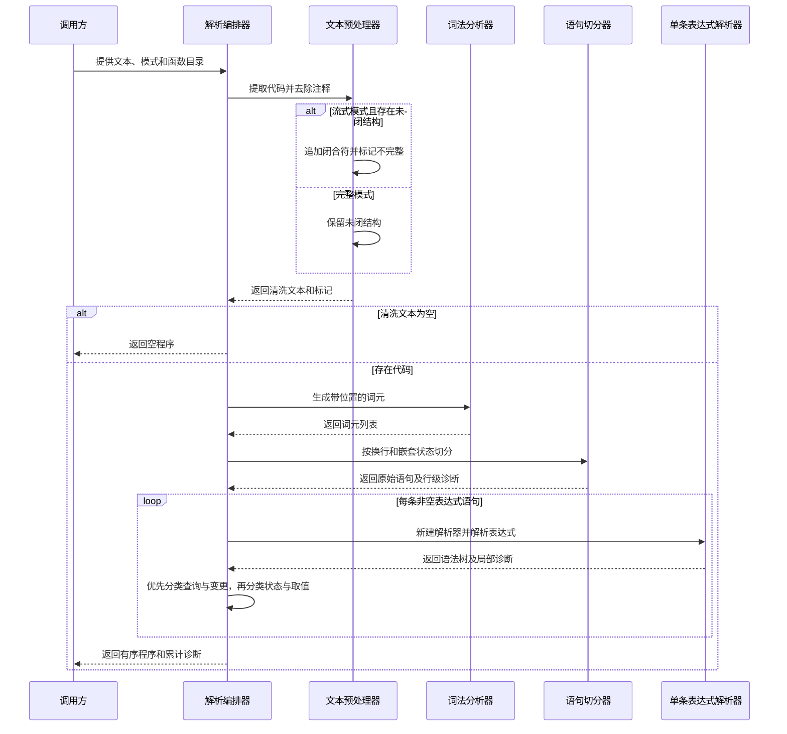
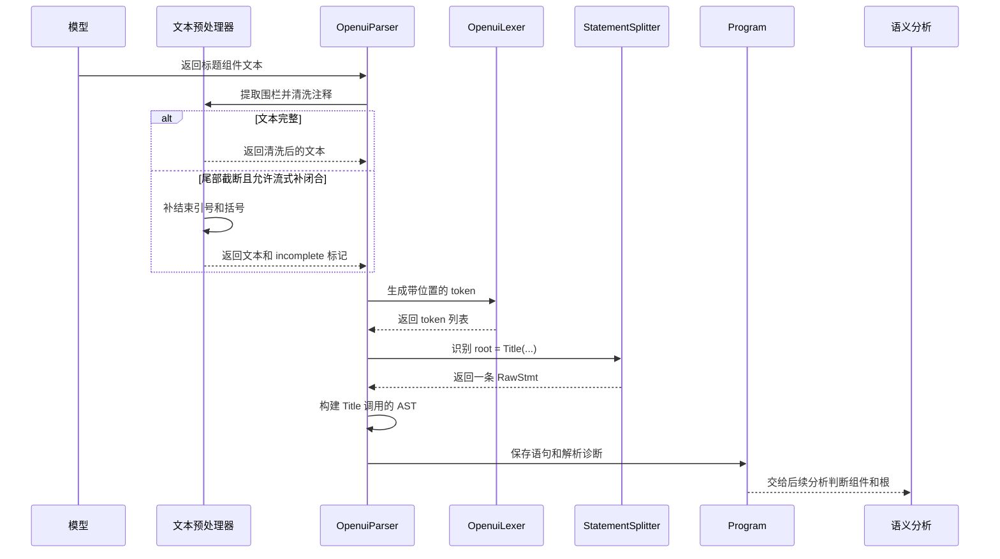

# 语法解析与程序模型设计说明书

## 1. 模块定位

本模块把 OpenUI Lang 文本转换成 `Program`，提供语义分析、静态类型分析和流式语句管理共用的程序结构。输出包含语句、表达式树和语法诊断，解析成功返回不等于程序有效。

`ValidationSnapshot` 使用本模块解析完整待校验程序。`StatementBoundaryScanner` 复用预处理、分词和切分规则，识别已完成的语句。`StatementRelations` 复用解析结果，分析修复提示需要的语句关系。

模块负责代码提取、去注释、按模式补闭合、词法分析、语句切分、表达式解析和语句分类。组件存在性、引用解析、根选择、参数类型和数据路径检查属于后续分析。Query、Mutation 和状态赋值在此仅形成模型，不执行运行时动作。

## 2. 方案总体设计

### 2.1 总体方案

`OpenuiParser` 编排一条同步处理链。`OpenuiPreprocessor` 清洗文本，`OpenuiLexer` 产生带位置的 token，`StatementSplitter` 切出赋值语句，`ExpressionParser` 为每条语句构建 AST，最后按表达式和语句名称分类，生成 `Program`。

预处理先委托 `OpenuiCodeExtractor` 提取代码。提取器优先选择语言标记为 openui、openui-lang 或 text 的第一个围栏块，其次选择包含 `root = Stack(` 的第一个围栏块，均未命中时保留去除首尾空白的原文。多个代码块不合并。预处理随后删除字符串外的 `#` 和 `//` 行注释，裁掉相关行尾空白。

解析模式只决定预处理是否补闭合。FINAL 保留未闭结构；STREAMING 补结束引号，再按括号栈从内向外补闭合符。去注释的引号状态按行重置，补闭合的引号状态跨行延续，两者在一次扫描中分别维护。

词法分析保留换行，语句切分使用换行和表达式嵌套状态共同决定边界。表达式使用 Pratt 算法，即按运算符优先级逐步构树。`Program` 保留全部语句；后续通过 `currentById()` 得到同名后定义覆盖的当前程序。

### 2.2 设计考量

模型输出可能带围栏、注释、多行组件和截断尾部。预处理与局部容错使解析器能够保留可用结构，同时将一部分错误变为诊断，供后续报告或修复使用。

流式语句识别和完整程序解析必须使用相同边界规则。因此分词、切分保持独立入口，流式调用方可以识别语句，而不必每次构建完整 AST。

名称解释必须跟随生效契约。`BuiltinCatalog` 提供 builtin 名称与签名，解析器据此区分裸引用和调用形态。相同目录还交给语义与类型分析，避免各阶段自行维护函数清单。Each 和 Render 的参数角色及绑定作用域仍由 `BuiltinAnalysis` 解释。

诊断需要定位，但文本清洗会改变原文位置。当前位置统一针对预处理后的文本，不生成模型原文到清洗文本的映射。这一限制需要由诊断消费者理解。

### 2.3 设计取舍

| 选择 | 得到的行为 | 接受的限制 |
| --- | --- | --- |
| 手写词法、切分和 Pratt 解析 | 可直接保留现有 OpenUI Lang 的优先级和容错政策。 | 词法、切分和表达式各自承担部分恢复规则，不能假设所有错误都有诊断。 |
| 组件与 builtin 都使用 `AstNode.Comp` | AST 保持统一，业务解释交给后续分析。 | 仅看调用节点不能确定调用合法性，后续仍需目录。 |
| 全部语句与当前定义视图分离 | 保留源码顺序，同时集中实现同名覆盖规则。 | `currentById()` 不删除旧语法诊断；直接解析全文与流式先合并定义的输入不同。 |
| FINAL 只禁止预处理补闭合 | 完整输入与流式输入复用同一表达式解析器。 | FINAL 仍包含字符串容错、可选分隔符和剩余 token 未检查等宽松行为。 |
| 独立复用分词与切分 | 流式扫描沿用完整解析的语句边界。 | 对累计文本反复读取时，流式调用方会重新处理累计内容。 |

现有边界适合保留。若要简化错误处理，优先统一数字异常、空表达式、缺分隔符和剩余 token 的政策，再决定是否收紧文法。引入新的解析框架本身不能替代这些语义决策。

## 3. 对外接口

本节的“对外”指本模块向 SDK 其他模块或直接调用方提供的 Java 接口，不代表远程服务接口。

### 3.1 接口表

| 接口 | 输入 | 输出 | 约束与副作用 |
| --- | --- | --- | --- |
| `OpenuiParser.parse(String)` | 原始文本 | `Program` | 使用 FINAL 和默认目录。文本可为 null。 |
| `OpenuiParser.parse(String, ParseMode)` | 文本、模式 | `Program` | 使用默认目录；模式控制预处理补闭合。 |
| `OpenuiParser.parse(String, ParseMode, BuiltinCatalog)` | 文本、模式、目录 | `Program` | 先预处理，再执行词法、切分和表达式解析。 |
| `OpenuiParser.parse(OpenuiPreprocessor.Result, BuiltinCatalog)` | 已预处理文本及补闭合标记、目录 | `Program` | 不重复预处理；目录为 null 时回退默认目录。 |
| `OpenuiPreprocessor.preprocess(String)` | 原始文本 | 清洗文本 | 提取围栏、去注释，不补闭合。 |
| `OpenuiPreprocessor.process(String, ParseMode)` | 原始文本、模式 | `OpenuiPreprocessor.Result` | STREAMING 可追加闭合符，FINAL 不追加。 |
| `OpenuiPreprocessor.streamRoundBoundary(String)` | 已转发的本轮原始文本 | 闭合后缀及语句分隔换行，或空串 | 保留未闭字符串内部空白；末尾行注释先用换行结束。返回后缀，不修改输入。 |
| `OpenuiLexer.tokenize(String)` | 待分词文本 | `List<Token>` | 保留 NEWLINE，末尾追加 EOF；不接受 null 文本的统一归一化职责。 |
| `StatementSplitter.splitDetailed(List<Token>)` | token 列表 | `SplitResult` | 返回原始语句和行级诊断。 |
| `StatementSplitter.split(List<Token>)` | token 列表 | `List<RawStmt>` | 便捷入口，不向调用方返回切分诊断。 |
| `ExpressionParser.parse()`、`diagnostics()` | 构造时提供的 token、语句 ID 和目录 | 单个 `AstNode`、诊断副本 | 实例包含可变游标，按单次解析使用；不检查所有尾部 token 均已消费。 |
| `Program.currentById()` | 程序内的全部语句 | 新的 `LinkedHashMap<String, Statement>` | 同名取最后定义，保留名称首次出现顺序，不修改程序列表。 |
| `BuiltinCatalog.fromContract(GenerationContract)` | 生效契约 | builtin 名称与签名目录 | 契约为 null 或 builtin 列表为空时回退默认目录。 |

解析主体在调用线程执行，不修改调用方数据，也不发起模型请求。默认 `BuiltinCatalog` 在类初始化时通过 `GenerationContractLoader` 加载默认契约，这是普通解析之外的初始化依赖。

### 3.2 正常输入输出

调用 `OpenuiParser.parse`，使用已有解析测试中的正常输入：

```openui
root = Title("hi")
```

返回值的关键内容为：

```text
Program
  statements: [Value("root", Comp("Title", [Str("hi")]), 语句范围)]
  diagnostics: []
  incomplete: false
```

这一结果确认了调用结构，没有确认 Title 在契约中存在。`Program.currentById()` 返回只有 root 的映射，值为同一条取值语句。

### 3.3 边界输入输出

| 输入与调用条件 | 输出或异常 | 含义 |
| --- | --- | --- |
| `parse(null)` | 空语句列表、空诊断列表、`incomplete=false`。 | 空程序的根问题由后续语义分析报告。 |
| 文本为 `root = Title("hi"`，使用 FINAL | 保留 Title 调用树，产生 UNCLOSED_BRACKET，`incomplete=false`。 | false 只说明预处理没有补闭合，不能证明原文完整。 |
| 相同文本使用 STREAMING | 预处理补 `)`，保留 Title 调用树，不因这个缺失产生括号诊断，`incomplete=true`。 | 补闭合不代表组件契约或业务要求已满足。 |
| 第一行为 `garbage here`，第二行为 `root = Title("ok")` | 保留 root 语句，第一行产生 MISSING_ASSIGNMENT。 | 切分器跳过缺赋值符号的行，继续处理后续行。 |
| 文本为 `x =` | 空语句列表，没有专门的空表达式诊断。 | 切分器不为零个表达式 token 创建语句。 |
| 文本为 `x = 1e` | `NumberFormatException`，不返回 `Program`。 | 数字转换异常没有统一转成解析诊断。 |
| 先定义 `x = 1`，后定义 `x = 2` | `statements` 保留两条；`currentById()` 的 x 指向第二条。 | 同名覆盖发生在当前定义视图中。 |

## 4. 关键数据结构

### 4.1 数据结构总表

| 数据结构 | 在模块中的作用 | 主要消费者 |
| --- | --- | --- |
| `OpenuiPreprocessor.Result`、`ParseMode` | 绑定清洗文本、补闭合标记和处理政策。 | 解析编排器、流式扫描器。 |
| `Token`、`TokenType` | 表示词法类别、值和位置。 | 语句切分器、表达式解析器。 |
| `StatementSplitter.RawStmt`、`SplitResult` | 连接语句切分与表达式解析，附带行级诊断。 | 解析编排器、流式扫描器。 |
| `AstNode` | 表示表达式结构。 | 语义分析、类型分析、语句关系分析。 |
| `Statement` | 表示有 ID、类型和范围的声明。 | 程序模型和后续分析。 |
| `Program` | 聚合有序声明、全部解析诊断和补闭合标记。 | 校验快照和分析器。 |
| `SourceSpan`、`ParseDiagnostic`、`ParseErrorCode` | 表示位置、语法问题类别和语句归属。 | 解析器、诊断转换与报告。 |
| `BuiltinCatalog` | 保存生效函数名称和签名视图，提供固定语法保留名判断。 | 解析器、语义分析和类型分析。 |

### 4.2 预处理与词法数据

`OpenuiPreprocessor.Result.text` 是后续位置坐标的基准文本。`wasIncomplete` 表示本次 STREAMING 预处理发现并补过待闭合结构。FINAL 的该字段恒为 false。

`Token.type` 决定词元类别。`text` 保存字符串、标识符和名称的解码文本；STATE_VAR 保留 `$`，BUILTIN_CALL 不保留 `@`。`number` 保存数字的 double 值。`line`、`column` 从 1 开始，`offset` 从 0 开始，`length` 表示词元长度。

### 4.3 语句与表达式模型

`RawStmt.id` 是赋值左侧名称，`tokens` 只包含右侧表达式，`span` 覆盖整条声明。`SplitResult` 分别保存语句列表和切分诊断，不要求两者一一对应。

`AstNode` 是密封接口，关键节点包括：

- `Comp(name, args)` 表示调用，不携带组件或 builtin 的合法性结论。
- `Str`、`Num`、`Bool`、`Null` 表示字面量；`Arr` 和 `Obj` 保存集合结构。
- `Ref` 和 `StateRef` 分开表示普通引用和状态引用。
- `Member`、`Index` 表示访问，`UnaryOp`、`BinOp`、`Ternary` 表示运算，`Assign` 表示状态赋值表达式。

`Statement` 的四种 record 都提供 ID、表达式和 `SourceSpan`。`State` 用 init 保存初始化表达式，通过 `expr()` 暴露给统一访问接口。语句分类先判断最外层 Query 或 Mutation，再判断 ID 是否以 `$` 开头。因此 `$data = Query(...)` 是 Query 声明。

### 4.4 程序与诊断模型

`Program.statements` 和 `diagnostics` 是不可变列表。`incomplete` 复制本次预处理的补闭合标记，不是语法正确性，也不是整个生成会话的截断历史。流式调用方先补闭合、再把文本交给 FINAL 解析时，FINAL 程序不会自动保留此前补闭合的历史。

`currentById()` 创建新映射，不过滤 `diagnostics`。直接解析含重复定义的全文时，旧定义产生的语法诊断仍然存在；流式会话先合并同名定义，再解析当前文本，旧定义就不在本次输入中。

`ParseDiagnostic` 保存 code、message、statementId 和位置。错误码只有 MISSING_ASSIGNMENT、INVALID_STATEMENT、UNCLOSED_BRACKET、UNEXPECTED_TOKEN 四类。`SourceSpan.endOffset` 不包含末尾位置，未知坐标用 -1。诊断和语句范围均指向清洗文本，AST 节点没有逐个附带范围。

## 5. 4+1 架构视图

本模块保留逻辑、开发、过程和场景视图。解析器在 SDK 调用进程内运行，没有独立部署单元，因此不另画物理部署图。

### 5.1 逻辑视图

`Program` 是后续分析共享的输出。语句聚合表达式，诊断与语句列表并列存在，允许可用结构和错误同时返回。



### 5.2 开发视图

静态工具分担文本与 token 转换，`ExpressionParser` 的实例保存单次解析游标。`OpenuiPreprocessor` 依赖已有代码提取能力；`BuiltinCatalog` 依赖契约定义和加载器。图中函数目录与契约处理属于共享依赖，不是解析器重新定义的一份契约。



### 5.3 过程视图

切分器接受 IDENT、TYPE 和 STATE_VAR 作为语句 ID。读取赋值符号后，它维护括号深度和顶层三元表达式深度。括号内及尚未结束的三元表达式内的换行继续归入表达式。深度归零的换行通常结束语句；后续非空行以 `?` 开始时仍继续收集。

`ExpressionParser` 先读前缀，再按优先级消费后续运算。优先级由高到低为成员与下标、一元、乘除余、加减、比较、相等、逻辑与、逻辑或及空值合并、三元表达式。`??` 与 `||` 同级，普通同级二元运算形成左结合树。

大写裸名称后接括号，且不是目录中的 builtin 时，解析为调用。目录中的 builtin 裸名称解析为引用，Action 允许裸调用。`@name` 后接括号也解析为调用，但本阶段不证明 name 已在契约中声明。



### 5.4 场景视图

模型生成一个标题组件时，输出可能包含围栏和注释。已有正常解析场景的代码是 `root = Title("hi") // comment`。预处理提取代码并去注释后，解析器形成 `Value` 中的 `Comp`，然后交给语义分析判断组件契约。

如果输出在字符串中截断，流式调用方可以请求补闭合。调用方仍需携带诊断和完整性标记判断后续处理，不能仅因获得 AST 就认定业务完成。



## 6. DFX 设计

### 6.1 可靠性

缺赋值符号和非法语句开头会形成诊断并跳到行末。缺闭括号时，表达式解析器保留已构建节点并记录诊断。未闭括号也可能把后续多行合入同一条语句，因此容错不保证恢复每一条后续声明。

当前存在无诊断的宽松行为。未知字符会跳过，未闭字符串可以形成 STR，调用与数组逗号、对象冒号采用可选消费，空表达式不生成语句，表达式尾部不做统一消费检查。畸形指数数字还可能直接抛 `NumberFormatException`。若上游需要稳定的失败协议，应先统一这些行为，不能把“没有诊断”当作严格文法证明。

### 6.2 性能

各阶段构建文本、token、原始语句和 AST 等中间对象。解析按表达式嵌套递归，当前没有文本长度、token 数或递归深度限制。类型分析会话的内部限制不约束这一阶段。

流式扫描复用这些工具，但会按需重处理累计文本。若出现长输出或频繁快照需求，应分别评估单次解析开销与累计重扫开销，再决定入口限制或增量扫描改造。

### 6.3 可诊断性

`ParseDiagnostic` 绑定语句 ID 和清洗文本位置，后续由 `ProgramAnalyzer` 转为语法类 `ValidationIssue`。AST 中的 Null 既可能是真实字面量，也可能是错误占位，消费者必须同时读取诊断。

需要定位模型原文时，应增加文本位置映射；只增加 AST 坐标无法恢复围栏提取和去注释造成的位置差异。需要追踪跨轮补闭合时，也应由流式状态保留记录，不能依赖随后 FINAL 解析的 `incomplete` 字段。

### 6.4 可扩展性与可测试性

语法结构和业务分析分离，使组件契约扩展无需改动 AST。builtin 名称来自契约，但新增运算符、表达式节点或语句类别仍需同步调整词法、切分、解析和下游遍历。`AstNode` 与 `Statement` 的密封接口有助于枚举受影响的分支。

独立的预处理、词法、切分和表达式入口支持局部测试，已有测试也覆盖组合解析、模式差异和行列诊断。后续收紧文法时，应明确输入是否仍返回相同 AST、是否新增诊断，以及流式与完整解析是否保持同一边界规则。
