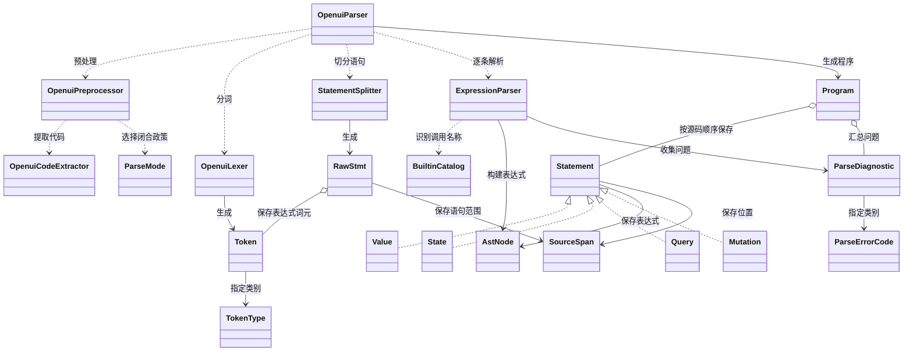
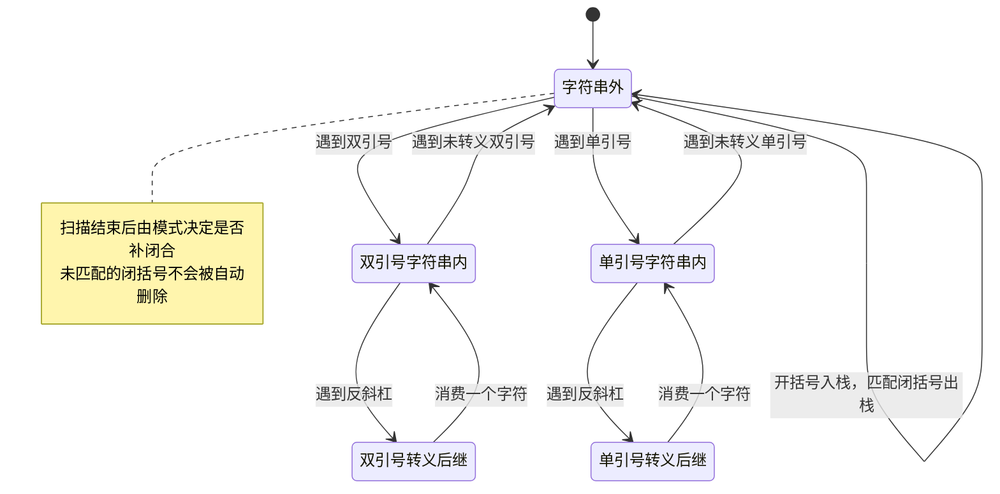
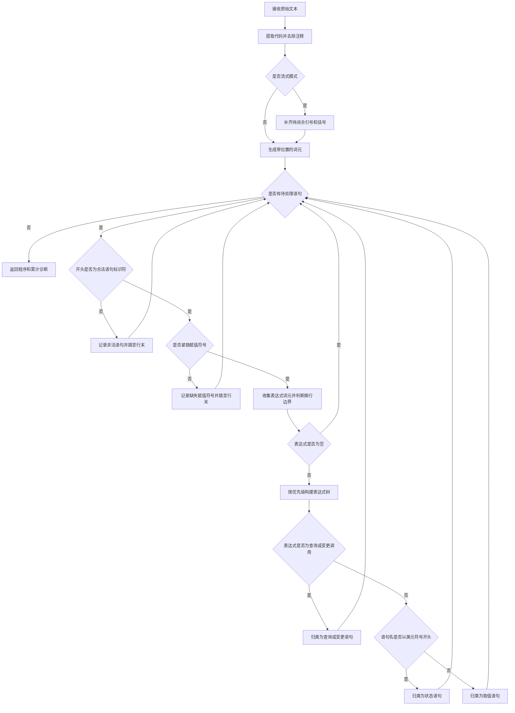
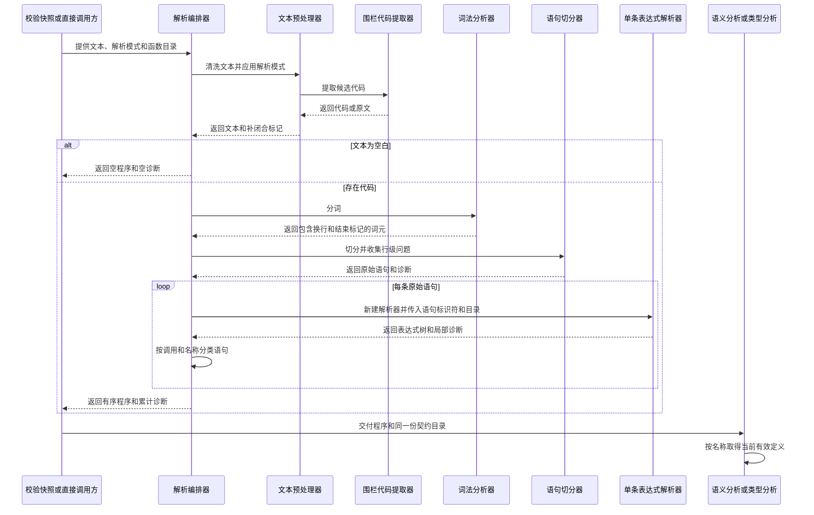

# 语法解析与程序模型设计

本模块把模型输出转换成 `Program`，让语义分析、类型分析和流式语句管理使用同一套语法。它保留语句、表达式结构和解析诊断，不判断界面是否可渲染。

当前实现采用手写词法分析、按换行切分语句和 Pratt 表达式解析。Pratt 解析按运算符优先级构建表达式树。解析过程允许部分错误继续向后传递，因此得到 `Program` 不等于语法完全正确。

## 模块定位与边界

上游有三类调用方。`ValidationSnapshot` 对待校验 DSL 执行 FINAL 解析；`StatementBoundaryScanner` 复用预处理、分词和切分来识别完整语句；`StatementRelations` 解析当前程序，为修复提示计算语句关系。

本模块完成文本清洗、词法识别、语句切分、表达式构树和语句分类。组件是否存在、引用是否可解析、入口如何选择，以及数据路径和参数类型是否正确，都由后续分析决定。解析器不会请求模型、执行 Query、触发 Mutation 或修改运行时状态。

`BuiltinCatalog` 虽然属于本模块，也供语义分析和类型分析使用。它提供当前契约中的 builtin 名称和签名，并区分固定语法保留字。Each 和 Render 的绑定作用域由 `BuiltinAnalysis` 管理，解析器不解释模板参数的业务角色。

### 输入、输出与副作用

| 对象或入口 | 输入 | 输出与约束 |
| --- | --- | --- |
| `OpenuiParser.parse(String)` | 原始文本 | 默认按 FINAL 解析，使用默认 builtin 目录。 |
| `OpenuiParser.parse(String, ParseMode, BuiltinCatalog)` | 文本、模式、目录 | 先预处理，再返回 `Program`。 |
| `OpenuiParser.parse(OpenuiPreprocessor.Result, BuiltinCatalog)` | 已清洗文本及补闭合标记 | 复用同一份预处理结果；目录为 null 时使用默认目录。 |
| `OpenuiPreprocessor.Result` | 预处理产物 | `text` 是清洗后的文本；`wasIncomplete` 表示流式预处理是否补过闭合符。 |
| `Program` | 有序语句、诊断、补闭合标记 | 列表不可变；不持有原始文本，也不保存最终校验状态。 |
| `Program.currentById()` | 程序中的全部语句 | 每次创建新的有序映射，同名取最后定义，保留名称首次出现的顺序。 |

单次解析使用本地集合和新的 `ExpressionParser`。表达式解析器持有游标与诊断列表，是一次解析使用的可变对象。词法、切分与预处理不保存跨请求状态，也不修改调用方文本。

常规解析不执行 I/O。默认 `BuiltinCatalog` 在类初始化时通过 `GenerationContractLoader` 加载 SDK 默认契约；这属于目录初始化，不是逐表达式加载。显式提供生效目录可以让解析、语义分析和类型分析使用相同的名称集合。

## 逻辑视图：程序模型保留原始顺序

### 关键类及职责

| 类 | 职责 |
| --- | --- |
| `OpenuiParser` | 编排预处理、词法分析、语句切分、表达式解析和语句分类。 |
| `OpenuiPreprocessor` | 委托 `OpenuiCodeExtractor` 提取围栏代码，去除行注释，并在 STREAMING 模式补闭合。另提供原始轮次输出的闭合后缀。 |
| `OpenuiLexer` | 生成包含值和位置的 `Token`，保留换行，追加 EOF。 |
| `Token`、`TokenType` | 表示词法类别、解码后的值、行列、偏移和长度。 |
| `StatementSplitter` | 将 token 切为 `id = expression`，输出 `RawStmt` 和被跳过行的诊断。 |
| `ExpressionParser` | 根据优先级生成 `AstNode`，同时记录局部语法问题。 |
| `AstNode` | 密封接口，表示调用、字面量、数组、对象、引用、成员访问、下标及运算。 |
| `Statement` | 密封接口，区分 `Value`、`State`、`Query`、`Mutation`。 |
| `Program` | 保存全部已解析语句、全部解析诊断和补闭合标记，提供当前定义视图。 |
| `SourceSpan` | 表示预处理后文本的位置范围。 |
| `ParseDiagnostic`、`ParseErrorCode` | 表示语法问题、归属语句和位置。 |
| `ParseMode` | 区分 FINAL 与 STREAMING 的预处理政策。 |
| `BuiltinCatalog` | 从契约派生 builtin 名称及签名，同时提供 Action 与 Query、Mutation 的语法保留名判断。 |



图中 `RawStmt` 是 `StatementSplitter` 的嵌套 record；四种语句是 `Statement` 的嵌套 record。`AstNode` 自身也是密封接口，各节点用 record 表示。集合节点复制构造参数，避免调用方随后修改节点中的集合。

`Program.statements()` 保留重复 ID，方便后续按同一条规则形成当前程序。它不会在解析过程中删除旧定义。`currentById()` 只对语句去重，不过滤 `Program.diagnostics()`；直接解析含重复定义的全文时，旧文本产生的语法诊断仍保留。流式会话先按 ID 维护当前定义，再交给 FINAL 解析，所以被覆盖的旧文本不会进入这一轮的解析输入。

## 核心实现机制与过程视图：文本逐步转为表达式树

### 预处理保留模式差异

`OpenuiCodeExtractor` 优先取语言标记为 openui、openui-lang 或 text 的第一个围栏块。没有这类块时，取包含 `root = Stack(` 的第一个围栏块；仍未命中时使用去除首尾空白的原文。多个候选代码块不会合并。

`OpenuiPreprocessor` 去除字符串外的 `#` 和 `//` 行注释，并裁掉注释前的行尾空白。它不统一压缩字符串或源码内部的全部空白。

一次字符扫描同时维护两套引号状态。去注释状态每行重置；自动闭合状态跨行延续。二者不能合并成一个引号标记，否则未闭字符串与下一行注释的处理会改变。

| 模式或方法 | 文本处理 | 完整性标记 |
| --- | --- | --- |
| FINAL | 清洗文本，不追加闭合符。 | `wasIncomplete` 恒为 false，不能据此推断输入原本完整。 |
| STREAMING | 补结束引号，再按括号栈从内向外补闭合。末尾悬空转义需要先补反斜杠。 | 原文有待闭合引号或括号时为 true。 |
| `streamRoundBoundary` | 对已转发的原始文本计算闭合后缀和换行；末尾有行注释时先结束注释。 | 只返回追加后缀，不返回 `Program`。 |

以下状态图描述自动闭合所需的全局引号状态。扫描器另外维护按行重置的去注释状态；注释字符不进入下图的闭合判断。



### 词法分析保留换行和清洗后的坐标

`OpenuiLexer` 跳过水平空白，把换行保留为 NEWLINE。标识符以 ASCII 字母或下划线开始；首字母大写的普通名称生成 TYPE，小写名称生成 IDENT。`$name` 生成 STATE_VAR，`@name` 生成 BUILTIN_CALL，后者的文本值不含 `@`。

数字存为 double。减号紧跟在已有值之后时作为运算符，否则在后继为数字时并入负数字面量。字符串在词法阶段解码，双引号支持 JSON 风格转义，单引号使用单独的解码规则。

`Token` 和 `SourceSpan` 的行列从 1 开始，偏移从 0 开始，结束偏移不包含在范围中。坐标指向预处理后的 DSL，不直接对应模型原文；围栏提取和去注释没有生成原文映射。当前 AST 节点不逐个保存范围，表达式诊断使用触发问题的 token，语句保存整句范围。

### 语句切分把换行解释为条件边界

切分器接受 IDENT、TYPE、STATE_VAR 作为语句 ID，并要求紧随 `=`。非法开头产生 INVALID_STATEMENT，缺 `=` 产生 MISSING_ASSIGNMENT；两种情况都跳到行末，再尝试下一条语句。

进入表达式后，切分器维护括号深度和顶层三元表达式深度。括号内换行被忽略，尚未遇到配对冒号的三元表达式继续收集。深度归零的换行通常结束语句；如果后续非空行以 `?` 开始，也继续归入当前表达式。

括号深度只计数量，不在切分阶段验证括号类型是否配对。表达式 token 为空时，切分器不生成 `RawStmt`，也不增加一条专门的空表达式诊断。



### 表达式解析把语法形态与业务合法性分开

`ExpressionParser` 先解析前缀，再持续消费优先级高于当前阈值的后续运算。成员访问与下标最高，其次是一元、乘除余、加减、比较、相等、逻辑与、逻辑或与空值合并，最后是三元表达式。`??` 与 `||` 使用相同优先级。普通二元运算在相同优先级下形成左结合树。

调用识别依赖词元类别和 `BuiltinCatalog`。

| 语法形态 | 解析结果 |
| --- | --- |
| 大写名称后接左圆括号，且不是目录中的 builtin | `AstNode.Comp`，组件存在性留给语义分析。 |
| 目录中的 builtin 使用大写裸名称 | `AstNode.Ref`，不会自动补 `@`。`Action` 是允许裸调用的例外。 |
| `@name` 后接左圆括号 | `AstNode.Comp`。此处不证明 name 已在契约中声明。 |
| `@name` 后面没有左圆括号 | `AstNode.Ref`。 |
| `$name` 后接赋值符号 | `AstNode.Assign`；否则是 `AstNode.StateRef`。 |
| 数组、对象、分组、成员、下标和运算 | 分别形成对应 AST 节点，不计算运行结果。 |

调用节点不单独区分“组件调用”和“builtin 调用”，两者都使用 `AstNode.Comp`。后续分析必须使用相同的目录解释名称。不能仅凭节点类型判断一个调用属于组件。

`OpenuiParser` 在表达式解析后分类语句。最外层 `Query(...)` 优先得到 `Statement.Query`，`Mutation(...)` 得到 `Statement.Mutation`；随后才按 ID 是否以 `$` 开头判断 `Statement.State`，其余为 `Statement.Value`。因此 `$data = Query(...)` 是查询声明，不是状态初始化。

### 一次解析的调用顺序

图中参与者分别对应 `OpenuiParser`、`OpenuiPreprocessor`、`OpenuiLexer`、`StatementSplitter` 和每条语句新建的 `ExpressionParser`。



## 开发视图：代码分层与状态范围

解析器和模型均为 Java SDK 内部类，不形成独立服务、进程或存储组件。文本、词元列表、语句列表和 AST 都在调用线程内构建。没有后台任务、数据库写入或消息投递。

`OpenuiParser` 是编排入口，词法和切分也提供独立静态方法，流式扫描器可以复用边界规则而不必构建完整 AST。`Program`、`Statement` 和 `AstNode` 则构成后续分析共享的程序模型。调用关系因此不是“只有顶层解析器能够使用所有下层类”的封闭结构。

解析过程会同时保留若干中间列表，并按表达式嵌套递归构树。当前没有文本长度、token 数量或表达式深度预算。类型分析的 `AnalysisBudget` 不限制本模块。流式调用方如果频繁请求当前程序，会重新对累计文本预处理、分词和切分，单次解析的无状态设计并不等于整个流式过程只扫描一遍。

## 异常、容错与未保证的行为

容错首先保证能保留可用结构，不保证每个非法字符都产生诊断。

| 情况 | 当前处理 | 对调用方的含义 |
| --- | --- | --- |
| 输入为 null 或清洗后为空 | 预处理为空字符串，返回空 `Program`。 | 是否缺根由后续语义分析判断。 |
| 行开头非法或缺赋值符号 | 记录诊断，跳过该行。 | 后续可切分的语句仍能继续解析。 |
| FINAL 中调用、数组、对象或分组缺闭括号 | 保留已构建节点，记录 UNCLOSED_BRACKET。 | AST 和诊断必须一并使用。 |
| 表达式遇到不支持的 token | 非 EOF 时记录 UNEXPECTED_TOKEN，前进一个 token 并返回 `AstNode.Null`。 | Null 可能是容错占位，也可能是真实字面量。 |
| 未闭字符串或非法双引号转义 | 词法分析容忍未闭字符串；转义解码失败时保留去除引号后的原始文本。 | 没有专门的字符串错误码保证这类输入被报告。 |
| 无法识别的字符 | 词法分析跳过。 | 不会为每个未知字符生成诊断。 |
| 不完整指数数字，例如 `1e` | 词法分析直接调用 `Double.parseDouble`。 | 可能抛 `NumberFormatException`，顶层没有统一转换为解析诊断。 |
| 表达式后还有剩余 token | `ExpressionParser.parse()` 返回已识别表达式，不做统一的尾部消费检查。 | 没有诊断不等于全文严格满足文法。 |
| 调用实参或数组元素之间缺逗号；对象键后缺冒号 | 对应分隔符采用可选消费。 | 当前文法包含宽松接受政策。 |

FINAL 不补闭合，并不代表 FINAL 是严格拒绝模式。部分容错行为发生在词法与表达式解析阶段，与预处理模式无关。未闭括号还可能让切分器把后续多行收进同一条表达式，因此“错误后继续解析”也不能保证恢复每一条后续声明。

语法诊断最终由 `ProgramAnalyzer` 转成 source 为 syntax 的 `ValidationIssue`。本模块没有 VALID 或 INVALID 状态，也不决定是否发起修复。

## 场景视图：生成一个标题组件

已有 `OpenuiParserTest.stripsFencesAndComments` 覆盖模型返回围栏代码和行注释的场景。其代码内容为：

```openui
root = Title("hi") // comment
```

模型输出的 openui 围栏先被提取，行注释随后被删除。词法分析得到 root 标识符、赋值符号、Title 名称、调用括号和字符串。切分器生成一条 `RawStmt`，表达式解析器构建 `Comp("Title", [Str("hi")])`，顶层分类为 `Statement.Value`。

此时 `Program` 只说明存在一条组件形态的调用。Title 是否在契约中、参数是否满足要求，以及 root 是否能渲染，都由后续分析确认。这个边界允许解析器处理当前未知的组件名，同时让语义层给出明确的契约错误。

同一测试组的 `unclosedStringInStreamingModeIsRepaired` 使用截断文本 `root = Title("hi`。STREAMING 预处理补结束引号和圆括号，得到同样的调用树，同时令 `Program.incomplete()` 为 true。该标记只说明做过文本补闭合，不说明修复已满足业务要求。流式轮末如果先由扫描器补闭合，再把当前定义交给 FINAL 解析，最终 `Program.incomplete()` 不会自动保留扫描器此前补闭合的历史。

## 设计分析与简化建议

目前最有价值的边界是 `Program` 与分析结果分离。解析器保留有序声明和诊断，语义层负责可渲染性，类型层负责使用要求。这种结构允许单独复用语句边界，也避免解析器依赖具体组件 schema。

建议保留这一结构，优先明确以下政策，暂不引入新的通用解析框架。

1. **把宽松解析政策写进接口契约。** 当前 FINAL 只控制预处理补闭合，名称容易让人误解为严格校验。应明确数字异常、字符串容错、可选分隔符、剩余 token 和空表达式的处理，再决定哪些行为需要统一。修改这些行为会改变已有 DSL 的接受范围。
2. **让语法容错具有可观察结果。** 可以先把数字格式失败转换为结构化诊断，并区分真实 Null 与错误占位的来源。后续分析即可减少把词法失败误解为正常空值的机会。是否严格检查尾部 token 应独立决策。
3. **在保留预处理复用的前提下补来源信息。** 如果需要直接定位模型原文，应增加清洗文本到原文的映射，并记录自动闭合的位置。仅给 AST 添加更多行列，仍不能恢复围栏提取造成的偏移变化。
4. **把资源限制放在解析入口。** 文本长度、token 数和递归深度需要独立于类型预算。超限时应返回明确诊断或失败结果，不能让后续类型预算承担已发生的解析开销。

这些建议是对现有边界的设计分析，本次文档没有改变解析行为，也没有新增语言能力。
