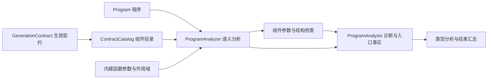
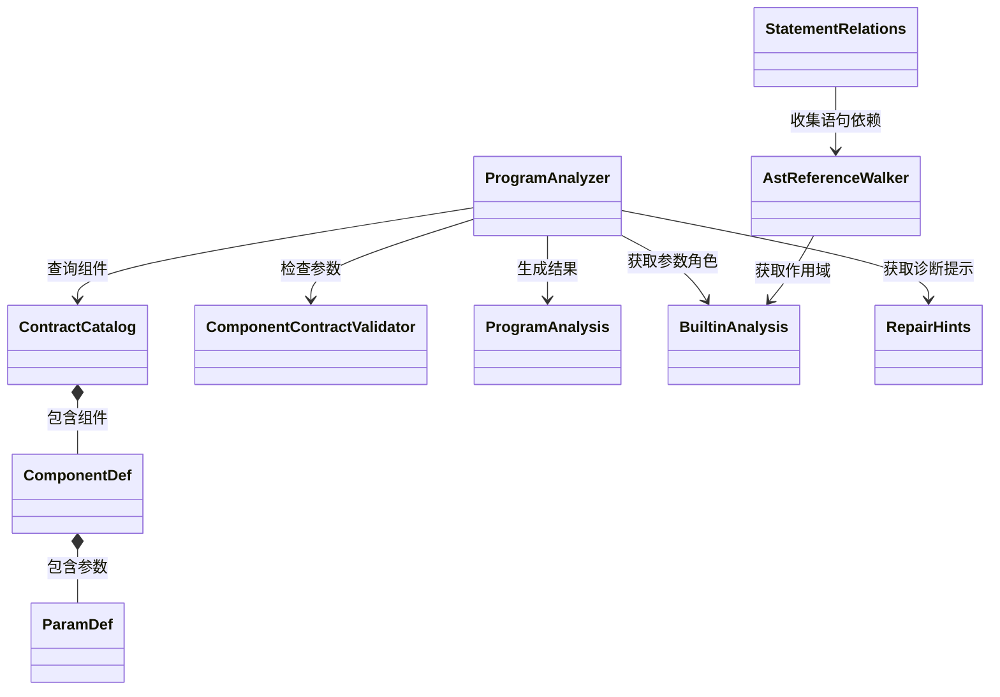
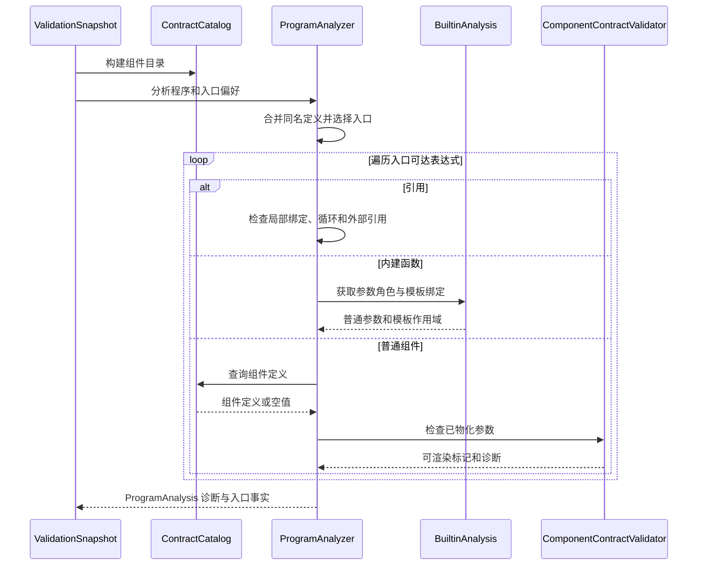
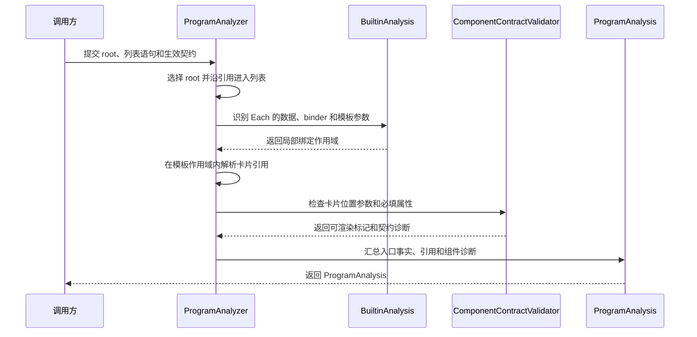

# 语义与契约分析设计说明书

## 1. 模块定位

语义与契约分析接收解析后的 `Program` 和生效契约，从选定入口检查可达引用、组件调用及结构约束，输出诊断和入口事实。类型分析使用同一程序和入口，继续检查类型与数据路径。

本模块不执行 DSL、渲染页面或调用模型，也不决定修复和降级。组件检查中的“物化”是为校验构造普通值和可渲染标记，不是渲染执行。

## 2. 方案总体设计

### 2.1 总体方案

`ValidationSnapshot` 从生效契约构造 `ContractCatalog` 和 `BuiltinCatalog`，再调用 `ProgramAnalyzer`。分析器建立当前符号表、选择入口，并沿引用递归检查可达表达式。普通组件交由 `ComponentContractValidator` 检查参数；builtin 的参数角色与局部绑定由 `BuiltinAnalysis` 提供。结果汇总为 `ProgramAnalysis`，供外层校验器与类型分析使用。

`AstReferenceWalker` 提供引用遍历，供类型分析收集可达语句，也供 `StatementRelations` 计算修复提示所需的上下游关系。`RepairHints` 为语义诊断和修复提示提供共享提示知识。

### 2.2 设计考量

- 以同名后者覆盖的当前定义建立符号表，同时保留名称首次出现的顺序。解析诊断仍来自完整程序。
- 从入口遍历可达定义，保留引用所属语句，以便诊断指向使用位置。局部绑定、外部引用和循环引用采用不同处理。
- 将组件 schema 的属性顺序转换为位置参数；结构检查与类型推导各自负责不同规则。
- 将 builtin 参数角色集中在 `BuiltinAnalysis`，使语义和引用遍历共享 binder 与模板作用域知识。

### 2.3 设计取舍

入口是有序回退策略：先选 `root`，再选 id 等于 `rootName` 的语句，再选调用名等于 `rootName` 的普通组件，之后选第一条普通组件语句，最后选原始第一条语句。`rootName` 因此是偏好而非强制约束。

只有签名、没有结构化属性的组件仅检查存在性，避免凭不足的 schema 推断属性规则。动态表达式使用非空占位值，避免将运行时才能求值的值误判为缺失；其类型约束交由类型分析处理。对象联合 schema 的属性检查采用首个可识别的对象分支，不是完整 JSON Schema 验证。

## 3. 对外接口

这里的接口指其他校验子系统使用的 Java 接口，并非模型或网络接口。

### 3.1 接口表

| 接口 | 输入 | 输出与副作用 |
| --- | --- | --- |
| `ContractCatalog.from(contract)` | 生效 `GenerationContract`；允许 null | 组件目录和能力缺口；null 得到空目录。 |
| `ContractCatalog.get(name)` | 组件名 | `ComponentDef`；未声明时为 null。 |
| `ProgramAnalyzer.analyze(program, rootName, externalRefs)` | 程序、可选入口偏好、外部引用集合 | `ProgramAnalysis`；生成本次诊断，不修改程序或契约。null 外部引用集合按空集合处理。 |
| `AstReferenceWalker.walkReachability(node, builtins, sink)` | 表达式、builtin 词表、引用接收器 | 将未被局部绑定遮蔽的引用交给 `sink`，用于类型可达性分析。 |
| `AstReferenceWalker.walkDependencies(node, builtins, initialScope, sink)` | 表达式、词表、初始绑定和接收器 | 将未被遮蔽的引用交给 `sink`，用于依赖分析；遍历策略与可达性入口不同。 |
| `StatementRelations.related(currentDsl, issues, builtins)` | 当前 DSL、诊断和可选 builtin 词表 | 诊断语句到传递上下游语句的映射；空 DSL 或诊断返回空映射。 |

### 3.2 典型输入输出

**正常输入输出示例。** 假设目录中有无需必填参数的 `Panel`，程序只有 `root = Panel()`，且没有解析诊断。`analyze` 选择 `root`，返回 `entryId = root`、`rootResolved = true`、`statementCount = 1`，语义诊断为空。

**边界输入输出示例。** 空程序产生 `root-missing`，返回 `entryId = null`、`rootResolved = false`、`statementCount = 0`。若入口引用不存在且不在 `externalRefs` 中的名称，则产生 `unresolved-ref`；若引用形成循环，也按未解析引用报告。

## 4. 关键数据结构

### 4.1 数据结构总表

| 数据结构 | 作用 | 生命周期 |
| --- | --- | --- |
| `Program` | 解析器产出的有序语句、AST 和语法诊断 | 一次校验输入 |
| `ContractCatalog` | 按名称查询组件及能力缺口 | 一次校验快照 |
| `ComponentDef`、`ParamDef` | 组件及有序位置参数的契约视图 | 目录内 |
| `ProgramAnalysis` | 语义诊断与入口事实 | 一次分析结果 |
| `WalkCtx` | 遍历期间的符号、引用路径、作用域和诊断 | 一次分析内部 |
| `ValidationIssue` | 问题代码、严重程度、位置及提示 | 结果和修复提示 |

### 4.2 `Program`

| 字段 | 作用 |
| --- | --- |
| `statements` | 保存源码顺序的全部语句，包括重复定义 |
| `diagnostics` | 保存解析阶段产生的语法诊断 |
| `incomplete` | 表示解析前是否执行过流式补闭合 |

### 4.3 `ContractCatalog`、`ComponentDef` 和 `ParamDef`

| 数据结构 | 字段 | 作用 |
| --- | --- | --- |
| `ContractCatalog` | 组件索引 | 按名称查询 `ComponentDef` |
| `ContractCatalog` | 能力缺口列表 | 为未知组件提供修复边界 |
| `ComponentDef` | `name` | 组件名称 |
| `ComponentDef` | `params` | 按契约顺序排列的位置参数 |
| `ComponentDef` | `signatureOnly` | 是否只有签名、没有结构化属性 schema |
| `ParamDef` | `name` | 参数名称 |
| `ParamDef` | `required` | 是否必须提供 |
| `ParamDef` | `hasDefault`、`defaultValue` | 区分无默认值、普通默认值和 null 默认值 |
| `ParamDef` | `schema` | 参数的嵌套结构约束 |

### 4.4 `ProgramAnalysis`

| 字段 | 作用 |
| --- | --- |
| `issues` | 汇总语法、引用、组件和契约诊断 |
| `entryId` | 最终选中的入口语句 id |
| `rootResolved` | 入口是否解析为可渲染组件 |
| `unresolvedRefs` | 未解析引用名称 |
| `statementCount` | 当前定义视图中的语句数量 |

### 4.5 `WalkCtx`

| 字段 | 作用 |
| --- | --- |
| 当前语句 id | 让诊断归属到引用的使用位置 |
| 符号表 | 查询当前有效定义 |
| 正在访问的引用集合 | 检测循环引用 |
| 局部绑定栈 | 维护 Each、Render 等模板作用域 |
| 诊断列表 | 保存本次遍历产生的问题 |

进入引用或模板后，`WalkCtx` 保存并恢复原上下文，防止循环状态和绑定泄漏到其他分支。

### 4.6 `ValidationIssue`

| 字段 | 作用 |
| --- | --- |
| `code` | 稳定的问题类型 |
| `severity` | 错误、警告或提示级别 |
| `statementId` | 诊断所属语句 |
| `component`、`path` | 定位组件和参数位置 |
| `message` | 面向调用方的解释 |
| `hint` | 面向修复模型的可执行提示 |

## 5. 4+1 架构视图

### 5.1 逻辑视图

### 5.2 开发视图

`BuiltinAnalysis` 同时供语义分析、引用遍历和类型分析使用。它位于类型分析实现中，当前不是独立部署单元。`ProgramAnalyzer` 的物化遍历与 `AstReferenceWalker` 的两种遍历承担不同任务；后两者对非法 binder、binder 参数及赋值右侧的处理也不同。

### 5.3 过程视图

组件未知时，分析器报告 `unknown-component` 并继续遍历实参。必填参数缺失或为 null，且没有声明默认值时，分别报告 `missing-required` 或 `null-required`，组件不再取得可渲染标记。多余参数或封闭对象中的未知属性也产生错误，但单独出现时不移除该标记。入口不能解析为组件时，另报 `root-not-renderable`。

### 5.4 场景视图

页面入口引用一条列表语句，列表用 `Each` 遍历运行时数据，模板中的卡片读取局部变量。

局部变量只在模板作用域有效；属于 `externalRefs` 的数据名称由运行时提供。若卡片缺少无默认值的必填属性，结果包含组件名、属性路径和语句 id，供调用方定位问题。

## 6. DFX 设计

### 6.1 可靠性与可诊断性

- **可靠性**：按递归路径检测循环；未知组件仍遍历实参，尽量保留嵌套诊断。局部作用域在退出模板时恢复。
- **可诊断性**：结构化问题包含代码、语句及可用的组件和属性路径；`RepairHints` 为部分问题提供修复提示。最终状态由外层按错误严重程度确定。

### 6.2 扩展性与可测试性

- **扩展性**：普通组件来自契约目录；特殊 builtin 的参数角色与作用域集中在 `BuiltinAnalysis`。如共享规则继续增长，可评估抽成共享内核，迁移时保留不同遍历策略。
- **测试性**：目录构造、入口选择、引用与契约检查可用固定程序和契约验证。调整共享遍历前应覆盖同名定义、循环、模板遮蔽和非法 binder 等行为。
