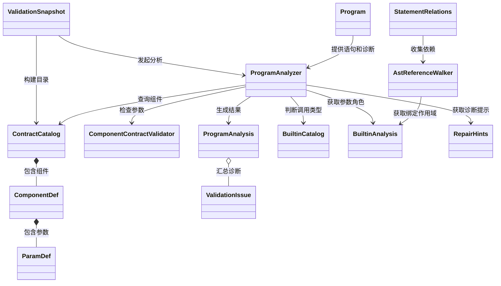
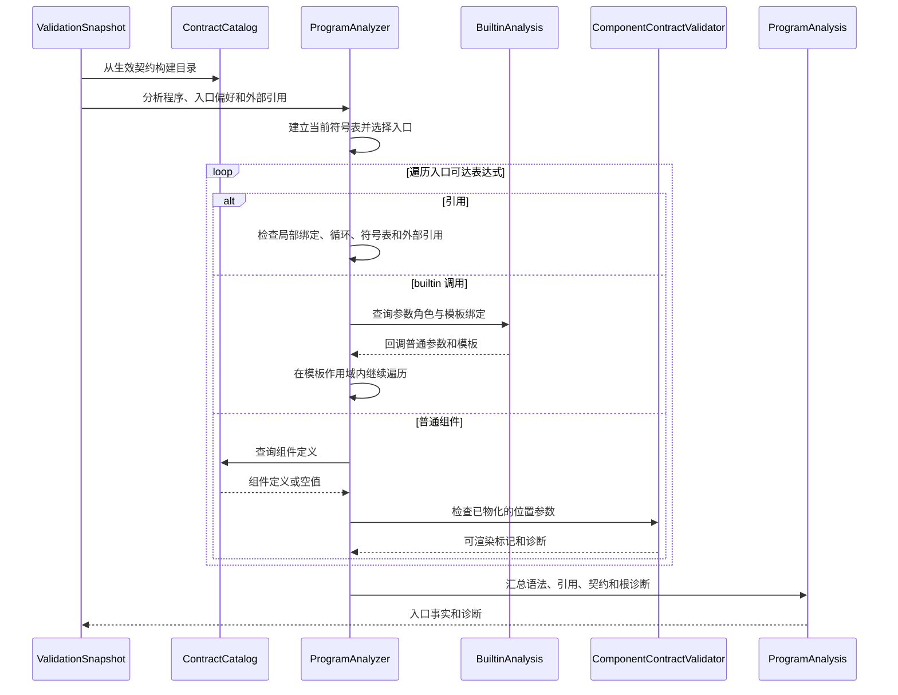

# 语义与契约分析设计

语义分析以解析后的程序和当前组件契约为输入，从选定入口检查可达的引用与组件，输出结构化诊断和入口事实。它回答“这棵页面能否按声明的组件结构解释”，类型分析再检查值与数据路径是否满足类型要求。

## 模块定位与边界

`ValidationSnapshot` 根据本次请求构建 `ContractCatalog` 和 `BuiltinCatalog`，然后调用 `ProgramAnalyzer`。分析结果 `ProgramAnalysis` 交给默认校验器；其中入口 id 也交给类型分析。语义分析不请求模型，不执行工具，不渲染页面，也不决定是否重试或降级。

| 输入 | 含义 |
| --- | --- |
| `Program` | 有序语句、表达式树及解析诊断；重复 id 仍保留在原始语句列表中。 |
| `ContractCatalog` | 从生效契约派生的组件定义、位置参数和能力缺口。 |
| `BuiltinCatalog` | builtin 名称及其调用信息，用于区别普通组件和特殊调用。 |
| `rootName`、`externalRefs` | 入口选择偏好，以及由运行时提供的外部引用名称。 |

输出的 `ProgramAnalysis` 包含诊断列表、入口 id、根是否解析为组件、未解析引用及去重后的语句数量。分析期间只创建本次遍历状态并向本地列表添加诊断；不会修改输入程序、契约或模型数据。语法诊断被纳入语义结果，最终有效性由外层校验器按诊断严重程度判断。

## 关键类设计

| 类 | 职责 |
| --- | --- |
| `ContractCatalog` | 根据组件 schema 构造按名称索引的目录，保留能力缺口供提示使用。 |
| `ComponentDef`、`ParamDef` | 表示一个组件及其按位置排列的参数、必填标记、默认值和参数 schema。 |
| `Program` | 提供有序语句、当前定义视图和解析诊断，是语义分析的程序输入。 |
| `ProgramAnalyzer` | 建立当前符号表、选择入口、递归检查引用和组件，并汇总语法与结构诊断。 |
| `ComponentContractValidator` | 检查物化后的组件参数、必填项和封闭对象的属性。 |
| `ProgramAnalysis` | 返回诊断及入口、根、引用和语句数量等事实。 |
| `ValidationIssue` | 表示带来源、位置、严重程度和修复提示的结构化诊断。 |
| `AstReferenceWalker` | 为类型可达性分析和修复依赖分析遍历未被局部绑定遮蔽的引用。 |
| `StatementRelations` | 根据当前程序及诊断，计算修复提示所需的上下游语句。 |
| `RepairHints` | 提供语义诊断提示，也为修复提示识别能力缺口等原因。 |
| `BuiltinAnalysis` | 提供 builtin 参数角色与绑定作用域；同时服务语义分析、引用遍历及类型分析。 |

## 核心实现机制

### 入口与引用解析

分析器先用 `Program.currentById()` 建立符号表。同名定义以后出现的语句为准，名称的首次出现顺序保留。入口按以下顺序选择：

1. 名为 `root` 的语句。
2. id 等于 `rootName` 的语句。
3. 调用名称等于 `rootName` 的普通组件语句。
4. 第一条普通组件语句。
5. 原始程序的第一条语句。

没有语句时报告 `root-missing`。有入口但入口最终没有解析为组件时报告 `root-not-renderable`。入口选择是回退策略，`rootName` 并不强制成为最终入口。

分析器从入口递归解释表达式，而不是逐个检查所有未被引用的定义。语法诊断仍来自整个解析结果。对引用，当前模板的局部绑定优先；随后检查正在访问的名称以发现循环，再查语句符号表。表中没有的名称若在 `externalRefs` 中，则保留为运行时动态值；否则记录 `unresolved-ref`。循环也按未解析引用报告。命名的顶层 `Query` 或 `Mutation` 引用代表运行时值；把它们作为普通值内联调用则报告 `inline-reserved`。

遍历上下文维护当前语句 id、递归路径和绑定作用域栈。进入命名语句或模板时暂存上下文，退出时恢复，避免一个分支的循环检测或局部名字泄漏到另一个分支。诊断中的语句 id 指向使用引用的语句。

### 组件契约检查

`ContractCatalog` 按 schema 中 `properties` 的顺序建立位置参数。每个参数保留是否必填、是否有默认值和原始参数 schema。只有签名而没有结构化属性的组件可以通过存在性检查，但跳过属性级规则。

遇到普通组件时，`ProgramAnalyzer` 先查询目录并递归处理实参，再交给 `ComponentContractValidator`：

- 找不到组件时产生 `unknown-component`，并继续遍历实参，以发现嵌套问题。
- 位置参数超出声明数量时产生 `excess-args`。
- 必填参数缺失或值为 null 时分别产生 `missing-required` 或 `null-required`；有声明的默认值时不报这两类错误。
- 对对象实参，只有 schema 明确禁止额外属性时才报告未知属性；嵌套对象按 schema 递归检查。

必填项缺失或为空会使该组件在语义物化中不可渲染；多余参数或未知对象属性虽产生错误，本身不使该组件失去可渲染标记。动态表达式使用非空占位值，避免把运行时才能求值的内容直接当成缺失。此处的“物化”只是构造用于检查的普通值和组件标记，不是实际渲染，也不对运行时数据进行完整类型验证。

### Builtin 协作与引用遍历

builtin 调用不按普通组件契约物化。`ProgramAnalyzer` 调用 `BuiltinAnalysis.walkArguments()`，由后者识别普通参数、binder 声明和模板参数。binder 是模板内的局部变量；它只在相应模板范围生效，binder 声明本身不作为普通引用检查。模板引用命名语句时，当前作用域继续有效。

`AstReferenceWalker` 共享同一套 builtin 参数角色，但服务两个不同问题：类型分析收集入口可达引用；`StatementRelations` 收集语句依赖，供修复提示定位上下游。两者对非法 binder、binder 参数和赋值右侧的遍历策略不同，因此不能把它们简单视为同一种遍历。`ProgramAnalyzer` 的物化遍历也独立维护状态和诊断。

## 典型业务场景

生成的页面入口引用一条列表语句。列表使用 `Each` 遍历运行时数据，并在模板中引用局部变量来构建卡片。

分析器先选中 `root`，沿引用进入列表语句。`BuiltinAnalysis` 告知分析器哪些位置是数据、binder 和模板。分析器在模板内认可局部变量，再按目录检查卡片的位置参数。若卡片缺少无默认值的必填属性，就生成带组件名、属性路径和语句 id 的诊断；若数据引用属于 `externalRefs`，则交由运行时提供，不报未解析引用。类型分析随后独立检查数据和属性类型。

## 异常与回退边界

语义分析把常规输入问题转换成结构化诊断，不用异常中断整个程序：

- 没有可用语句时返回 `root-missing`。
- 入口无法解析为组件时返回 `root-not-renderable`，但仍保留其他诊断。
- 未知组件会产生 `unknown-component`，并继续遍历它的实参，便于发现嵌套问题。
- 循环引用停止递归并产生引用诊断，不会无限展开。
- `externalRefs` 中的名称作为运行时动态值保留，不会被当作未解析引用。
- 契约缺失时组件目录为空，语义分析仍然运行；未知组件和引用问题照常进入结果。

组件的必填参数缺失或显式为 null，会使该组件不能作为可渲染根继续物化。多余参数、未知对象属性等契约错误仍会进入诊断，但不改变已经构造出的组件标记。最终是否 `VALID` 由外层校验器根据诊断严重程度决定。

## 设计分析与简化建议

当前边界把组件结构检查与数据类型推导分开，使语义阶段能在不执行 DSL 的情况下提供可定位诊断。目录将 schema 转成有序参数，也让语义遍历不必反复解释原始契约。

`ProgramAnalyzer` 同时负责入口选择、递归物化、引用作用域和诊断组装。后续若这些规则继续增长，可以先用行为测试固定入口优先级、循环与 binder 作用域，再考虑提取纯粹的入口选择逻辑。不要仅为缩短类文件而引入多层转发。

`BuiltinAnalysis` 位于类型分析包，却为语义分析和引用遍历提供共同规则。若后续修改频繁跨越这三个调用方，可考虑把参数角色和作用域规则提取为共享内核；迁移时需保留两种引用遍历策略的差异。`ProgramAnalyzer` 和 `AstReferenceWalker` 目前有各自的遍历，合并前应先验证物化、诊断位置及 binder 容错行为确实一致。

`ComponentContractValidator` 对联合 schema 选择首个可识别的对象分支进行属性检查。若契约开始大量使用形状不同的联合分支，应先用真实契约验证该策略是否足够，再决定是否扩展分支选择；不宜把它误认为完整 JSON Schema 验证器。
