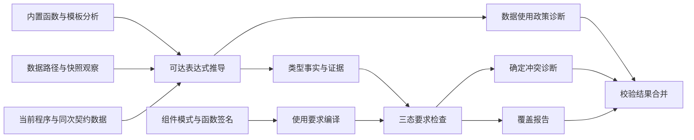
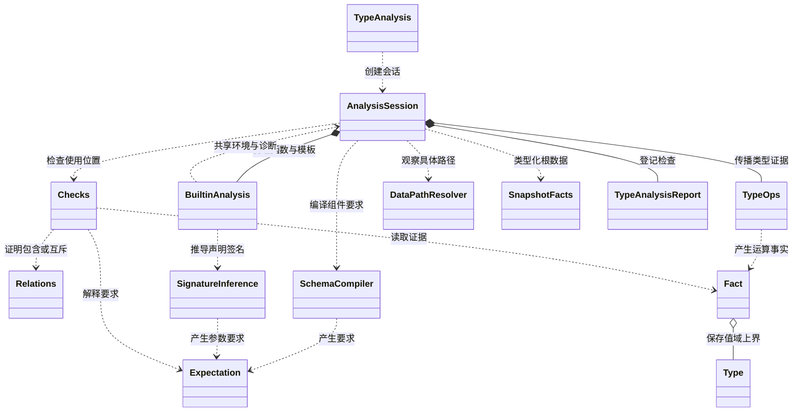
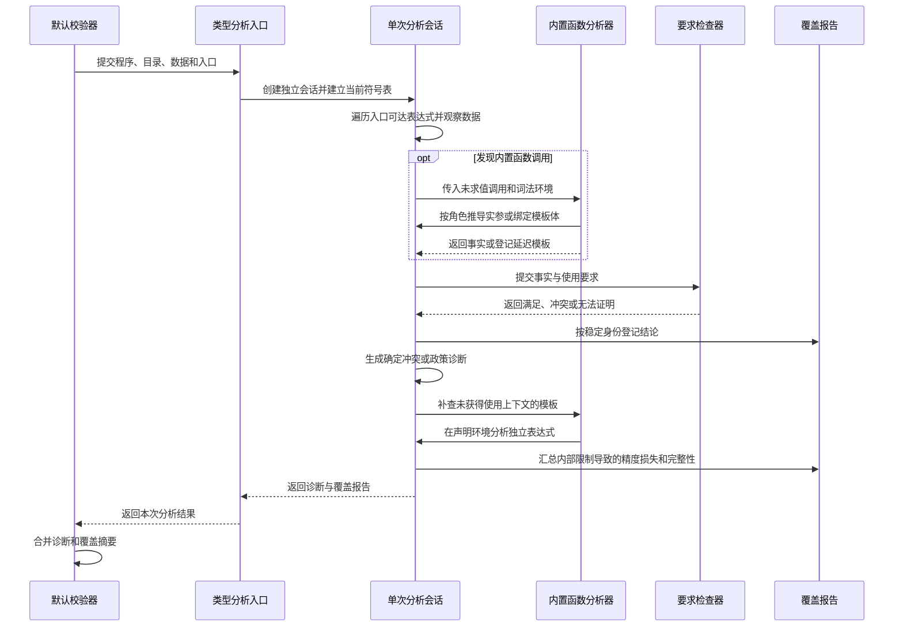
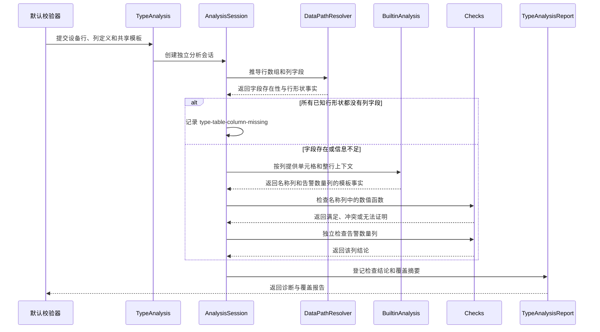

# 静态类型与数据分析设计说明书

## 1. 模块定位

本模块判断当前可渲染程序中的值是否满足组件参数、builtin 签名及数据使用要求。它将表达式推导为 `Fact`，将契约编译为 `Expectation`，输出诊断与检查覆盖情况。

模块位于语法解析、语义与契约分析之后。输入的 `Program`、`ContractCatalog`、`BuiltinCatalog`、数据快照和入口来自同一次校验。分析只处理当前定义中从入口可达的取值语句。同名语句以后定义为准，被覆盖或不可达的辅助定义不产生当前类型错误。

入口选择、引用合法性、组件存在性和参数结构由上游负责。模型调用、修复循环和 Markdown 降级由外层生成器负责。本模块不执行 DSL，不计算业务指标，不修改输入数据。

## 2. 方案总体设计

### 2.1 总体方案

`TypeAnalysis.analyze` 为每次校验创建独立的 `AnalysisSession`。会话建立当前符号表，遍历入口可达表达式，并在使用位置登记检查要求。一次修复后的重新校验会重新分析合并后的当前程序，不继承上一轮推导状态。

分析使用三个分开的模型：`Type` 表示值的可能范围，`Fact` 补充观察证据及信息损失，`Expectation` 表示使用位置的要求。`Checks` 结合这些信息返回三态结论。

| 结论 | 含义 | 通用检查的处理 |
| --- | --- | --- |
| `MATCH` | 已证明满足要求 | 记录覆盖 |
| `MISMATCH` | 已证明冲突，或存在适用于当前对象的真实反例 | 记录覆盖并产生诊断 |
| `UNPROVEN` | 数据、规则或上下文不足 | 记录覆盖及原因 |

组件参数通过 `SchemaCompiler` 编译要求。普通 builtin 通过 `SignatureInference` 绑定类型变量并实例化返回类型。`BuiltinAnalysis` 统一处理参数角色、binder、模板和特殊返回语义。数据由 `DataPathResolver` 与 `SnapshotFacts` 只读观察，`TypeOps` 负责结构及证据传播。

默认校验器合并本模块诊断，并将 `TypeAnalysisReport` 摘要写入 `ValidationMetadata.extra`。数据路径不可证明、空组件槽位和图表点数等既有产品政策可以直接产生 ERROR，不能全部按通用三态检查解释。

### 2.2 设计考量

生成代码常同时包含已知字面量、部分数据和延迟模板。二元的“通过或失败”会把信息不足误判成错误，或把没有发现错误误当成已证明正确。三态结论保留这种区别。

真实观察与类型上界也需要分开。一个异构数组的合并类型可能掩盖部分行缺字段，实际行证据仍能提供反例。反过来，Filter 后不能假定输入中观察到的坏行仍然存在，因此运算必须明确删除失效证据。

模板的类型与使用上下文分开。Render 声明时只产生 `Type.Template`，实际 body 与捕获环境留在会话内。Table 在每列提供单元格和整行事实，模板才取得对应类型。同一模板用于不同列时分别检查，诊断归属实际使用位置。

### 2.3 设计取舍

| 选择 | 收益 | 代价或限制 |
| --- | --- | --- |
| 只分析入口可达的当前定义 | 避免旧定义和未使用辅助语句污染结果 | 不能把结果解释成全量源码的类型证明 |
| 不执行 DSL，以类型上界和观察事实推导 | 不依赖渲染器，也不执行模型生成逻辑 | 不按条件执行选支，未知外部状态保持未证明 |
| 普通 builtin 由签名驱动，特殊语义集中实现 | 普通函数扩展无需新增分派规则 | 新增特殊证据传播仍需 Java 实现并校验声明兼容性 |
| 会话状态隔离，事实结构不可变 | 多次校验不相互污染，模板作用域可追踪 | 重复引用和组件专用检查可能重复推导表达式 |
| 固定结构限制超限后放宽为安全摘要 | 保留可能值，避免截掉错误分支后宣称通过 | 精度降低，部分要求变成未证明 |

分析入口不再接收可配置预算。`AnalysisSession`、`TypeOps` 和 `SnapshotFacts` 共享一次分析的完整性标记；当达到内部遍历、联合展开、对象深度或数组采样限制时，分析保留安全摘要，并把报告标记为不完整。类型证明诊断和产品政策诊断仍分别统计。

## 3. 对外接口

### 3.1 接口表

这里的对外接口指校验模块之间的协作接口。宿主应用通常调用完整校验器，由它保证程序和契约来自同一次快照。

| 接口 | 调用方 | 输入 | 输出与约束 |
| --- | --- | --- | --- |
| `TypeAnalysis.analyze` | 默认校验器 | `Program`、组件目录、builtin 目录、可空数据模型、入口 ID | `TypeAnalysis.Result`，包含 `issues` 与 `coverage`；每次调用创建独立分析会话 |
| `BuiltinAnalysis.validateDefinition` | 契约加载过程 | `BuiltinSpec` | 检查 Java 特殊布局与返回语义的最低前提；冲突时抛出 `GenerationSdkException` |
| `BuiltinAnalysis.ownsCallLayout` | 契约加载过程 | builtin 名称 | 判断参数布局是否由 Each 或 Render 特殊逻辑管理 |
| `BuiltinAnalysis.walkArguments` | 语义及引用遍历 | builtin 目录、调用 AST、binder 容错策略、`ArgumentVisitor` | 按普通实参或模板角色回调，并提供模板 binder 集合 |
| `TypeAnalysisReport.metadataSummary` | 默认校验器 | 已完成的覆盖报告 | 返回字符串键值摘要，写入 `ValidationMetadata.extra` |

分析无网络或文件副作用，不修改输入。`ObservedValue` 可直接持有数据快照中的值，调用方需保证分析期间快照稳定。缺少必需程序或目录属于参数错误，不返回业务诊断。合法但未知的数据或上下文通常返回带损失原因的事实。

### 3.2 正常输入输出

输入使用默认契约中的 TextContent，其内容参数接受 string 或 number。程序、目录和入口由同次校验快照准备，分析参数如下：

```text
程序：root = TextContent(data.title)
数据模型：{"title":"设备列表"}
入口：root
分析限制：由分析会话内部管理
```

输出中的关键结果如下，不展开其他覆盖计数：

```text
issues：空列表
coverage.mismatched()：0
coverage.unproven()：0
coverage.analysisComplete()：true
```

路径观察得到字符串字面值事实，内容参数要求得到满足。分析读取数据，不创建 TextContent 的运行时实例。

### 3.3 边界输入输出

下面三个输入使用相同程序和契约，区别在于数据是否提供、字段是否存在。

| 输入 | 类型分析输出要点 |
| --- | --- |
| `dataModel = null` | 数据事实为 `Unknown + UNKNOWN_INPUT`；内容参数检查记 `UNPROVEN`；不产生缺路径诊断 |
| `dataModel = {}` | 已知空对象确定没有 title；产生 `type-data-path-missing`；依赖该值的通用检查记 `BLOCKED_BY_ERROR` |
| `dataModel = {"title":true}` | 路径存在但 boolean 与 string 或 number 要求冲突；产生 `type-prop-mismatch` |

因此，无数据不能按空对象处理。`coverage.mismatched()` 也不能代替诊断数量，因为路径诊断不一定经过同一条要求登记路径。

另一个边界是 `root = TextContent(data.devices.name)`，数据为 `{"devices":[]}`。空数组不能证明成员 name 的形状，路径解析返回 `Unprovable`，会话按既有政策产生 `type-data-unprovable`，而不是虚构一条缺字段的设备行。

## 4. 关键数据结构

### 4.1 数据结构总表

| 数据结构 | 主要内容 | 生命周期 |
| --- | --- | --- |
| `Type` | 可能值的类型上界及结构 | 不可变值 |
| `Fact` | 类型、观察证据、精度损失、上游错误身份 | 单次推导产物，不可变值 |
| `Expectation` | 组件参数与 builtin 的使用要求 | 编译后的不可变要求 |
| `AnalysisSession.Input` | 同次快照中的程序、目录、数据和入口 | 一次分析 |
| `AnalysisSession` | 符号、环境、模板使用位置、诊断、完整性和覆盖 | 一次分析的可变协作状态 |
| `TypeAnalysisReport` | 去重后的检查结论、未证明原因及完整性标记 | 一次分析的报告 |
| `DataPathResolution` | 路径结果类型、存在性观察或失败原因 | 一次字面量路径观察 |
| `AnalysisCompleteness` | 记录本次分析是否触发内部限制 | 一次分析的单向状态 |

### 4.2 Type 的值域结构

| 变体或字段 | 语义 |
| --- | --- |
| `Never`、`Unknown` | 分别表示没有合法值和无法缩小的可能值范围 |
| `Scalar.kind`、`StringLiterals.values` | 标量种类及有限字符串字面值集合 |
| `Sequence.element` | 数组元素的类型上界 |
| `Sequence.minLength`、`maxLength` | 数组长度区间，无界上界用 `UNBOUNDED` |
| `RecordType.fields` | 字段名到 `Field(type, presence)` 的映射；`OPTIONAL` 表示可能缺失，不代表 null |
| `RecordType.extra` | 未显式列出字段的值约束；`Never` 表示禁止额外字段 |
| `Union.alternatives` | 多个可能值域的联合 |
| `Component.name`、`Template` | 按名称区分的组件类型与不包含模板体的模板形状 |

`Types` 提供常规归一化构造。联合展平、去重、删除 `Never` 并稳定排序。空数组归一为 `Sequence(Never, 0, 0)`。原始构造器不全部承担相同的归一化工作。

### 4.3 Fact 的事实与证据

| 字段 | 保存内容 | 对检查的影响 |
| --- | --- | --- |
| `type` | 可能值上界 | 支持类型包含和互斥证明 |
| `evidence` | `ObservedValue`、`FieldPresence`、`ElementPresence`、`LengthSource`、`KnownLength` | 提供真实反例、字段存在及保长度证明 |
| `losses` | 未知输入、缺少上下文、未支持规则、预算损失、缺少元素证据等 | 解释为何无法证明 |
| `upstreamErrors` | 已报告错误的身份集合 | 下游通用检查返回 `UNPROVEN(BLOCKED_BY_ERROR)`，抑制重复报错 |

`ObservedValue` 按检查路径关联。其他数据路径的坏值不能证明当前对象有错。`FieldPresence` 分别记录非 null、缺失、显式 null 和总数。`LengthSource` 表示已证明保持数量的来源，`KnownLength` 表示直接观察到的精确数量。

Fact 的身份包含全部字段。同样的 Type 配上不同证据或损失，可能产生不同检查结论，因此不能只按 Type 复用结果。

### 4.4 Expectation 的要求模型

| 变体 | 关键字段与含义 |
| --- | --- |
| `Accept`、`EnumValues` | 指定允许的 Type 或字符串枚举集合 |
| `RequireField`、`ConditionalField` | 指定字段名和嵌套要求；前者要求存在，后者只检查出现的字段 |
| `SequenceOf`、`RecordValues` | 指定数组元素或对象映射值的嵌套要求 |
| `AllOf`、`AnyOf`、`ExactlyOne` | 指定必须全部、至少一个或恰好一个满足的子要求 |
| `Unsupported` | 保留当前无法编译的 schema 位置与关键词 |

复合要求必须对同一个值或可对齐的分区组合判断。分别找到违反不同 AnyOf 候选的两个值，不代表存在一个值违反全部候选。空数组满足逐元素要求，非空组件内容另有产品政策。

`SchemaCompiler` 支持 type、properties、required、items、additionalProperties、字符串 enum、anyOf 和 component 扩展。并列要求按 AllOf 组合，未支持要求保留 Unsupported。`ExactlyOne` 存在于内核，不代表 schema 编译器已支持 oneOf。

### 4.5 AnalysisSession 的输入与会话状态

| 关键字段或结构 | 用途 |
| --- | --- |
| `Input.program/catalog/builtins` | 绑定本次程序及两类生效目录 |
| `Input.dataModel/entryId` | 提供数据快照和可达起点 |
| `symbols`、`spans` | 保存当前有效表达式和语句定位 |
| `LexicalEnvironment` | 不可变父子链，查询 binder 并支持内层同名遮蔽 |
| `templateUseSites` | 保存当前模板的实际使用位置，控制诊断与覆盖归属 |
| `emitted`、`issues` | 按错误码、语句、组件和使用位置去重并保存诊断 |
| `completeness`、`coverage` | 共享本次分析完整性和结论报告 |

`synth` 按 AST 形状推导事实。引用先查词法环境，再查符号表。可变 state、无法解析的引用和循环引用保护返回未知事实。三元表达式分析两侧后合并，不执行条件选支。

Builtin 的 `DeferredTemplate` 留在会话内，保存 Render 调用 AST、声明语句、捕获环境和 body 位置。Table 的 cell 使用提供单元格和整行绑定，模板在该位置重新检查。根遍历结束后，尚未获得使用上下文的模板在声明环境补查，binder 依赖部分保持 `MISSING_CONTEXT`。

### 4.6 TypeAnalysisReport 的检查身份与完整性

`Obligation(statementId, useSite, kind, contractPath)` 是一条检查要求的稳定身份。`Entry` 保存要求、`verdict` 与未证明原因。同一身份重复登记保留首次结论，不按数据行数或重复求值次数累加。

| 状态或查询 | 含义 |
| --- | --- |
| `discovered/matched/mismatched/unproven` | 已发现要求及三态结论数量，满足 `discovered = matched + mismatched + unproven` |
| `analysisComplete()` | 未触发内部限制；不表示全部要求已证明 |
| `metadataSummary()` | 输出 `typeChecks.*` 计数、完整性和未证明原因摘要 |

完整遍历可以包含 `UNPROVEN`，受限会话也可以包含已证明检查。`VALID` 表示没有导致失败的诊断，不能替代完整类型证明。发生限制时，摘要会包含 `typeChecks.analysisComplete=false`、`typeChecks.traversalTruncated=true` 和 `typeChecks.precisionLosses=PRECISION_BUDGET`。

## 5. 4+1 架构视图

### 5.1 逻辑视图

逻辑上分为事实推导、要求编译、结论检查和报告四部分。Builtin 与数据观察提供专门语义，统一产出事实或要求。



### 5.2 开发视图

`TypeAnalysis` 保持完整分析入口。`AnalysisSession` 组织协作，`BuiltinAnalysis` 还向契约加载和语义遍历提供共享规则。



### 5.3 过程视图

分析在校验调用所在进程内同步执行，没有独立服务或持久化状态。不同请求各自持有会话、完整性标记和模板表。组件类型分析与专用 Table、Chart 检查复用同一会话。



### 5.4 场景视图

设备明细页用 Table 展示返回行，名称列和告警数量列共享 Render 模板。模块分别检查列字段与模板实际参数，避免同一模板在名称列和数值列之间错误复用结论。



Table 列存在性允许部分行缺值，逐行读取字段则可能被一条缺字段行违反。行数组为空时，模块不会虚构行结构证明列存在。没有数据模型时，依赖数据的要求保留未证明，独立静态错误仍被检查。

图表由同一行数组经 Each 派生 labels 和 values 时，可以传播共同长度来源。Sort 保留数量证据，Filter 将长度下界降为零并删除保留行与长度来源证据。图表长度关系与元素要求分别检查，长度未知不阻止已知元素类型错误被报告。

## 6. DFX 设计

| 关注点 | 当前设计与限制 |
| --- | --- |
| 工作量与完整性 | 不暴露可配置分析预算。会话限制根遍历和模板补查最多 2,048 项，联合分支最多 64 个，对象深度最多 16 层，数组最多采样 256 项。触发任一限制后由 `AnalysisCompleteness` 保持不完整状态，不使用墙钟分支 |
| 精度 | 超限使用覆盖原可能值的安全摘要并记录 `PRECISION_BUDGET`。普通签名不复制实参观察证据或伪造输出数量；特殊运算明确保留或删除证据。未知输入、缺上下文、未支持 schema 保留为可解释的未证明 |
| 可诊断性 | 保留错误码、语句与使用位置，模板声明信息可追溯；上游错误身份抑制连锁报错。覆盖摘要区分未证明与分析不完整。产品政策诊断不全等同于 `MISMATCH`，错误总数需读取诊断列表 |
| 扩展与测试 | 普通 builtin 由签名扩展，特殊布局及返回语义在定义期校验。已有测试覆盖类型、路径、签名、对象枚举及入口可达行为；新增规则应验证未知、空集合、混合类型、上下文遮蔽和内部限制边界，不仅断言正常输入通过 |

保持纯分析和单次会话可以直接测试输入到诊断、覆盖的行为。后续优化优先减少同一上下文内重复推导，并保持完整性标记与事实损失同步。若增加缓存，键必须包含完整事实、词法环境及模板使用位置，不能只按 Type 或 AST 复用。
