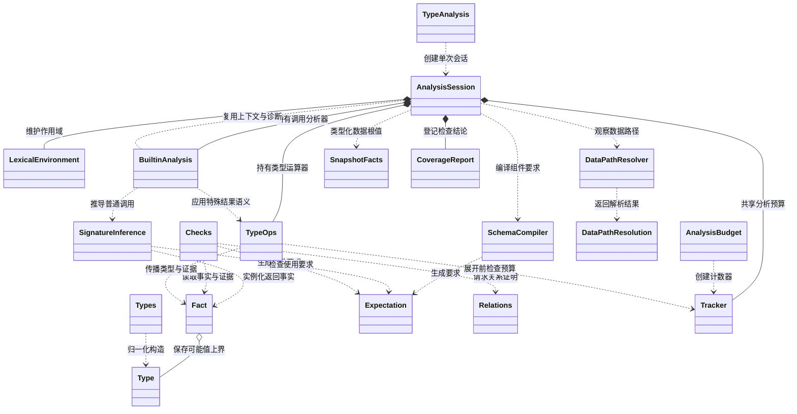
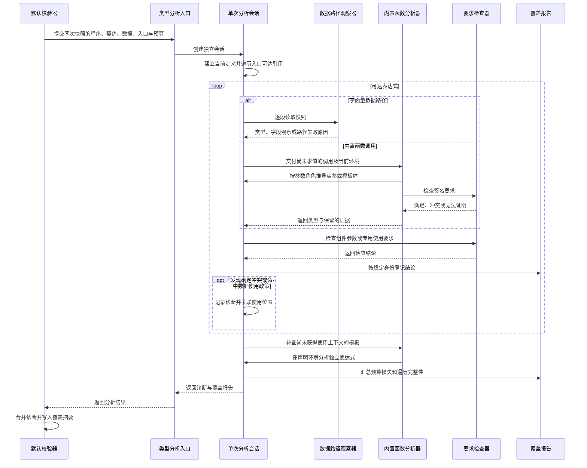
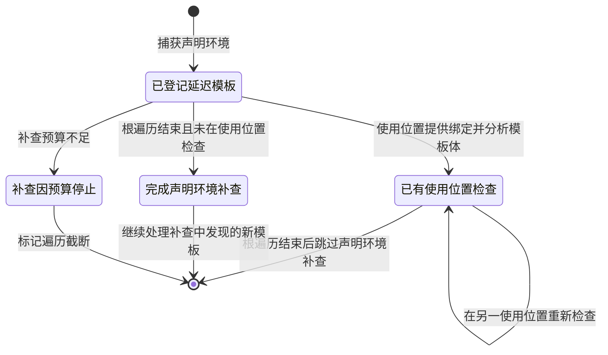

# 静态类型与数据分析设计

## 模块定位与责任边界

静态类型与数据分析负责判断当前可渲染程序中的值，是否满足组件参数和 builtin 调用的要求。它将表达式推导成 `Fact`，将契约要求编译成 `Expectation`，再给出已证明满足、已证明冲突或无法证明的结论。这个模块不执行 DSL，也不计算业务指标。

分析对象是当前定义中从入口可达的取值语句。同名语句以后定义为准。被覆盖的旧定义和入口无法到达的辅助语句，不产生当前类型错误。入口选择、语法错误和普通引用合法性由上游语义与解析模块负责。

`TypeAnalysis` 是分析出口。`DefaultOpenuiLangValidator` 从同一次 `ValidationSnapshot` 提供程序、组件目录、builtin 目录、完整 Render Data Model 和语义分析选定的入口。每次调用创建独立的 `AnalysisSession`，不会继承上一轮模型生成的推导状态。流式修复的下一轮再次校验时，会重新分析合并后的完整当前程序。

本模块不发起模型请求，不重试，不选择 Markdown 降级，也不修改提示词。外部生成器根据合并后的校验结果决定是否修复。通用检查中的 `UNPROVEN` 本身不触发修复。

## 输入、输出与副作用

| 边界 | 内容与语义 |
| --- | --- |
| 输入程序 | `Program`，使用 `currentById()` 的当前定义口径 |
| 输入契约 | 同一次校验快照中的 `ContractCatalog` 与 `BuiltinCatalog` |
| 输入数据 | 可空的 `Map<String, Object>`。`null` 表示没有 Render Data Model，不等于一个已知的空对象 |
| 输入入口 | 语义分析选定的语句 ID。不存在可用入口时，没有类型分析的可达起点 |
| 输入预算 | `AnalysisBudget`。省略时使用默认值，每次分析创建独立计数器 |
| 输出诊断 | `ValidationIssue` 列表，包含类型错误和既有数据使用政策诊断 |
| 输出覆盖 | `CoverageReport`，记录检查要求、三态结论、未证明原因和遍历完整性 |
| 对外合并 | 默认校验器合并类型诊断，并将覆盖摘要放入 `ValidationMetadata.extra` |

分析不进行文件、网络或运行时组件调用，不修改输入。可变状态只存在于本次会话中，包括符号表、诊断去重表、模板使用位置栈、预算计数和覆盖记录。类型及事实值使用不可变结构。

`ObservedValue` 可以直接持有输入快照中的值。本模块只读这些值，没有再次深拷贝整个数据模型。调用方仍需保证校验期间的数据快照稳定。`CoverageReport` 本身是可变报告对象，分析结束后由调用方读取，不是跨请求共享状态。

## 关键类及协作关系

| 类 | 职责 |
| --- | --- |
| `TypeAnalysis` | 对外接收完整分析输入，返回诊断和覆盖报告 |
| `AnalysisSession` | 构建当前符号表，遍历可达表达式，管理词法环境、检查位置和诊断身份 |
| `Type`、`Types` | 表达值的可能范围，构造和归一化联合、数组、对象等类型 |
| `Fact` | 在类型之外保留观察证据、精度损失和上游错误身份 |
| `Expectation` | 表达参数、对象字段、数组元素和复合 schema 的检查要求 |
| `Relations` | 分别证明类型包含关系和类型互斥关系 |
| `Checks` | 将事实与要求结合，形成三态结论 |
| `SchemaCompiler` | 将组件参数的 schema 子集编译成检查要求 |
| `SignatureInference` | 将 builtin 的 `TypeExpr` 转成参数要求，绑定类型变量并实例化返回类型 |
| `TypeOps` | 集中实现字段读取、对象覆盖、数组数量和证据传播 |
| `DataPath`、`DataPathResolver` | 识别字面量数据路径，观察快照中的字段、值和数组数量 |
| `DataPathResolution` | 区分解析成功、确定缺失、非法遍历和无法证明 |
| `SnapshotFacts` | 将 JSON 值转成带证据的类型事实，按预算处理深度和数组采样 |
| `BuiltinAnalysis` | 统一 builtin 分派、参数角色、binder 作用域、延迟模板和特殊返回语义 |
| `AnalysisBudget`、`Tracker` | 配置和记录本次分析的资源限制与精度损失 |
| `CoverageReport` | 按稳定检查身份去重，保留结论和完整性状态 |

下图展示主要依赖。`Tracker` 是 `AnalysisBudget` 的嵌套类，`LexicalEnvironment` 是 `AnalysisSession` 的嵌套类。

## 核心实现机制

### 类型、事实与要求各自表达什么

### Type 表达可能值，Fact 表达为什么知道

`Type` 是封闭的类型代数。`Never` 没有合法值，`Unknown` 表示当前无法缩小可能值范围。标量包含 number、string、boolean 和 null。字符串还能保留有限字面值集合。

数组使用 `Sequence(element, minLength, maxLength)`，同时表达元素上界和长度区间。空数组表示为元素是 `Never`、长度为零的序列。对象使用 `RecordType`，每个字段有 `REQUIRED` 或 `OPTIONAL` 存在性，并用 `Extra` 表达未列出的字段是否允许出现。字段可能缺失与字段存在且为 null，是两件不同的事。

`Union` 表达多个值域的联合。`Component` 按组件名称区分，属于名义类型。`Template` 只表示模板形状，模板 AST 和捕获环境保存在会话内部。

常规构造使用 `Types`。联合会展平、去重、移除 `Never` 并稳定排序。元素为 `Never` 的数组也会归一化，避免构造出声称非空却没有合法元素的类型。`Type` 的原始构造器不能全部替代这些归一化工厂。

`Fact` 在 `Type` 之外携带三类信息：

- `evidence` 保存实际观察值、字段存在计数、元素存在性、长度来源和已知长度。
- `losses` 保存未知输入、缺少上下文、未支持规则、预算不足等精度损失。
- `upstreamErrors` 保存已经报告的错误身份，阻止下游对同一问题连续报错。

两个事实即使类型相同，只要证据或损失不同，就不能互换检查结果。例如，同为 `Unknown`，一个事实带有适用于当前数据路径的真实字符串反例，另一个完全没有观察值。面对 number 要求，前者可能确定冲突，后者只能无法证明。

### Expectation 表达使用要求

`Expectation` 与 `Type` 分开，避免把“值可能是什么”和“使用位置要求什么”混为一谈。

`Accept` 要求值落在给定类型中。`RequireField` 要求字段存在，`ConditionalField` 只在字段出现时检查。`SequenceOf` 对每个数组元素提出要求，`RecordValues` 对对象映射中的每个值提出要求。`AllOf`、`AnyOf` 和 `ExactlyOne` 分别表达全部满足、至少一个满足和恰好一个满足。

空数组满足逐元素要求，因为不存在违反要求的元素。但产品需要非空组件内容时，会另行执行组件槽位政策。类型上的满足和页面是否可用，不能使用同一个判断替代。

`SchemaCompiler` 支持 type、properties、required、items、additionalProperties、字符串 enum、anyOf 和 component 扩展。同一 schema 的并列要求按 `AllOf` 组合。注解类关键词忽略，其他未支持要求保留为 `Unsupported`，不会静默编译成任意值。当前 `integer`、oneOf、数值和长度边界、pattern 等不属于完整支持范围。内核存在 `ExactlyOne`，不表示 schema 编译器已经支持 oneOf。

### 检查必须区分冲突与不知道

`Relations.proveIncluded` 证明来源类型的全部可能值都被目标接受。返回 false 只表示证明失败。`proveDisjoint` 则证明两个类型没有共同值。`Checks` 再结合实际观察证据形成结论。

| 结论 | 含义 | 通用检查的处理 |
| --- | --- | --- |
| `MATCH` | 已证明满足当前要求 | 记录覆盖 |
| `MISMATCH` | 已证明冲突，或有适用于当前检查对象的真实反例 | 记录覆盖并由调用方产生诊断 |
| `UNPROVEN` | 证据、规则或预算不足 | 只记录覆盖及原因 |

观察证据按检查路径关联，不能拿另一个路径上的坏值证明当前值有错。`AnyOf` 也必须对同一个值或可对齐的分区组合判断。分别找到违反不同候选的两个值，不能证明存在一个值违反全部候选。

如果事实已经关联上游错误，通用检查返回 `UNPROVEN(BLOCKED_BY_ERROR)`。这样，缺失路径不会继续制造一串参数类型冲突。观察反例的重新类型化使用不再递归追访同一证据的检查过程，避免反例检查自身无限递归。

### 单次分析如何推进

`AnalysisSession` 先从当前有效定义建立符号表，再从入口遍历引用。`AstReferenceWalker` 复用 builtin 的实参角色和作用域规则，避免将 Each 或 Render 的 binder 当成普通外部引用。

表达式推导由 `synth` 分派。字面量直接形成事实，数组合并元素类型并记录精确长度，对象按同名字段后值覆盖前值。引用先查词法环境，再查当前符号表。循环引用或缺少定义时返回未知事实，引用合法性错误由上游语义分析负责。可变 state 的初始值不能代表交互后的全部值，因此 state 引用保持未知。

词法环境使用不可变父子链。binder 只影响指定 body，内层同名变量遮蔽外层。三元表达式分析两侧并合并结果，不根据条件执行选支。不同分支的长度来源不一致时，合并结果会删除这类来源证据。

组件调用按契约中的参数顺序映射实参，编译参数 schema 并登记检查。组件参数数量、必填参数和普通结构合法性继续由语义与契约分析负责。所有参数仍参与表达式推导，以发现嵌套调用中的独立问题。

### 数据路径与快照观察

`DataPath` 只表达以 data 开始的字面量访问，包含点号成员、字符串键和整数下标。动态键和动态下标不进入字面量路径观察器，而由一般表达式推导处理。

`DataPathResolver` 按段只读访问快照。对象成员读取、数组下标和数组字段投影使用不同规则。例如 `data.rows.name` 对每行读取 name，结果带数组形状。观察器分别统计字段有非 null 值、缺失和显式 null 的数量，不能把 null 当成缺字段。

解析结果有四种：

| 结果 | 含义与会话行为 |
| --- | --- |
| `Resolved` | 形成类型事实，并附加字段观察、路径长度来源和可证明的精确数量 |
| `Missing` | 快照确定没有该路径，发出 `type-data-path-missing` 并阻塞依赖检查 |
| `InvalidTraversal` | 对标量取成员等非法访问，发出 `type-data-invalid-traversal` 并阻塞依赖检查 |
| `Unprovable` | 例如向空数组继续投影字段，发出既有 `type-data-unprovable` 政策诊断并返回未知事实 |

数组字段投影的类型长度通常先表示为无界区间。`resolveCardinality` 在每步都确定时另外提供精确数量。投影中部分行缺字段时，会保留缺失观察并记 `UNKNOWN_INPUT`，因为当前契约没有规定缺失行在运行时应跳过、保留空值还是失败。

直接读取 data 根值时，`SnapshotFacts` 对整个值做类型化。数组保存元素联合和精确长度，对象保存实际出现的必有字段及关闭的额外字段约束。数组采样或结构深度超限时，未访问部分进入 `Unknown` 上界并记录 `PRECISION_BUDGET`。因此，已扫描样本没有坏值不能直接证明全部数据正确。

无 Render Data Model 时，不调用路径观察器制造缺失诊断。数据依赖表达式变成 `Unknown + UNKNOWN_INPUT`，字面量、固定返回类型、调用数量和其他静态可知部分继续检查。

### builtin 签名、特殊语义与模板

### 普通调用由声明驱动

`BuiltinAnalysis` 先确认函数存在于本次生效目录。Java 中拥有某个特殊处理器，不会让契约未声明的函数自动合法。

普通调用先按 `BuiltinSpec.params` 检查数量、位置、可选参数和末尾变长参数。`SignatureInference` 将每个 `TypeExpr` 编译成 `Expectation`，从实参收集命名类型变量，再实例化 `returnType`。

同一类型变量多次出现时取联合，未知实参不能被其他已知实参掩盖。省略的可选参数按 null 参与绑定。未绑定变量保留 `UNBOUND_TYPE_VARIABLE`，返回声明中的 any 保留未知输入。普通签名推导不复制实参观察值，也不凭空声明输出数组与输入等长。

### 特殊调用明确声明怎样保留证据

| 调用 | Java 分析中的特殊含义 |
| --- | --- |
| `Sort` | 保留元素类型、长度区间、长度来源和存在证据 |
| `Filter` | 保留元素类型上界，长度下界降为零，移除保留行和长度来源证据 |
| `Each` | 用输入元素绑定 binder 后分析 body，以 body 类型替换元素，保留输入数量 |
| `First`、`Last` | 从数组选择元素，空数组可能性影响可证明程度 |
| `Flatten` | 展平一层数组并传播可证明的数量区间 |
| `MergeObject` | 按参数顺序覆盖字段，后字段替换旧字段类型与证据 |
| `ObjectKeys`、`ObjectValues`、`ObjectEntries` | 根据对象形状推导枚举结果 |
| `FormatDate` | 数组输入形成字符串数组，标量输入形成字符串，联合输入保留两种形状 |
| `Switch` | 分析全部 case 值与 default 并合并结果，省略 default 时加入 null |
| `Render` | 捕获声明环境并登记延迟模板，暂不把模板 body 当普通实参执行分析 |

特殊函数仍接受契约签名约束。定义加载时，`BuiltinAnalysis.validateDefinition` 检查固定参数角色和返回声明是否覆盖 Java 语义的结果范围，冲突时抛出 `GenerationSdkException`。扩展普通 builtin 可以只提供签名；新增 Java 特殊语义仍需实现处理器。

Each 的 binder 接受字符串字面量或裸标识符。输入可能为空时，body 中依赖“确有某一行”的判断保留 `NO_ELEMENT_EVIDENCE`。空输入仍分析 body 的独立静态错误，但不能由不存在的行制造缺字段反例。

### Render 在使用位置取得单元格上下文

`Render` 只向事实层返回 `Type.Template`。实际 AST、声明语句和捕获环境保存在 `BuiltinAnalysis` 的会话内模板表中。Table 的 cell 使用位置提供单元格事实与整行事实，模板分析器据此绑定第一个和第二个 binder。

使用位置环境与声明环境合并，再由 Render 自身 binder 覆盖同名变量。同一模板在不同列使用时分别检查。诊断和覆盖身份归属实际使用位置，模板声明位置作为追溯信息保留，避免第一列的检查吞掉第二列的错误。

下图是模板分析过程的概念状态，不是源码中的状态枚举。模板可在多个使用位置反复检查。

### 表格与图表的专用使用要求

Table 除普通参数 schema 外，还检查行是否为平坦对象数组，以及列字段是否出现在任意一行。部分行缺值可以合法使用该列，只有所有已知行形状都没有该字段时才报 `type-table-column-missing`。这与逐行读取 `row.field` 的要求不同，后者可能被一条确定缺字段的行违反。

没有行证据时，列存在性可以记为无法证明。若保留下来的对象形状已经能证明所有分支都没有该字段，Filter 没有增加字段的能力，仍可报告确定错误。空数组没有可用行形状时，不为 cell 模板虚构一个行上下文。

LineChart 和 BarChart 分开检查 labels 元素、series values 元素和两者长度关系。元素检查不依赖长度关系是否可证明。长度区间互斥可证明长度冲突，两个精确长度相同可证明等长。同为一个非精确区间不足以证明等长，但两侧事实带有相同且非空的保长度来源集合时，可以证明数量相同。

LineChart 还检查少于两个点的趋势线，同一 series 重复使用同一派生表达式也有独立诊断。这些是产品使用要求，不是通用类型包含规则。

### 预算与覆盖完整性

`AnalysisBudget` 使用确定性的计数和结构限制，不按墙钟时间改变结果。它与生成器的模型修复时间预算独立。

| 配置 | 默认值 | 主要用途 |
| --- | --- | --- |
| `maxTypeNodes` | 4096 | 限制受跟踪类型运算的节点展开 |
| `maxUnionBranches` | 64 | 限制受跟踪联合及组合的分支展开 |
| `maxObjectDepth` | 16 | 限制快照类型化的结构深度 |
| `maxArraySample` | 256 | 限制快照类型化的单数组扫描样本 |
| `maxChecks` | 2048 | 当前用于可达根分析和未消费模板补查的展开检查点 |

受预算控制的操作在展开前检查，超限时改用包含原可能值的安全摘要，例如 Unknown，并记录精度损失。不能截掉可能失败的分支后宣称通过，也不能用预算耗尽本身制造业务错误。

当前预算并非整个分析器的硬工作量上限。`DataPathResolver` 的路径观察和递归类型化没有接收共享 `Tracker`；部分联合直接经 `Types` 构造。`maxChecks` 也不是每条 `CoverageReport.Obligation` 登记时扣减的总数。深数据、宽对象或大量参数仍可能在这些入口之外消耗工作量。

覆盖统计以检查要求为单位，不按数据行数或重复调用次数计数。稳定身份由语句、使用位置、要求种类和契约位置组成，同一身份保留首次结论。报告满足 `discovered = matched + mismatched + unproven`。

`analysisComplete` 只表示分析没有被标记为遍历截断。它不表示全部要求都得到证明。完整遍历可以包含 `UNPROVEN`，已证明的检查也可能发生在一个被截断的会话中。预算生产方直接上报精度损失，不能只依赖最后某次检查是否无法证明来推断完整性。

默认校验器只向 metadata 暴露计数、完整性和原因摘要。完整的检查条目保留在内部报告结构中。因此，`ValidationResult` 为 VALID 也不等于类型使用已被完整证明，调用方需要结合 `typeChecks.unproven` 和 `typeChecks.analysisComplete` 解读。

## 异常与回退政策

缺少必需的程序或目录、非法类型结构、非法字面量路径，会由对应构造器或解析器抛出参数异常。合法 AST 无法识别成字面量路径时，会话转入普通表达式推导。特殊 builtin 定义与 Java 语义冲突属于契约加载错误，明确抛出 SDK 异常。

数据未知、缺少模板上下文、不支持 schema、泛型未绑定和受控预算超限通常形成带原因的未知事实，不中止整次校验。引用解析中的循环保护也返回未知，避免无限沿符号引用展开。

需要保留一个现状区别：通用 `Checks` 的 `UNPROVEN` 只进入覆盖报告，但数据路径不可证明、空组件槽位和图表点数等产品政策可以直接发出 ERROR。这些诊断没有全部经过同一条 `MISMATCH` 登记路径，不能用 `typeChecks.mismatched` 代替错误总数。

本模块没有异常后的网络重试或页面降级。它返回事实、诊断和覆盖信息。生成器是否进入修复，由外层校验结果和生成策略决定。

## 典型业务场景：设备明细表中的列与格式化模板

设备页面用 Table 展示返回的设备行，每列绑定一个真实字段。名称列与告警数量列共享一个 Render 模板时，两处使用会得到不同的单元格事实。名称列可能是 string，告警数量列可能是 number。

分析先推导行数组，再分别检查列字段是否出现在行形状中。若模型生成了数据完全没有的字段，该列产生确定的缺列诊断。若只是部分行缺值，Table 的列存在要求仍可满足。

随后，模板在每列的使用位置重新绑定值和整行。模板中的数值 builtin 若不接受 string，会在名称列的实际使用位置报告参数冲突。告警数量列的正确使用不会被名称列的结果覆盖。模板依赖的外层 Each 变量继续由捕获环境提供。

如果宿主没有提供数据，数据相关要求记为无法证明，模板内部独立的静态错误继续检查。如果行数组为空，分析不虚构一条设备行证明字段存在；组件槽位的非空要求仍可能按页面政策报告问题。这三种情况具有不同含义，不能统一变成“数据不匹配”。

图表使用同一批设备行派生 labels 和 values 时，Each 保留共同长度来源，可以证明两者等长。若 values 额外经过 Filter，分析删除保长度证据，长度关系可能只能记为无法证明，直到有精确数量或确定冲突。

## 设计取舍与简化建议

当前设计把值域、证据和使用要求分开，适合处理“数据没有完全给出，但仍需识别确定错误”的生成场景。Builtin 的参数角色与模板作用域集中在 `BuiltinAnalysis`，语义遍历和类型推导共享这套知识，减少两个阶段对同一调用作出不同解释的风险。

后续简化可以优先处理以下边界，不需要改变对外生成流程：

1. 统一数据类型化入口。让路径观察与 `SnapshotFacts` 使用同一份预算和类型化策略，同时保留路径特有的存在性计数。当前两处分别处理递归形状和字符串域，容易出现精度及资源限制不同步。
2. 让预算名称与实际扣减单位一致。若 `maxChecks` 表示检查要求总数，将消费点集中在要求登记入口；若只限制根和模板展开，则使用能表达该含义的配置名。类型节点预算也应覆盖实际可能大量分配的构造入口。
3. 把类型证明结果与产品使用政策明确分开。可为数据不可证明、空槽位和图表要求提供统一的政策诊断入口，并分别统计。这样可以保留现有行为，同时避免把覆盖冲突数误读为诊断总数。
4. 保持 `TypeAnalysis` 的单入口，缩小内部公开类型范围。会话、运算器和观察器属于协作实现，外部直接拼装会话会绕过同次快照的约束。`BuiltinAnalysis` 的共享定义与遍历能力可以保留明确的对外边界。
5. 针对重复推导再决定是否增加缓存。当前符号、组件参数和专用 Table 或 Chart 检查可能重复分析表达式。缓存必须包含词法环境、模板使用位置及完整事实身份，不能只用 AST 或 Type 作为键。先减少同一上下文内的重复求值，比引入跨使用位置缓存更容易保证正确。

这些是基于当前实现的改进建议。现有机制仍以完整快照、单次会话和明确的未证明信息作为正确性边界。
