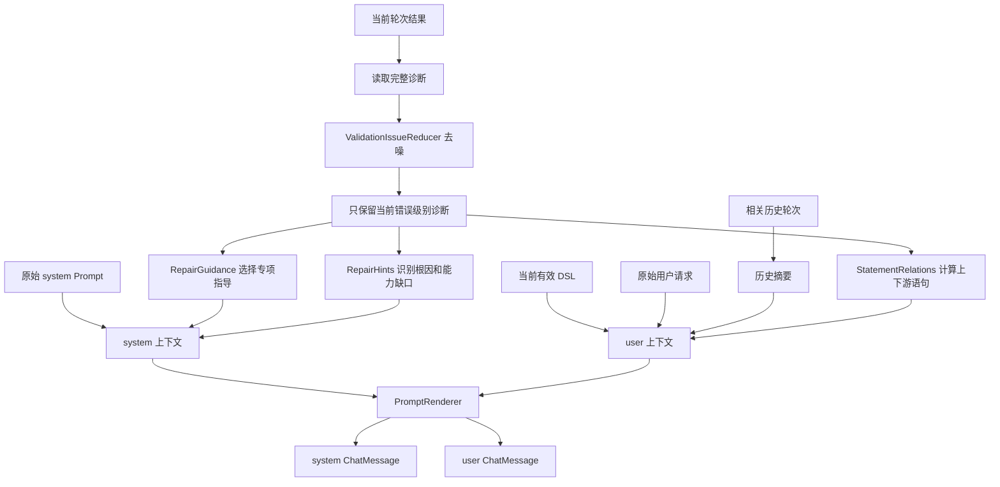
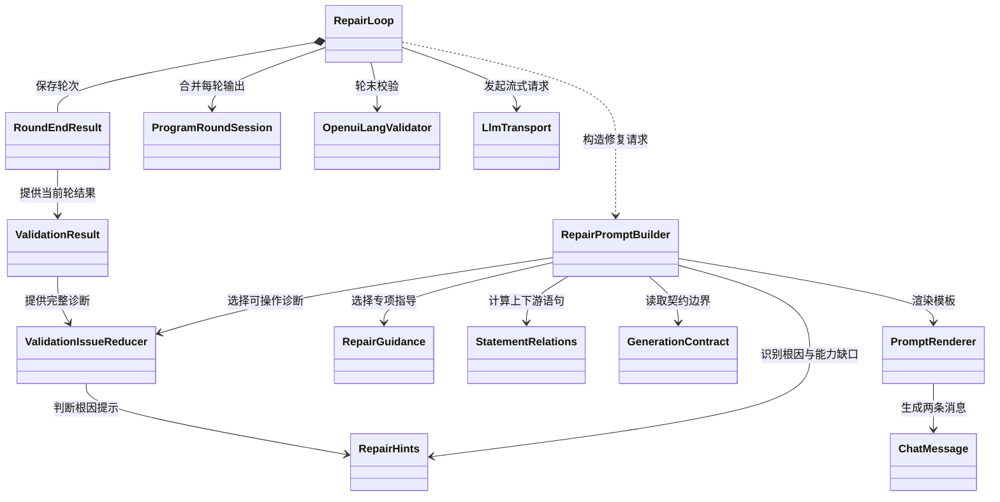
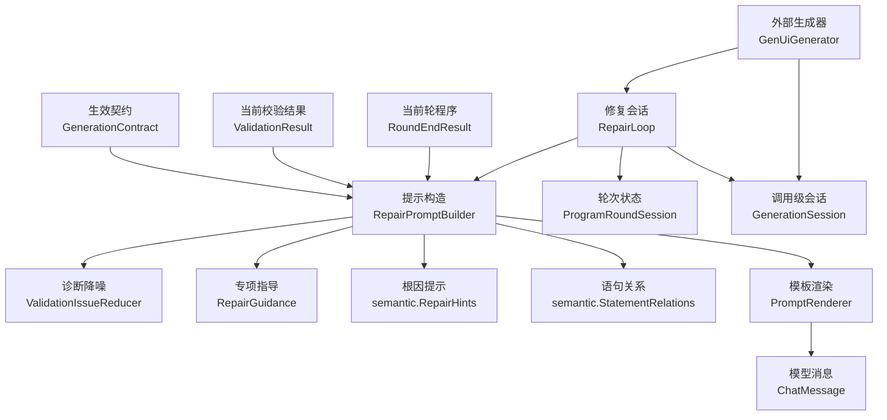
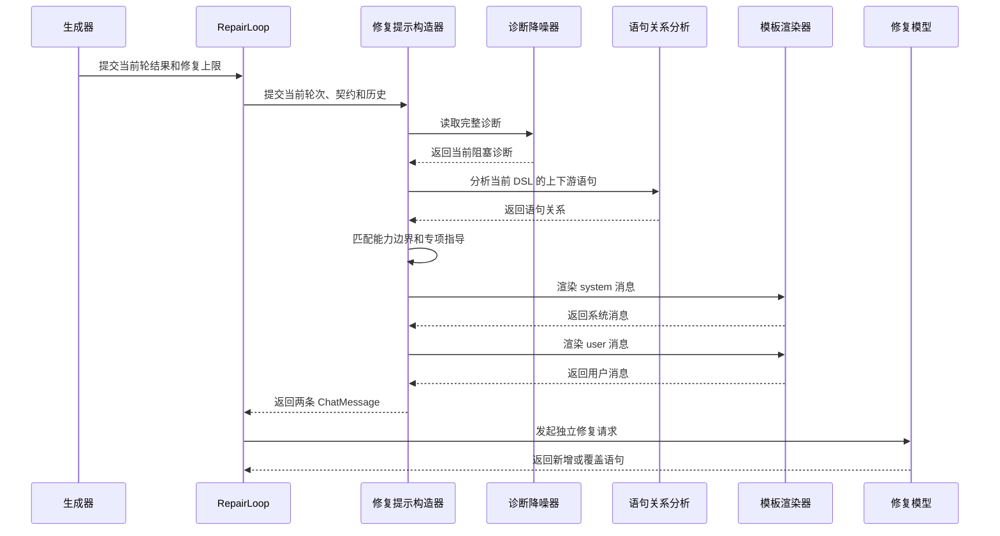
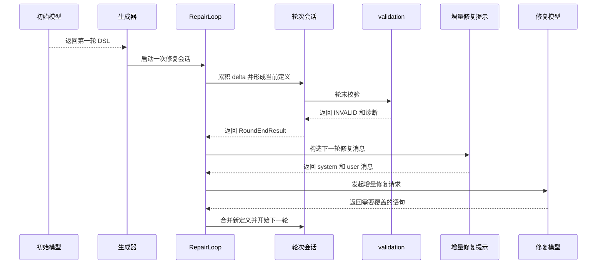

# 增量修复提示设计说明书

## 1. 模块定位

增量修复提示模块负责把一轮校验结果转换成下一轮模型可执行的修复消息，并在流式生成中管理首轮与修复轮的程序合并、轮末校验和结果快照。

它负责：

- 维护一次调用专属的 `RepairLoop`，串联首轮生成和后续修复轮。
- 把每轮模型增量输出交给 `ProgramRoundSession`，在轮末提交校验。
- 从完整诊断中选出当前真正需要处理的问题。
- 抑制重复诊断和由根因引起的级联噪声。
- 根据当前契约识别能力边界和可行替代方案。
- 根据当前有效 AST 找出诊断语句的上下游关系。
- 从历史轮次提取有限的变化信息。
- 生成 system 和 user 两条 `ChatMessage`。
- 在请求中断时保留已完成轮和当前未校验轮的快照。

其中，`RepairPromptBuilder` 只负责提示构造；`RepairLoop` 负责轮次编排。这个模块不负责：

- 直接修改业务模型或生成请求之外的宿主状态。
- 决定整页 Markdown 降级后的具体内容。

模型传输由 `LlmTransport` 提供，调用级截止时间、取消和 Markdown 降级由外部生成入口与 `GenerationSession` 负责。

## 2. 方案总体设计

### 2.1 总体方案

模块采用“轮次编排、诊断整理、上下文投影、模板渲染”四段式设计：

1. `RepairLoop` 维护当前程序、轮次记录和修复次数；每轮结束后决定是否继续请求。
2. `ValidationIssueReducer` 从完整诊断生成低噪声视图。
3. `RepairHints`、`RepairGuidance` 和 `StatementRelations` 将诊断转换为根因提示、专项指导和相关语句。
4. `RepairPromptBuilder` 汇总当前 DSL、诊断、契约边界和有限历史，交给 `PromptRenderer` 生成两条消息。

当前有效 DSL 和最新诊断是权威状态。历史只用于说明变化过程，不能覆盖当前状态。

### 2.2 设计考量

- 修复模型需要看到足够上下文，但不能被完整历史淹没。
- 诊断需要保留真正可执行的根因，过滤无法直接行动的级联错误。
- 语句关联必须理解 AST 和 binder 作用域，不能只做字符串搜索。
- 契约能力缺口需要成为明确约束，防止模型继续实现不支持的操作。
- 提示构造应保持纯函数，使提示内容可以独立测试和复现。

### 2.3 设计取舍

| 设计问题 | 当前选择 | 备选方案 | 选择原因 | 影响 |
| --- | --- | --- | --- | --- |
| 诊断来源 | 当前轮可操作诊断 | 直接使用全部诊断 | 降低噪声，避免模型修复症状 | 完整诊断仍保留在 `ValidationResult` |
| 历史范围 | 只保留与当前错误码相关的最近三轮 | 携带全部轮次 | 控制提示长度，突出当前问题 | 历史不能代表当前状态 |
| 语句关联 | 基于当前 AST 和词法作用域 | 基于文本变量名 | 能正确处理 `@Each`、`@Render` binder | 需要重新解析当前 DSL |
| 能力越界 | 在 system 消息中提高优先级 | 只在诊断中提醒 | 防止模型继续近似实现不支持的能力 | 原始请求被标记为辅助上下文 |
| 修复输出 | 只允许新增或覆盖完整语句 | 允许模型返回整页 | 保留已正确程序，减少修改范围 | 不支持直接删除定义 |
| 轮次边界 | 每轮独立关闭模型请求，轮末统一校验 | 在同一请求中混合多轮输出 | 保证当前 DSL 和诊断对应同一轮 | 需要跨轮输出分隔和当前定义合并 |
| 修复上限 | `maxAttempts` 与调用级截止时间共同限制 | 只依赖其中一个条件 | 固定上限适合测试，截止时间保护真实调用 | 首次修复允许启动，后续修复受截止时间约束 |

## 3. Prompt 设计

### 3.1 Prompt 的目标

增量修复 Prompt 不是重新生成页面的 Prompt。它要求模型根据当前有效程序和最新诊断，只输出需要新增或覆盖的完整语句。

Prompt 同时解决三个问题：

1. 告诉模型当前程序到底是什么。
2. 告诉模型当前轮次真正阻塞的原因是什么。
3. 限制模型只能使用当前契约和增量修复规则修改程序。

### 3.2 system 消息的组成

system 消息按以下顺序编排：

| 顺序 | 内容 | 作用 | 是否必选 |
| --- | --- | --- | --- |
| 1 | 原始 system Prompt | 保留语言、组件、数据和业务约束 | 是，可为空 |
| 2 | 增量修复标记 | 标识当前进入修复模式 | 是 |
| 3 | 固定增量规则 | 规定只能新增或覆盖完整语句，禁止整页重写和删除 | 是 |
| 4 | 能力边界 | 说明当前请求中哪些操作不支持，以及应该使用什么 fallback | 命中能力缺口时出现 |
| 5 | 诊断专项指导 | 根据当前错误类型选择语法、引用、签名、数据或根节点指导 | 有可操作诊断时出现 |

固定增量规则是 system 消息的核心约束，主要包括：

- 只返回需要修改或新增的完整 OpenUI Lang 语句。
- 保持现有语句 id。
- 使用后定义覆盖前定义。
- 不输出删除语句。
- 保持一个可达的 `root`。
- 只使用原始契约中的组件、builtin、工具和示例。
- 不伪造数据、字段和统计结果。
- 以调用方数据模型为主要内容，以原始请求为辅助上下文。

如果命中 `CapabilityGapSpec`，能力边界位于固定增量规则之后、专项指导之前。它会覆盖原始请求中要求实现但当前契约不支持的动态操作。

### 3.3 user 消息的组成

user 消息按照“目标、当前状态、问题定位、变化历史”的顺序编排：

| 顺序 | 内容 | 作用 | 是否必选 |
| --- | --- | --- | --- |
| 1 | 原始用户请求 | 说明页面目标和业务语境 | 是，可为空 |
| 2 | 当前有效 DSL | 提供完整程序；未重新输出的定义继续生效 | 有当前程序时出现 |
| 3 | 当前轮原始输出 | 帮助重写语法损坏的原始片段 | 只有语法错误时出现 |
| 4 | 最新轮末诊断 | 提供当前真正需要处理的问题 | 有诊断时出现 |
| 5 | 相关语句 | 提供诊断语句的上下游定义 | 能解析出关系时出现 |
| 6 | 历史轮次摘要 | 说明程序变化和重复失败趋势 | 存在相关历史时出现 |

原始请求在命中能力边界时标记为“仅作上下文”。这样模型仍能理解用户目标，但不会把不可支持的原始要求当成高于契约边界的指令。

当前有效 DSL 是 user 消息的核心状态。它使用 `ProgramRoundSession` 的后定义覆盖结果，而不是直接拼接所有历史输出。

本轮原始输出只在语法错误时出现。语义或类型错误不需要模型重新阅读原始文本，只需要当前 DSL 和结构化诊断。

### 3.4 上下文优先级

Prompt 内部使用以下优先级：

| 优先级 | 上下文 | 解释 |
| --- | --- | --- |
| 最高 | 当前有效 DSL和最新诊断 | 描述当前必须修复的实际状态 |
| 高 | 当前生效契约和能力边界 | 限制允许使用的组件、builtin 和替代方案 |
| 中 | 原始 system Prompt | 保留初次生成的通用规则 |
| 辅助 | 原始用户请求 | 提供业务目标，但不能越过契约边界 |
| 最低 | 历史轮次 | 只说明变化趋势，不能覆盖当前状态 |

历史轮次只保留与当前错误码相关的记录，最多三轮。每轮原始输出最多保留 2048 个字符，并优先在完整语句边界截断。找不到安全边界时，省略该片段。

### 3.5 上下文编排流程



`RepairPromptBuilder` 只负责把这些结构化片段放入模板。固定规则和文案位于模板中，诊断代码、位置、组件、路径和提示作为数据注入。

### 3.6 Prompt 输出协议

模块始终输出两条消息：

```text
system：
  原始系统约束
  + 增量修复规则
  + 可选能力边界
  + 当前诊断对应的专项指导

user：
  原始请求
  + 当前有效 DSL
  + 可选的本轮原始输出
  + 最新诊断
  + 相关语句
  + 有限历史摘要
```

模型的响应协议与 Prompt 的上下文编排相对应：

```text
只返回需要新增或覆盖的完整语句。
不返回整页 DSL、JSON、Markdown 围栏或解释性散文。
```

### 3.7 Prompt 示例

```text
system：
  [REPAIR:INCREMENTAL]
  只返回需要覆盖或新增的完整语句。
  保持已有语句 id，禁止删除语句。
  builtin 必须使用前导 @。

user：
  原始请求：展示设备数量。

  当前有效 DSL：
    root = TextContent(Number(data.count))

  最新诊断：
    code = unresolved-ref
    statementId = root
    hint = builtin 必须使用前导 @
```

模型应返回：

```openui
root = TextContent(@Number(data.count))
```

Prompt 不要求模型重新输出未出错的定义，也不把旧轮次的完整输出作为当前程序。

### 3.8 真实装配示例

下面的例子对应当前 `RepairPromptBuilder` 的实际装配方式：原始 system Prompt 只出现一次，当前有效 DSL、最新诊断和语句位置进入 user 消息，专项指导根据当前诊断动态加入 system 消息。

#### 示例一：未解析的语句引用

```text
输入：
  原始 system Prompt：
    ORIGINAL SYSTEM PROMPT: use openui-lang only.

  原始用户请求：
    show the header

  当前有效 DSL：
    root = Stack([header])
    header = Header(title)

  当前轮原始输出：
    header = Header(title)

  最新诊断：
    code = unresolved-ref
    source = reference
    statementId = header
    message = unresolved reference "title"
    hint = define a statement named "title" earlier in the document
```

模块生成的 system 消息关键片段是：

```text
ORIGINAL SYSTEM PROMPT: use openui-lang only.

[REPAIR:INCREMENTAL]

## Incremental repair rules (fixed)
1. Return ONLY complete openui-lang statements to change or add.
2. Keep existing statement ids exactly.
3. Return raw openui-lang statements only.
4. Never emit a deletion.
5. Keep exactly one reachable `root`.

## Diagnostic-selected guidance
- Classify the unresolved name from its syntax:
  `@name(...)` is a builtin call,
  `Name(...)` is a component call,
  and a bare identifier is a statement reference.
- If it is a statement, define it with that exact id.
```

对应的 user 消息关键片段是：

```text
## Original request
show the header

## Current effective DSL
root = Stack([header])
header = Header(title)

## Latest round-end diagnostics (authoritative for this round)
### unresolved-ref
unresolved reference "title"
- Location: (stmt=header, line 4:9)
- Hint: define a statement named "title" earlier in the document
```

模型应该补充或覆盖 `title` 定义，例如：

```openui
title = TextContent("设备标题")
```

模型不需要重新输出 `root` 和 `header`，因为这两个定义已经存在且没有被要求修改。

#### 示例二：命中契约能力边界

```text
输入：
  原始用户请求：
    按设备型号分组展示设备数量

  当前有效 DSL：
    grouped = GroupBy(data.devices, "model")
    root = Table([Col("型号", "model"), Col("数量", "count")], grouped)

  当前诊断：
    code = unknown-component
    source = contract
    component = GroupBy
    hint = "GroupBy" (分组展示) exceeds the openui-lang capability boundary
```

当前契约把 `GroupBy` 归入“分组展示”能力缺口，并提供 fallback：

```text
用一张 Table 展示全部行；
用 @Sort 按分组字段排序，并把该字段放在第一列。
```

因此 system 消息会在专项指导之前加入：

```text
## Capability boundary (overrides the original request)
1. The original request asks for "分组展示", which is NOT supported
   as a dynamic operation in openui-lang.
2. Instead: 用一张 Table 展示全部行；
   用 @Sort 按分组字段排序，并把该字段放在第一列。
3. Redefine every diagnosed statement id with a valid expression.
4. Make the capability notice the first child of `root`.

## Diagnostic-selected guidance
- Follow the capability boundary above.
- Stop trying to implement or approximate the unsupported operation.
- Redefine `grouped` and `root`.
```

user 消息仍然保留原始请求，但会把它标为辅助上下文：

```text
## Original request (for context only)
按设备型号分组展示设备数量

## Current effective DSL
grouped = GroupBy(data.devices, "model")
root = Table([Col("型号", "model"), Col("数量", "count")], grouped)

## Latest round-end diagnostics (authoritative for this round)
### unknown-component
"GroupBy" does not exist in the current contract
- Component: GroupBy
- Hint: exceeds the openui-lang capability boundary
```

这个例子说明 Prompt 的上下文不是简单拼接。原始请求负责说明用户想要什么，当前契约决定什么可以实现，当前 DSL 和最新诊断决定本轮具体修改什么。

### 3.9 RepairLoop 与提示构造的边界

`RepairLoop` 只在轮末结果为 `INVALID` 时构造下一轮请求。它先读取当前轮结果，再把早于当前轮且与当前错误码重复的轮次交给 `RepairPromptBuilder`。提示构造完成后，`RepairLoop` 以固定的 `temperature=0`、关闭 thinking 的修复配置发起下一次流式请求。

每轮模型请求结束后，`ProgramRoundSession` 先合并增量文本，再由 `OpenuiLangValidator` 重新校验。校验成功时，`RepairLoop` 将结果标记为 `repaired=true`；请求中断时，当前轮保留原始输出和当前定义，但 `validationResult` 为空，避免把未完成输出误当成已校验结果。

## 4. 对外接口

### 4.1 接口清单

| 接口或入口 | 调用方 | 输入 | 输出 | 状态变化或副作用 | 异常和错误结果 |
| --- | --- | --- | --- | --- | --- |
| `RepairLoop.Context` | 生成入口 | 原始 system prompt、用户请求、契约、数据模型、修复次数上限 | 一次修复会话的不可变上下文 | 复制数据模型；修复次数不能为负数 | 契约或数据模型为空、修复次数为负数时拒绝构造 |
| `RepairLoop.run(...)` | `GenUiGenerator` | 已装配的首轮请求体 | `GenUiGenerationResult`，包含最终 DSL、校验结果、结束原因和轮次记录 | 流式消费首轮与修复轮；每轮轮末校验 | 同一实例重复执行；模型请求或读取失败 |
| `RepairLoop.snapshot(...)` | `GenerationSession` | 宿主终止原因 | 已完成轮加当前未校验轮的结果快照 | 不发模型请求、不执行轮末校验 | 无 |
| `RepairPromptBuilder.build(...)` | `RepairLoop` | 原始提示、用户请求、契约、当前轮次、历史轮次 | 两条 `ChatMessage` | 纯函数，不修改程序 | 当前轮次为空时拒绝构造 |
| `ValidationResult.actionableIssues()` | 修复提示构造器、调用方 | 完整 `ValidationIssue` 列表 | 去噪后的诊断列表 | 不改变校验状态 | 空输入返回空列表 |
| `ValidationIssueReducer.actionable(...)` | `ValidationResult` | 原始诊断列表 | 稳定顺序的低噪声诊断 | 不修改原列表 | null 或空列表返回空列表 |
| `StatementRelations.related(...)` | `RepairPromptBuilder` | 当前 DSL、当前诊断、builtin 目录 | 诊断语句到相关语句的映射 | 只解析当前 DSL | 空 DSL 或无有效程序返回空映射 |
| `RepairHints.unresolvedRefHint(...)` | 语义分析、修复提示 | 未解析名称 | 根因提示文本 | 无副作用 | 未知名称返回通用定义提示 |

### 4.2 典型输入输出

#### 例一：缺少 builtin 前导 `@`

```text
输入：
  当前 DSL：
    root = TextContent(Number(data.count))

  当前诊断：
    code = unresolved-ref
    statementId = root
    hint = builtin 必须使用前导 @

处理：
  - 保留这条根因诊断。
  - 打开 needsMissingAtGuidance。
  - 不携带无关历史。

输出：
  system 消息要求模型把 Number(...) 改为 @Number(...)。
  user 消息携带当前有效 DSL和诊断。
```

#### 例二：命中能力缺口

```text
输入：
  当前 DSL：
    grouped = @UnsupportedGroup(data.rows)
    root = Table([Col("名称", "name")], grouped)

  当前契约：
    capabilityGaps 中声明 UnsupportedGroup 不支持动态实现，
    并提供直接展示已有数据的 fallback。

输出：
  system 消息加入能力边界。
  user 消息携带 grouped 的诊断和相关语句。
  修复规则要求重定义 grouped，并让 capabilityNotice 成为 root 的第一个子项。
```

## 5. 关键数据结构

### 5.1 关键数据结构总表

| 数据结构 | 作用 | 生命周期 | 主要使用方 |
| --- | --- | --- | --- |
| `RepairLoop` | 维护当前程序、轮次记录、修复次数和请求中状态 | 一次流式生成调用 | 生成入口、程序会话、模型传输 |
| `RepairLoop.Context` | 保存原始提示、用户需求、契约、数据模型和修复上限 | 一次修复会话 | `RepairLoop` |
| `ValidationIssue` | 表示一条结构化校验诊断 | 单次校验或轮次 | 降噪、提示、调用方 |
| `ValidationResult` | 保存完整诊断和校验状态 | 单次校验或轮次 | 生成器、修复提示 |
| `RoundEndResult` | 保存当前轮 DSL、原始输出、校验结果、耗时、契约版本和结束原因 | 单轮生成 | 轮次会话、提示构造、结果快照 |
| `GenerationContract` | 提供组件、builtin 和能力边界 | 一次生成会话 | 提示构造、语句关联 |
| `CapabilityGapSpec` | 描述不支持的能力及 fallback | 一次生成会话 | 能力边界提示 |
| 语句关系映射 | 描述诊断语句的上下游关系 | 单次提示构造 | `RepairPromptBuilder` |
| 提示模型 | 保存模板渲染所需的结构化字段 | 单次提示构造 | `PromptRenderer` |
| `ChatMessage` | 表示最终 system 或 user 消息 | 单次修复请求 | 生成器、模型调用层 |

### 5.2 `ValidationIssue`

| 字段 | 作用 | 修复提示中的用途 |
| --- | --- | --- |
| `code` | 稳定的问题类型 | 选择专项指导和匹配历史 |
| `source` | 诊断来源，例如 syntax、reference 或 type | 判断指导类别 |
| `severity` | 严重程度 | 只将 `ERROR` 纳入阻塞修复 |
| `statementId` | 归属语句 | 定位当前定义和上下游 |
| `component` | 相关组件或 builtin | 匹配契约和能力缺口 |
| `path` | 参数或数据路径 | 帮助模型定位表达式 |
| `message` | 面向人的问题说明 | 渲染到 user 消息 |
| `hint` | 可执行的根因提示 | 保留根因并指导修复 |

### 5.3 `RoundEndResult`

| 字段 | 作用 |
| --- | --- |
| `currentDefinitions` | 当前轮合并后的有效 DSL |
| `rawOutput` | 本轮模型返回的原始文本 |
| `validationResult` | 当前轮校验状态和诊断 |
| `elapsedMs` | 本轮从开始到结束的耗时 |
| `contractVersion` | 本轮使用的契约版本 |
| `endReason` | 本轮完成、失败或中断原因 |

修复提示优先使用 `currentDefinitions`。只有当前诊断包含语法错误时，才把 `rawOutput` 放入 user 消息。

### 5.4 `RepairLoop` 的会话状态

| 关键字段或状态 | 作用 |
| --- | --- |
| `context` | 固定本次生成的原始提示、契约、数据模型和修复上限 |
| `program` | 持有跨轮的 `ProgramRoundSession`，累计当前有效定义 |
| `rounds` | 保存已完成的轮末结果；中断轮只在快照中临时追加 |
| `repairConfig` | 从初始模型配置派生，固定 `temperature=0` 且关闭 thinking |
| `inFlight` | 区分正在接收模型输出的轮和已完成校验的轮 |
| `budgetExpired` | 由外部 `GenerationSession` 提供，用于限制后续修复启动 |

首轮请求不计入 `maxAttempts`。首轮失败后至少允许启动一次修复；之后同时受 `maxAttempts` 和调用级截止时间限制。修复成功后，最终校验结果会附加 `repaired=true`。

### 5.5 提示模型

提示模型由 `RepairPromptBuilder` 临时创建，主要字段包括：

| 字段 | 作用 |
| --- | --- |
| `originalSystem` | 初始系统提示 |
| `originalRequest` | 初始用户请求 |
| `currentProgram` | 当前有效 DSL |
| `diagnostics` | 当前可操作诊断 |
| `relatedStatements` | 诊断语句的上下游关系 |
| `capabilityBoundary` | 命中的能力缺口和 fallback |
| `history` | 有限的历史轮次摘要 |
| `needs...Guidance` | 当前诊断选择的专项指导开关 |

提示模型不是跨轮状态。消息生成完成后，它不再被保存或复用。

## 6. 4+1 架构视图

### 6.1 逻辑视图



### 6.2 开发视图



### 6.3 过程视图



### 6.4 场景视图



## 7. DFX 设计

| 维度 | 当前设计 | 需要关注的点 |
| --- | --- | --- |
| 可靠性 | 当前 DSL 和最新诊断优先，历史只作辅助；每轮请求关闭后才进入轮末校验；中断轮不产生校验结论 | 历史错误码相同不代表根因相同，快照不能把未完成轮标记为有效 |
| 性能 | 历史最多三轮，单轮原始输出限制在完整语句边界内 | `StatementRelations` 需要重新解析当前 DSL，复杂程序会增加提示构造成本 |
| 可诊断性 | 保留 code、source、位置、hint 和相关语句；轮次记录保存结束原因和契约版本 | `ValidationIssueReducer` 不能影响完整诊断，否则调用方难以回溯 |
| 失败处理 | 模型读取失败返回当前快照，由外部生成入口统一发送错误帧并决定是否降级 | 轮末校验只对已完整关闭的请求执行 |
| 可扩展性 | `RepairGuidance` 用指导开关，模板负责文案 | 新增诊断类型时需要同时补路由和模板指导 |
| 可测试性 | Prompt 构造保持纯函数，`RepairLoop` 可通过自定义 `LlmTransport` 测试轮次和快照 | 应分别测试诊断降噪、能力边界、历史裁剪、语句关系、修复次数上限和中断快照 |
