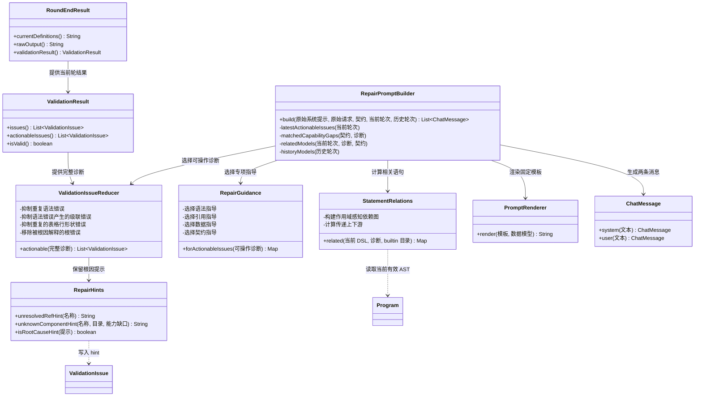
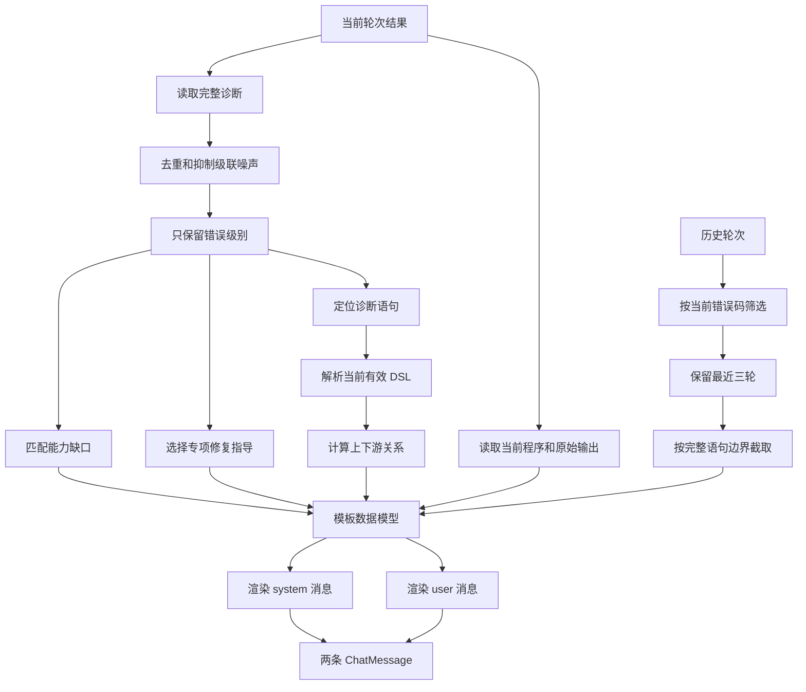
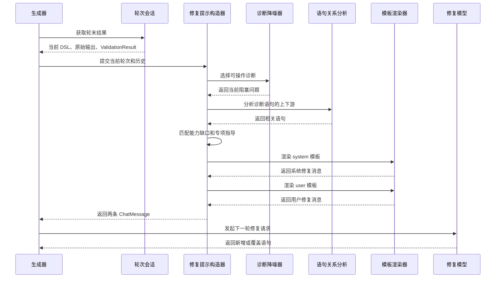
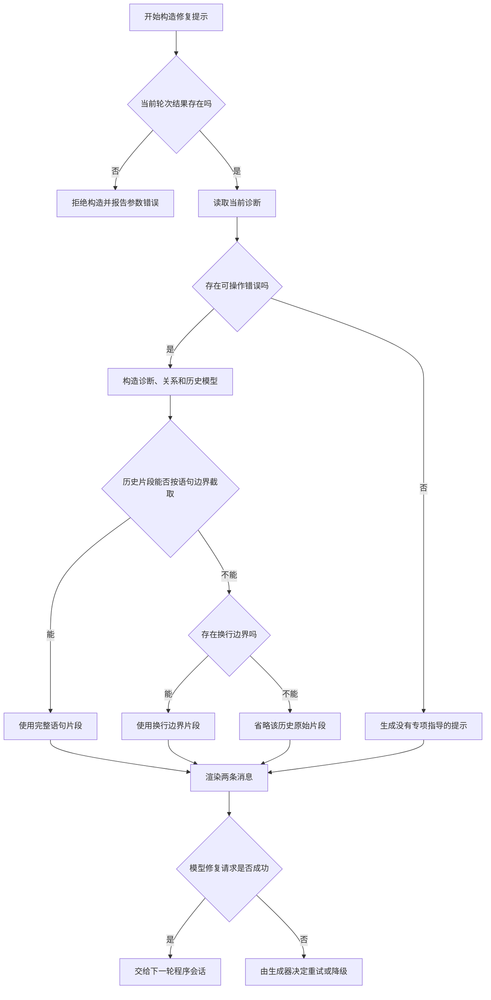

# 增量修复提示模块设计

## 模块定位

增量修复提示模块把一轮校验结果转换成下一轮模型可以执行的修复指令。它处理诊断筛选、根因提示、能力边界、语句关联和历史摘要，最终生成一条系统消息和一条用户消息。

模块的职责边界是：

- 读取当前轮校验结果，提取真正需要修复的问题。
- 根据当前契约补充能力边界和可行替代方案。
- 根据当前有效 AST 找出错误语句的上下游关系。
- 选择与当前问题相关的历史轮次。
- 将结构化数据渲染为固定格式的修复提示。

模块不负责：

- 再次校验 DSL。
- 修改 `Program` 或 `ProgramRoundSession`。
- 发起模型请求。
- 决定是否开始下一轮。
- 决定修复失败后的 Markdown 降级。

这些动作由外部生成器和流式程序状态模块协作完成。

## 输入、输出和副作用

### 输入

模块接收以下信息：

| 输入 | 作用 |
| --- | --- |
| 原始系统提示 | 保留初次生成时的语言、组件、数据和业务约束 |
| 原始用户请求 | 让修复模型理解原始目标 |
| 当前生效契约 | 提供组件、builtin、能力缺口和替代方案 |
| 当前轮次结果 | 提供当前有效 DSL、原始输出和最新校验结果 |
| 历史轮次结果 | 提供重复失败的变化轨迹和有限上下文 |

当前轮次结果是唯一的修复事实来源。历史只用于说明程序如何变化，不能覆盖当前 DSL 和当前诊断。

### 输出

`RepairPromptBuilder.build(...)` 返回两个 `ChatMessage`：

1. `system` 消息：原始系统提示、增量修复规则、能力边界和诊断类型专项指导。
2. `user` 消息：原始请求、当前有效 DSL、必要的原始输出、最新诊断、相关语句和历史摘要。

构建过程是纯数据转换，没有网络请求和可见副作用。

## 关键类设计

### `RepairPromptBuilder`

`RepairPromptBuilder` 是模块的编排器。它不决定诊断含义，也不直接拼接修复文案。它先把当前轮数据转换成模板模型，再交给 `PromptRenderer` 渲染固定模板。

它的处理顺序是：

1. 从当前 `ValidationResult` 中取得完整诊断。
2. 用 `ValidationIssueReducer` 去掉重复和级联噪声。
3. 只保留 `ERROR` 级别的可操作诊断。
4. 根据未知组件和当前契约匹配能力缺口。
5. 根据当前 AST 计算相关语句。
6. 过滤与当前错误码重复的历史轮次。
7. 选择 `RepairGuidance` 的专项指导开关。
8. 渲染 system 和 user 两个模板。

### `ValidationIssueReducer`

`ValidationIssueReducer` 生成低噪声诊断视图，但不改变完整诊断和校验状态。

它执行四类抑制：

- 同一语句保留第一个阻塞语法错误。
- 语法失败导致的派生语义和类型错误不重复发送。
- 已经有具体行形状问题时，抑制同位置的通用属性不匹配。
- 已经存在解释性错误时，移除 `root-missing` 和 `root-not-renderable` 这类尾部错误。

带有根因提示的 `unresolved-ref` 或 `unknown-component` 不会被普通级联规则吞掉。这样可以保留“缺少 `@`”“使用了 JavaScript 全局对象”或“越过能力边界”等模型可以直接执行的修复方向。

### `RepairGuidance`

`RepairGuidance` 只根据当前可操作诊断选择模板开关。它不读取历史错误标签，因为跨轮覆盖后，旧诊断可能已经不再适用于当前程序。

指导类别包括：

- 语法重写。
- builtin 或 action 缺少前导 `@`。
- 能力边界越界。
- 未知组件。
- 未解析引用。
- 调用签名不匹配。
- 根不可渲染。
- 数据引用和数据完整性。
- 表格行形状。
- 表格列缺失。
- 类型要求。
- 通用回退指导。

### `RepairHints`

`RepairHints` 是语义诊断和修复提示共同使用的知识层。它把未知名称路由为三类提示：

1. 名称是 builtin 或 action step。提示模型补上前导 `@`。
2. 名称是 JavaScript 全局对象或关键字。提示该写法不属于 OpenUI Lang，并改用当前契约中的 builtin。
3. 名称属于能力缺口或普通未知组件。前者给出契约声明的替代方案，后者要求使用当前契约已有组件。

提示内容同时承担根因标记的作用。`ValidationIssueReducer` 使用这个标记决定是否保留该诊断。

### `StatementRelations`

`StatementRelations` 从当前有效 DSL 重新解析 AST，建立语句依赖图。图的边来自语句引用，不依赖文本变量名匹配。

`@Each` 和 `@Render` 的模板参数会带来词法作用域。同名 binder 在作用域内引用模板变量，不应被误判成对另一个顶层语句的依赖。因此依赖节点包含语句 id 和当前绑定集合。

模块计算两类传递关系：

- 上游：错误语句依赖的定义。
- 下游：依赖错误语句的定义。

这些关系只用于提示模型定位修复范围，不构成修改授权列表。模型仍必须遵守增量提示中的语句和契约规则。

## 核心实现机制

### 诊断到提示模型的转换

### 能力边界

当当前诊断是未知组件，并且名称命中契约中的 `CapabilityGapSpec`，提示构造器会把能力缺口提升到 system 消息的前部。

能力边界包含：

- 原始请求中的哪项操作不受支持。
- 如果数据已经预聚合，可以直接展示已有结果。
- 如果数据没有预聚合结果，不得在 DSL 中模拟该操作。
- 使用契约声明的 fallback。
- 重定义所有被诊断的语句。
- 让能力说明成为 `root` 的第一个子项。

这样处理可以避免模型继续尝试实现校验器明确不支持的动态操作。

### 当前程序和原始输出

user 消息总是携带当前有效 DSL。当前程序遵循语句 id 的后定义覆盖规则，未重新输出的定义继续生效。

本轮原始模型输出只在当前诊断包含语法错误时加入提示。语法错误需要模型看到原始片段，才能重写整条语句；纯语义或类型错误只需要当前有效 DSL 和结构化诊断。

### 历史轮次

历史记录遵循三个限制：

- 只保留与当前错误码重复的轮次。
- 最多保留最近三轮。
- 每轮原始输出最多保留 2048 个字符，并尽量在完整语句边界截断。

如果找不到完整语句边界，模块退回到换行边界；如果仍无法安全截取，则不放入原始片段。历史永远是辅助上下文，当前有效 DSL 和最新诊断优先级更高。

### 增量修复规则

system 模板固定要求模型：

- 只返回需要新增或覆盖的完整语句。
- 保持现有语句 id。
- 使用后定义覆盖规则。
- 不输出删除语句。
- 保持一个可达的 `root`。
- 只使用当前契约中的组件、builtin、工具和示例。
- 不伪造数据和统计结果。
- 以当前数据模型为主要内容，以原始请求为辅助上下文。

这些规则由模板统一维护，`RepairPromptBuilder` 只提供结构化数据。

## 运行时过程

提示模块只参与到“轮次结果 → 修复消息”这一段。模型请求、delta 合并和下一轮是否继续由生成器和流式程序状态模块负责。

## 异常和回退路径

当前轮次为空时，`RepairPromptBuilder` 不会生成一个“万能修复提示”。历史片段解析失败也不会阻塞当前提示构造，模块会退回到更短的安全片段或省略该片段。

模型请求失败、修复次数上限和会话时间预算不属于本模块的异常策略。它们由外部生成器处理。

## 典型业务场景

### 场景一：模型忘记 builtin 的前导 `@`

1. 语义分析把裸调用识别为未解析引用。
2. `RepairHints` 发现该名称属于 builtin。
3. 诊断中写入“需要前导 `@`”的根因提示。
4. `ValidationIssueReducer` 保留这条可操作提示。
5. `RepairGuidance` 打开 `needsMissingAtGuidance`。
6. 模板要求模型只重定义出错语句，并写成 `@Name(...)`。

这个场景中，提示模块不会要求模型重写整页，也不会把外部引用作为修复方向。

### 场景二：请求超出契约能力边界

1. 当前语句调用未知名称。
2. 该名称命中契约中的能力缺口别名。
3. `RepairPromptBuilder` 将能力边界放到 system 消息前部。
4. 模型被要求使用契约提供的 fallback。
5. 模型重定义所有相关语句，并让能力说明成为 `root` 的第一个子项。

该场景的关键是让“不可实现”成为明确约束，而不是让模型继续尝试近似实现。

### 场景三：错误来自下游语句，但根因在上游

1. 当前诊断归属于下游 `Table` 语句。
2. `StatementRelations` 从当前 AST 找到上游数据准备语句。
3. 提示消息同时携带诊断语句和相关语句 id。
4. 模型可以覆盖上游定义，或覆盖下游定义修正使用方式。
5. 未被重新输出的其他定义保持不变。

这让增量修复具备局部修改能力，同时保留整个程序的稳定部分。

## 设计分析

### 职责清晰的部分

- `ValidationIssueReducer` 只做诊断视图降噪。
- `RepairHints` 只负责根因提示路由。
- `StatementRelations` 只负责 AST 依赖关系。
- `RepairGuidance` 只负责诊断到模板开关的映射。
- `RepairPromptBuilder` 负责组装数据和渲染消息。

每个协作类都有单一的中间结果，便于单独验证。

### 有明确价值的抽象

`ValidationResult.issues()` 和 `actionableIssues()` 分开，保留了完整诊断与修复诊断两种使用场景。修复提示不会破坏调用方对完整诊断的需求。

`StatementRelations` 使用 AST 和词法作用域，而不是字符串搜索。这个抽象可以正确处理模板 binder 和同名变量遮蔽。

`RepairGuidance` 使用布尔开关驱动模板，使新增一种错误指导时不必改动提示组装流程。

### 需要关注的复杂度

`RepairPromptBuilder` 同时负责诊断筛选、契约匹配、依赖关系、历史裁剪和模板装配。它仍然是一个清晰的边界，但内部协调工作较多。后续如果提示字段继续增加，可以把“轮次上下文投影”拆成独立的不可变模型，让 builder 只负责组装。

`RepairHints` 位于语义知识和修复提示之间。它现在共享少量规则，价值明确；如果继续加入大量业务文案，最好把提示路由和文案模板分离，避免语义分析依赖提示文案格式。

### 不应误判为缺陷的设计

默认配置允许重复错误、空补丁和无进展继续尝试。这是为了让模型在时间预算内获得多轮修复机会。是否设置硬上限属于生成器策略，不应由提示模块自行终止。

历史只按当前错误码筛选，而不是把整段历史全部塞入提示。这是有意限制上下文噪声。错误码相同并不保证根因相同，因此当前 DSL 和最新诊断必须始终位于更高优先级。

### 最值得优先保持的约束

最重要的约束是“修复消息只能描述当前状态”。历史标签、被覆盖定义和已失效的能力判断都不能覆盖当前程序。只要这条约束被破坏，增量修复就会把旧错误重新引入当前 DSL。
