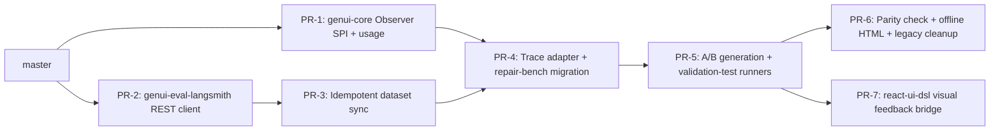

# Migration plan for moving generation, validation, and evaluation to LangSmith

## Goal

Move the GenUI generation, validation, and repair evaluation workflows onto LangSmith so that datasets, per-round execution traces, validation diagnostics, repair rates, and cross-run comparisons live in one system instead of scattered local JSONL, HTML, and Markdown files.

The smallest change that meets this goal adds a zero-dependency trace hook to `packages/genui-java-sdk`, builds a dedicated Maven evaluation module `packages/genui-eval-langsmith` on top of LangSmith REST API v1, migrates the three Java evaluation tracks (`repair-bench`, `validation-test`, and end-to-end A/B generation) onto LangSmith datasets and experiments, and optionally attaches frontend visual scores from `packages/react-ui-dsl` to the same LangSmith runs.

## Current state and gap assessment

The repository currently has zero LangSmith code, dependencies, or configuration. Verification and evaluation are split across five disconnected tools.

| Track | Location | Corpus size (measured) | Current artifact | Migration scope |
| --- | --- | --- | --- | --- |
| Repair replay benchmark (`repair-bench`) | `packages/genui-java-sdk/src/test/java/.../bench/RepairBenchCli.java` | 25 real cases in `packages/genui-java-sdk/repair-cases/` | Local JSONL and offline HTML report | Migrate as primary LangSmith experiment track |
| End-to-end A/B validation driver | `packages/genui-java-sdk/src/test/java/.../bench/ValidationBenchmarkDriver.java` | External JSON fixtures (`arm=off` vs `arm=on`) | Local `.dsl`, `metrics-{arm}.json`, `.llm-calls.json` | Migrate as A/B LangSmith experiment track |
| Manual-annotation validation corpus | `packages/genui-java-sdk/src/test/java/.../report/ValidationCorpusReportGenerator.java` | 49 cases in `validation-test/1..4.json` plus `error_detail.txt` | `validation-test/validation-results.md` | Migrate as deterministic validation-only LangSmith experiment |
| Offline interception corpus | `packages/genui-java-sdk/src/test/java/.../interception/InterceptionCorpusTest.java` | 144 cases in `interception-corpus/manifest.json` | JUnit CI gate | Keep as local JUnit CI gate; optional read-only sync to LangSmith |
| Frontend visual eval loop | `packages/react-ui-dsl/src/__tests__/e2e/eval-loop.ts` + `packages/genui-eval-cli` | 32 e2e snapshots, 22 fuzz inputs | Local `.eval-runs/` and `eval-history.json` | Optional Phase 2 attachment via LangSmith feedback API |

### Seven concrete gaps

1. **Zero runtime observability in `genui-core` (High).** `GenUiGenerator`, `GenerationSession`, and `RepairLoop` emit no structured lifecycle events. `RepairBenchRunner` cannot see the exact prompt bytes sent on repair rounds, so `RepairBenchReport` reconstructs repair prompts from templates after the fact. `SseDeltaParser` and `ChatCompletionRequest` do not request or parse `stream_options.include_usage`, so token counts and cost per round are missing.
2. **Strict dependency boundary on `genui-core` (High).** `packages/genui-java-sdk/pom.xml` only allows `fastjson2` at runtime and `com.huawei.bsp.commonlib.resetclient` as `provided`. LangSmith transport code must not enter `genui-core` main dependencies.
3. **Fragmented corpora with non-trivial schema semantics (Medium).** `repair-cases/` separates `null` dataModel (data types unknown, static checks still run) from `{}` (explicit empty dataModel). `validation-test/` stores annotations separately in `error_detail.txt`. None of the corpora carry idempotent upsert keys, dataset version tags, or contract SHA-256 metadata in a shared schema.
4. **Metric mismatch between LangSmith row averages and `repair-bench` rates (High).** LangSmith averages row-level feedback across all examples in a dataset, which matches the secondary rate `repaired / total`. Our 80% target uses the main rate `repaired / (repaired + still-invalid)`, which excludes `not-reproduced`, `timeout`, and `transport-error`. Our workflow also tracks per-code repair rates (`issueBuckets`) and capability boundary compliance (`capabilityNoticeRate`, `casesWithRemainingGapCalls`, `consecutiveUnmatchedUnknownComponents`). These require explicit session-level summary feedback in LangSmith.
5. **Duplicated CLI and LLM transport code (Medium).** Three classes implement OpenAI-compatible HTTP transport separately (`OpenAiCompatBenchTransport`, `ValidationBenchmarkDriver.OpenAiHttpTransport`, and `OpenAiCompatibleLlmTransport`). `genui-eval-cli` only calls synchronous `GenUiGenerator.generate` with `GenUiValidationConfig.disabled()`, so it cannot drive the streaming validation and repair loop.
6. **Cross-language boundary for visual evaluation (Medium).** Java owns generation, validation, and repair. Node plus Playwright owns browser rendering, screenshots, and VLM judging in `packages/react-ui-dsl`. Keeping TypeScript changes out of Java PRs requires a clean handoff contract based on LangSmith `dataset_id`, `session_id`, and `run_id`.
7. **Unverified LangSmith environment and network setup (Blocker for live verification).** The workspace has no `.env` file and no `LANGSMITH_API_KEY` or `LANGSMITH_ENDPOINT`. SaaS (`api.smith.langchain.com`) versus internal self-hosted deployment, proxy reachability, and data sanitization rules for internal Huawei corpus payloads are not confirmed yet.

## Architecture decisions

### Decision 1. Keep `genui-core` dependency-free and put LangSmith in a new Maven module

`packages/genui-java-sdk` adds only a small, dependency-free observer SPI (`GenerationObserver` and immutable event records) plus optional SSE usage capture. All LangSmith HTTP calls, dataset syncing, and experiment runners live in a new Maven module `packages/genui-eval-langsmith` registered in root `pom.xml`. Production consumers of `genui-core` pay zero extra jars and zero network overhead when no observer is registered.

### Decision 2. Use a thin JDK 21 `HttpClient` plus `fastjson2` client for LangSmith REST API v1

The official `com.langchain.smith:langsmith-java` artifact is still in `0.1.0-beta.x`, brings OkHttp, Jackson, and Kotlin runtime dependencies, and still requires writing the Java experiment runner ourselves. A thin client over JDK 21 `java.net.http.HttpClient` and `fastjson2` calls five stable endpoints (`/api/v1/datasets`, `/api/v1/examples`, `/api/v1/sessions`, `/api/v1/runs/batch`, `/api/v1/feedback`). It reuses our existing proxy logic, passes Checkstyle, PMD, SpotBugs, and FindSecBugs without suppression noise, and is 100% testable offline against JDK `com.sun.net.httpserver.HttpServer`.

### Decision 3. Map one case execution to a nested LangSmith run tree and preserve all custom rates via summary feedback

Each evaluated example creates one root `chain` run linked to `reference_example_id` and `session_id`, with child runs underneath.

```
Root run (run_type=chain, name=genui_case, reference_example_id, session_id)
  ├── Round 0 (run_type=chain, name=round_0_initial)
  │     ├── LLM call or replay (run_type=llm, exact messages JSON, raw output, token usage, latency)
  │     └── Validator check (run_type=tool, name=openui_validator, status, raw issues, actionable issues)
  ├── Round 1..N (run_type=chain, name=round_k_repair)
  │     ├── Repair prompt build + LLM stream (run_type=llm, exact messages JSON, raw delta output, usage)
  │     └── Validator check (run_type=tool, name=openui_validator, actionable issues, diff summary)
  └── Markdown fallback (run_type=llm, only when triggered)
```

Row-level feedback attached to the root `run_id` records `reproduced` (0 or 1), `repaired` (0 or 1), `status` (categorical value), `attempt_count`, `initial_issue_count`, `final_issue_count`, `capability_notice_present`, `remaining_gap_alias_count`, `consecutive_unmatched_unknown_count`, `markdown_fallback`, and `validation_coverage` (for `validation-test`).

Session-level summary feedback attached to `session_id` (with `run_id` omitted) records `main_repair_rate`, `end_to_end_repair_rate`, `secondary_repair_rate`, `not_reproduced_rate`, `capability_notice_rate`, `cases_with_remaining_gap_calls`, `consecutive_unmatched_unknown_cases`, and `bucket::<issueCode>::repair_rate`. Experiment metadata stores `git_commit`, `contract_version`, `contract_sha256`, `model`, `temperature`, `max_attempts`, `timeout_minutes`, and `arm`.

### Decision 4. Keep `InterceptionCorpusTest` as a local JUnit CI gate

The 144 interception cases are fast, deterministic, zero-LLM unit assertions. Moving them behind network calls to LangSmith would add CI flakiness for zero gain. Keep them in `mvn test`, and optionally push snapshots to a LangSmith dataset only for cross-corpus visibility.

### Decision 5. Preserve `dataModel` null versus empty-object fidelity

LangSmith example `inputs` is a JSON object. Store explicit `"hasDataModel": true | false` alongside `"dataModel": {...} | null` so deserialization never collapses missing `dataModel` into `{}`.

## PR sequence and dependency graph

| PR ID | Title | Branch base | Depends on | Review gated | Primary files touched |
| --- | --- | --- | --- | --- | --- |
| `PR-1` | Add zero-dependency `GenerationObserver` SPI and SSE usage capture in `genui-core` | `master` | None | Yes (public SDK API) | `packages/genui-java-sdk/src/main/java/com/huawei/cloudsop/genui/core/llm/**`, `.../core/validation/repair/RepairLoop.java`, unit tests |
| `PR-2` | Create `packages/genui-eval-langsmith` module with REST API v1 client and batch run uploader | `master` | None (parallel with `PR-1`) | No | `pom.xml`, `packages/genui-eval-langsmith/**` |
| `PR-3` | Add idempotent dataset sync CLI for `repair-cases`, `validation-test`, and fixture packs | `PR-2` | `PR-2` | No | `packages/genui-eval-langsmith/src/**/dataset/**`, `packages/genui-java-sdk/repair-cases/` (read-only) |
| `PR-4` | Implement LangSmith trace adapter and migrate `repair-bench` runner and evaluators | `PR-1` + `PR-2` + `PR-3` | `PR-1`, `PR-2`, `PR-3` | Yes (metric parity sign-off) | `packages/genui-eval-langsmith/src/**/trace/**`, `.../eval/RepairExperimentRunner.java`, `.../eval/SummaryFeedbackCalculator.java` |
| `PR-5` | Migrate `ValidationBenchmarkDriver` (A/B arms) and `ValidationCorpusReportGenerator` to unified LangSmith CLI | `PR-4` | `PR-4` | No | `packages/genui-eval-langsmith/src/**/eval/GenerationAbExperimentRunner.java`, `.../eval/ValidationCorpusExperimentRunner.java`, `.../cli/LangSmithEvalCli.java` |
| `PR-6` | Add dual-run parity harness, CI workflow, and retire redundant local drivers | `PR-5` | `PR-5` | Yes (deletes legacy bench entrypoints) | `packages/genui-java-sdk/src/test/java/.../bench/**`, `packages/genui-java-sdk/docs/repair-bench.md`, `.github/workflows/**` |
| `PR-7` | Attach `react-ui-dsl` Playwright screenshots and VLM judge scores to LangSmith runs | `PR-5` | `PR-5` | Yes (crosses into TS package) | `packages/genui-eval-cli/**`, `packages/react-ui-dsl/src/__tests__/e2e/eval/**` |



## Per-PR execution checklist

### PR-1. Add zero-dependency `GenerationObserver` SPI and SSE usage capture in `genui-core`

- [ ] **Depends on:** None (branches from `master`).
- [ ] **Files edited:**
  - `packages/genui-java-sdk/src/main/java/com/huawei/cloudsop/genui/core/llm/GenerationObserver.java` (new, public SPI with default no-op methods)
  - `packages/genui-java-sdk/src/main/java/com/huawei/cloudsop/genui/core/llm/LlmUsage.java` (new, record for `promptTokens`, `completionTokens`, `totalTokens`)
  - `packages/genui-java-sdk/src/main/java/com/huawei/cloudsop/genui/core/llm/GenUiLlmConfig.java` (add optional `includeStreamUsage` flag, default `false` so production payloads stay unchanged)
  - `packages/genui-java-sdk/src/main/java/com/huawei/cloudsop/genui/core/llm/protocol/ChatCompletionRequest.java` (emit `stream_options: {"include_usage": true}` when `stream && includeStreamUsage`)
  - `packages/genui-java-sdk/src/main/java/com/huawei/cloudsop/genui/core/llm/stream/SseDeltaParser.java` (overload to capture trailing `usage` frame without breaking `[DONE]` or `finish_reason=stop` handling)
  - `packages/genui-java-sdk/src/main/java/com/huawei/cloudsop/genui/core/llm/GenUiGenerator.java` (add `withObserver(GenerationObserver)` copying method, invoke lifecycle callbacks for session start/end, LLM call start/end with exact request JSON, round validation end, markdown fallback start/end)
  - `packages/genui-java-sdk/src/main/java/com/huawei/cloudsop/genui/core/validation/repair/RepairLoop.java` (emit exact repair request JSON, round index, `RoundEndResult`, and `LlmUsage` to observer)
  - `packages/genui-java-sdk/src/test/java/com/huawei/cloudsop/genui/core/llm/GenerationObserverTest.java` (new)
- [ ] **One change built:** Expose exact per-round prompts, raw outputs, validator results, timings, and optional token usage from `GenUiGenerator.generateStream` without adding any dependency to `genui-core`.
- [ ] **Visible result:** Registering an in-memory observer on `GenUiGenerator` records the exact ordered event tree (session -> round 0 -> llm + validation -> round 1..N -> fallback -> session end) with byte-exact request bodies and parsed `LlmUsage`.
- [ ] **Verification (Unit):** Run `mvn -pl packages/genui-java-sdk test verify` (includes Checkstyle, PMD, SpotBugs, fmt-check). Verify default `GenUiGenerator` produces identical request JSON when `includeStreamUsage=false` and observer throws are isolated from generation output.
- [ ] **Verification (Live):** Run `RepairBenchCli --cases=packages/genui-java-sdk/repair-cases --limit=2 --repair` with an observer printing event summaries to stderr against the configured OpenAI-compatible endpoint. Pass predicate: every round logs non-empty exact request JSON, matches `rounds.size()`, and captures non-zero `totalTokens` when the endpoint returns SSE usage frames.
- [ ] **Verification (Perf):** Measure `DefaultOpenuiLangValidator` plus `GenUiGenerator.generateStream` with no-op observer versus `master` baseline across 25 validation-only replays (5 trials, median wall time in ms). Fail threshold: median overhead above 3% or more than 5 ms per case.
- [ ] **Review gate:** Operator reviews public `GenerationObserver` and `LlmUsage` signatures before merge.

### PR-2. Create `packages/genui-eval-langsmith` module with REST API v1 client and batch run uploader

- [ ] **Depends on:** None (branches from `master`, runs in parallel with `PR-1`).
- [ ] **Files edited:**
  - `pom.xml` (register `packages/genui-eval-langsmith` module)
  - `packages/genui-eval-langsmith/pom.xml` (depends on `genui-core` and `junit-jupiter` test scope only; zero LangChain/OkHttp/Jackson dependencies)
  - `packages/genui-eval-langsmith/src/main/java/com/huawei/cloudsop/genui/eval/langsmith/LangSmithConfig.java` (reads `LANGSMITH_API_KEY`, `LANGSMITH_ENDPOINT`, `LANGSMITH_WORKSPACE_ID`, `HTTPS_PROXY`, env vars over repo-root `.env`)
  - `packages/genui-eval-langsmith/src/main/java/com/huawei/cloudsop/genui/eval/langsmith/LangSmithClient.java` (typed methods for `upsertDataset`, `listExamples`, `createExample`, `updateExample`, `createSession`, `updateSession`, `ingestRunsBatch`, `createFeedback`)
  - `packages/genui-eval-langsmith/src/main/java/com/huawei/cloudsop/genui/eval/langsmith/BatchRunBuffer.java` (async bounded queue, flushes by count/size/close, retries 429 and 5xx with exponential backoff, dumps failed batches to disk when `LANGSMITH_FAILED_TRACES_DIR` is set)
  - `packages/genui-eval-langsmith/src/main/java/com/huawei/cloudsop/genui/eval/langsmith/SharedOpenAiTransport.java` (single consolidated OpenAI-compatible SSE transport with proxy and timeout support)
  - `packages/genui-eval-langsmith/src/test/java/com/huawei/cloudsop/genui/eval/langsmith/LangSmithClientContractTest.java` (new, runs against local JDK `HttpServer`)
- [ ] **One change built:** Standalone Maven module that speaks LangSmith REST API v1 reliably with batching, retry, proxy support, and offline failure dump.
- [ ] **Visible result:** Local contract tests verify exact JSON payloads, `x-api-key` headers, dotted-order run hierarchy fields (`id`, `trace_id`, `parent_run_id`, `dotted_order`, `session_id`, `reference_example_id`), and batch retry behavior.
- [ ] **Verification (Unit):** Run `mvn -pl packages/genui-eval-langsmith verify`. All contract tests, Checkstyle, PMD, SpotBugs, and FindSecBugs pass with zero warnings.
- [ ] **Verification (Live):** Run a smoke command against a real LangSmith workspace (`LANGSMITH_API_KEY` set) that creates a temporary dataset `genui-smoke-test`, adds 1 example, creates 1 experiment session, posts a 2-node parent/child run batch, attaches 1 run feedback and 1 session summary feedback, and reads them back via API. Pass predicate: HTTP 2xx on every call, UI displays nested run tree and both feedback scores, cleanup removes smoke dataset.
- [ ] **Verification (Perf):** Benchmark `BatchRunBuffer` ingesting 500 synthetic runs (5 KB payload each) against local `HttpServer` with 10 ms simulated latency. Baseline: single-run sequential POST (~5000 ms). Pass predicate: batched throughput completes in under 500 ms with fewer than 25 HTTP requests.

### PR-3. Add idempotent dataset sync CLI for `repair-cases`, `validation-test`, and fixture packs

- [ ] **Depends on:** `PR-2`.
- [ ] **Files edited:**
  - `packages/genui-eval-langsmith/src/main/java/com/huawei/cloudsop/genui/eval/dataset/DatasetSyncer.java` (idempotent sync by stable `caseId` plus `contentSha256`; creates new examples, updates changed examples, leaves unchanged examples untouched, never deletes historical examples silently unless `--prune` is passed)
  - `packages/genui-eval-langsmith/src/main/java/com/huawei/cloudsop/genui/eval/dataset/RepairCaseDatasetAdapter.java` (reads `packages/genui-java-sdk/repair-cases/`, preserves `hasDataModel`, `dataModel`, `originalIntent`, `dsl`, `internalIssueCodes`, `contractVersion`, `contractSha256`)
  - `packages/genui-eval-langsmith/src/main/java/com/huawei/cloudsop/genui/eval/dataset/ValidationTestDatasetAdapter.java` (reads `validation-test/1..4.json` plus `error_detail.txt` annotations)
  - `packages/genui-eval-langsmith/src/main/java/com/huawei/cloudsop/genui/eval/dataset/FixtureDatasetAdapter.java` (reads `ValidationBenchmarkDriver` JSON fixtures)
  - `packages/genui-eval-langsmith/src/test/java/com/huawei/cloudsop/genui/eval/dataset/DatasetSyncerTest.java` (new)
- [ ] **One change built:** Repeatable dataset sync that turns git-tracked corpora into versioned LangSmith datasets while preserving exact schema semantics (`null` vs `{}` `dataModel`, raw unstripped DSL, contract hash).
- [ ] **Visible result:** Running `sync-dataset` twice produces 25 created on run 1 and 0 created / 0 updated / 25 unchanged on run 2 for `repair-cases`, and 49 examples for `validation-test`.
- [ ] **Verification (Unit):** Run `mvn -pl packages/genui-eval-langsmith test`. Verify round-trip fidelity for `null` `dataModel`, `{}` `dataModel`, unstripped DSL whitespace, and idempotency across repeat runs against stub `HttpServer`.
- [ ] **Verification (Live):** Execute `sync-dataset --type=repair-cases --source=packages/genui-java-sdk/repair-cases --dataset=genui-repair-cases` and `sync-dataset --type=validation-test --source=validation-test --dataset=genui-validation-test` against LangSmith. Re-run both commands immediately. Pass predicate: exact counts (25 and 49), second run reports 0 mutations, spot-check `case-20_GEN-00140` (`hasDataModel=false`) and `case-03_GEN-00109` (`hasDataModel=true`) in LangSmith UI.
- [ ] **Verification (Perf):** Time full idempotent no-op sync of 74 examples (25 + 49). Fail threshold: more than 10 seconds wall time or more than 5 HTTP requests during no-op sync.

### PR-4. Implement LangSmith trace adapter and migrate `repair-bench` runner and evaluators

- [ ] **Depends on:** `PR-1`, `PR-2`, `PR-3`.
- [ ] **Files edited:**
  - `packages/genui-eval-langsmith/src/main/java/com/huawei/cloudsop/genui/eval/trace/LangSmithGenerationObserver.java` (implements `GenerationObserver` from `PR-1`, builds parent/child run payloads with `dotted_order`, `trace_id`, `parent_run_id`, `session_id`, `reference_example_id`, exact prompts, raw outputs, token usage, and validator diagnostics)
  - `packages/genui-eval-langsmith/src/main/java/com/huawei/cloudsop/genui/eval/repair/RepairExperimentRunner.java` (pulls examples from LangSmith dataset or local pack, runs validation-only or `--repair` via `GenUiGenerator.generateStream` + replay transport, computes row-level feedback and capability boundary checks)
  - `packages/genui-eval-langsmith/src/main/java/com/huawei/cloudsop/genui/eval/repair/SummaryFeedbackCalculator.java` (pure function computing `main_repair_rate`, `end_to_end_repair_rate`, `secondary_repair_rate`, `not_reproduced_rate`, `capabilityBoundary`, and per-code `issueBuckets` for LangSmith session summary feedback)
  - `packages/genui-eval-langsmith/src/test/java/com/huawei/cloudsop/genui/eval/repair/RepairExperimentParityTest.java` (new, asserts 100% numeric equality against `RepairBenchRunner` on deterministic fixtures)
- [ ] **One change built:** Full `repair-bench` execution against LangSmith datasets with nested per-round traces, row-level evaluators, and exact summary feedback parity.
- [ ] **Visible result:** Every repair run appears in LangSmith under **Datasets -> genui-repair-cases -> Experiments** with clickable per-round traces showing exact prompts sent to the model, validator diagnostics per round, row scores, and experiment-level `main_repair_rate` and `bucket::*` scores.
- [ ] **Verification (Unit):** Run `mvn -pl packages/genui-eval-langsmith verify`. `RepairExperimentParityTest` proves `main_repair_rate`, `end_to_end_repair_rate`, `secondary_repair_rate`, `byStatus`, `issueBuckets`, and `capabilityBoundary` match `RepairBenchRunner` to the exact decimal on mock SSE streams covering all 6 statuses (`repaired`, `still-invalid`, `not-reproduced`, `timeout`, `transport-error`, `invalid`).
- [ ] **Verification (Live):** Run validation-only across all 25 `repair-cases` and `--repair --limit=5` against live LLM + LangSmith. Pass predicate: LangSmith experiment UI displays 25 validation-only runs with zero `transport-error`, and 5 repair runs with nested round trees, real prompt text (no reconstructed placeholder), token usage, and non-null `main_repair_rate` summary feedback.
- [ ] **Verification (Perf):** Compare 25-case validation-only wall time with LangSmith upload versus local `RepairBenchCli` trunk baseline. Fail threshold: total wall time increase exceeds 3 seconds for 25 cases (async batch flush keeps upload off the validation critical path).
- [ ] **Review gate:** Operator audits one live LangSmith experiment in the UI and confirms metric parity with existing `RepairBenchReport` before `PR-5` and `PR-6`.

### PR-5. Migrate `ValidationBenchmarkDriver` (A/B arms) and `ValidationCorpusReportGenerator` to unified LangSmith CLI

- [ ] **Depends on:** `PR-4`.
- [ ] **Files edited:**
  - `packages/genui-eval-langsmith/src/main/java/com/huawei/cloudsop/genui/eval/ab/GenerationAbExperimentRunner.java` (runs `--arm=off` or `--arm=on` against a LangSmith fixture dataset, logs `first_dsl_ms`, `duration_ms`, `llm_calls`, `reasks`, `validation_status`, `dsl_chars`, and full call traces)
  - `packages/genui-eval-langsmith/src/main/java/com/huawei/cloudsop/genui/eval/corpus/ValidationCorpusExperimentRunner.java` (runs 49 `validation-test` examples, emits `validation_status`, `annotation_coverage` as `DETECTED`/`MISSED`/`IGNORED`/`UNLABELED`, `raw_issue_count`, `actionable_issue_count`, and summary coverage rates)
  - `packages/genui-eval-langsmith/src/main/java/com/huawei/cloudsop/genui/eval/cli/LangSmithEvalCli.java` (single entry point with subcommands `sync-dataset`, `eval-repair`, `eval-ab`, `eval-corpus`, plus `--offline-report=<path>` fallback flag to keep local JSONL/HTML generation when air-gapped)
  - `packages/genui-eval-langsmith/src/test/java/com/huawei/cloudsop/genui/eval/cli/LangSmithEvalCliTest.java` (new)
- [ ] **One change built:** Unify all three Java evaluation tracks under one CLI and one LangSmith experiment workflow, enabling native side-by-side A/B comparison (`arm=off` vs `arm=on`) and `DETECTED`/`MISSED` trend tracking over commits.
- [ ] **Visible result:** Running `eval-ab --arm=off` and `eval-ab --arm=on` creates two comparable experiments on the same dataset in LangSmith; running `eval-corpus` reproduces the exact `{DETECTED=18, MISSED=7, IGNORED=23, UNLABELED=1}` baseline in LangSmith summary feedback.
- [ ] **Verification (Unit):** Run `mvn -pl packages/genui-eval-langsmith verify`. Verify `eval-corpus` matches `ValidationCorpusReportGenerator` counts on `validation-test/1..4.json` (`INVALID=26, VALID=23`, `rawIssues=90`, `actionableIssues=60`, `DETECTED=18, MISSED=7, IGNORED=23, UNLABELED=1`).
- [ ] **Verification (Live):** Run `eval-corpus` on `genui-validation-test` and `eval-ab` (`off` and `on`, `--limit=3`) against live LangSmith. Pass predicate: LangSmith **Compare** view shows `arm=off` vs `arm=on` diff side-by-side with `first_dsl_ms` and `reasks`, and `eval-corpus` summary feedback matches local counts 100%.
- [ ] **Verification (Perf):** Time 49-case `eval-corpus` against local `ValidationCorpusReportGenerator` trunk baseline. Fail threshold: validation compute overhead > 5%, or total command time including LangSmith upload > 5 seconds.

### PR-6. Add dual-run parity verification, CI integration, and retire duplicate local drivers

- [ ] **Depends on:** `PR-5`.
- [ ] **Files edited:**
  - `packages/genui-java-sdk/src/test/java/com/huawei/cloudsop/genui/bench/ValidationBenchmarkDriver.java` (remove after confirming parity; replaced by `eval-ab`)
  - `packages/genui-java-sdk/src/test/java/com/huawei/cloudsop/genui/bench/OpenAiCompatBenchTransport.java` (remove duplicate transport)
  - `packages/genui-java-sdk/src/test/java/com/huawei/cloudsop/genui/bench/RepairBenchCli.java` (keep offline HTML view or delegate to `LangSmithEvalCli --offline-report`, remove duplicated runner logic)
  - `packages/genui-java-sdk/docs/repair-bench.md` (update to LangSmith workflow and offline fallback instructions)
  - `packages/genui-eval-langsmith/README.md` (new, operator how-to for dataset sync, experiment runs, and self-hosted vs SaaS env vars)
  - `.github/workflows/langsmith-validation-eval.yml` (new, optional manual or post-merge workflow running zero-LLM `eval-corpus` and `eval-repair` validation-only when `LANGSMITH_API_KEY` secret is configured)
- [ ] **One change built:** Remove duplicated bench drivers and transports once LangSmith parity is verified, while preserving zero-LLM offline mode for air-gapped debugging.
- [ ] **Visible result:** One evaluation CLI, one OpenAI transport, updated docs, and green full-repo Java verification (`mvn verify`).
- [ ] **Verification (Unit):** Run `mvn verify` across all modules (`tools/lint-rules`, `packages/genui-java-sdk`, `packages/genui-eval-cli`, `packages/genui-eval-langsmith`). All unit tests, `InterceptionCorpusTest` (144 cases), Checkstyle, PMD, SpotBugs, and fmt-check pass.
- [ ] **Verification (Live):** Run `LangSmithEvalCli eval-repair --offline-report=target/offline.html` with no `LANGSMITH_API_KEY` set (verify offline fallback still works), then run with `LANGSMITH_API_KEY` set (verify online upload works). Pass predicate: exit code 0 in both modes, identical `mainRate` and `byStatus`.
- [ ] **Verification (Perf):** Full `mvn verify` build time compared to trunk baseline. Fail threshold: total build time grows by more than 20 seconds.
- [ ] **Review gate:** Operator approves deletion of legacy `ValidationBenchmarkDriver` and doc rewrite before merge.

### PR-7 (Optional Phase 2). Attach `react-ui-dsl` Playwright screenshots and VLM judge scores to LangSmith runs

- [ ] **Depends on:** `PR-5` (kept separate so TypeScript edits never mix into Java PRs).
- [ ] **Files edited:**
  - `packages/genui-eval-cli/src/main/java/com/huawei/cloudsop/genui/evalcli/EvalCliMain.java` (add optional `--validate` flag and emit `langsmithRunId` in output JSONL when LangSmith env vars are active)
  - `packages/react-ui-dsl/src/__tests__/e2e/eval/langsmith-feedback.ts` (new, posts 4 judge rubric scores `component_fit`, `data_completeness`, `format_quality`, `layout_coherence`, `overall`, `visual_issues` tags, and screenshot reference/attachment to the matching `run_id`)
  - `packages/react-ui-dsl/src/__tests__/e2e/eval-loop.ts` (wire optional LangSmith feedback push after judge phase when `LANGSMITH_API_KEY` is set)
- [ ] **One change built:** Bridge frontend visual evaluation into the same LangSmith experiment runs produced by the Java generation pipeline.
- [ ] **Visible result:** A single LangSmith experiment row shows Java generation trace, static validation diagnostics, repair rounds, and VLM visual scores side by side.
- [ ] **Verification (Unit):** `pnpm --filter @cloudsop/openui-react-ui-dsl test` plus `mvn -pl packages/genui-eval-cli verify`.
- [ ] **Verification (Live):** Run `eval-loop.ts` on 2 e2e fixtures with `LANGSMITH_API_KEY` set. Pass predicate: LangSmith run shows both Java generation child spans and the 5 numeric visual judge feedback keys.
- [ ] **Verification (Perf):** Measure judge phase latency with feedback push enabled versus baseline. Fail threshold: feedback upload adds more than 500 ms per fixture.
- [ ] **Review gate:** Operator confirms whether `react-ui-dsl` visual eval should be in scope before starting this PR.

## Confirmed operator decisions and remaining runtime check

Operator confirmed on 2026-11-28:

1. **LangSmith target and model execution.** Use LangSmith Cloud (`https://api.smith.langchain.com`) with local or intranet OpenAI-compatible models. Inference runs locally; only datasets, traces, and feedback upload to LangSmith Cloud.
2. **Data sanitization.** No masking or redaction is needed; upload `dataModel` payloads verbatim.
3. **End-to-end scope.** Include all seven stages (`PR-1` through `PR-7`), covering Java generation/validation/repair and `react-ui-dsl` Playwright visual judge feedback.
4. **Offline HTML report.** Retain self-contained offline HTML report generation (`--offline-report`) alongside LangSmith uploads.

Remaining runtime check when live credentials are supplied:

1. **LLM streaming `usage` support.** Confirm whether the configured local/intranet model gateway accepts `stream_options: {"include_usage": true}` or rejects it with HTTP 400. Default `includeStreamUsage` to `false` on `GenUiLlmConfig` and enable it via CLI flag `--include-usage` so incompatible gateways never break.
