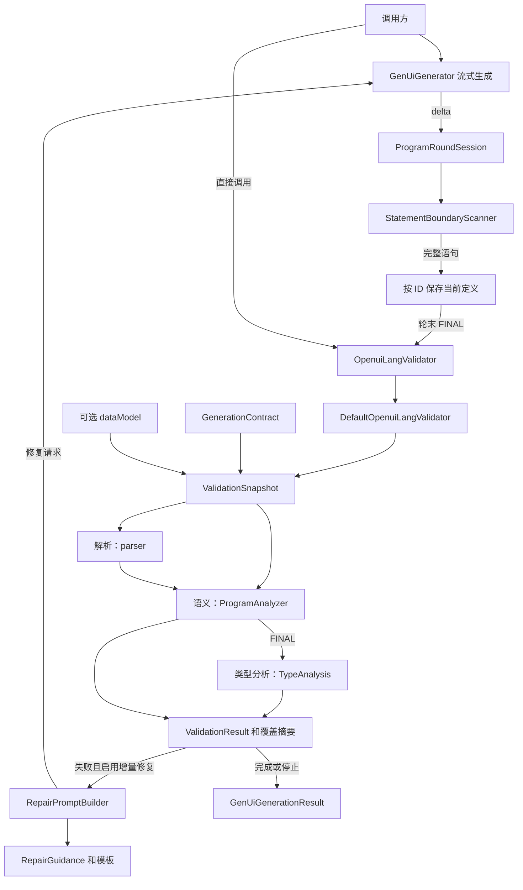
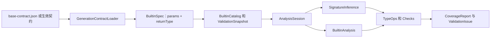

# Java SDK validation 类依赖与功能梳理

基于 `06b2a01f` 及其后工作区的校验模块精简。范围为 `core/validation` 及其直接上下游。**【10月】**表示功能在 2026-10-01 及之后引入或发生重要变化；历史类清单对应精简前的 `06b2a01f`。提交日期以 Git 作者日期为准。

## 总览

校验器将 DSL 转成语法树，再结合生效契约和可选数据模型进行语义及静态类型检查。流式生成实时输出内容，每轮结束才校验当前有效程序；失败后可用同名语句覆盖或新增语句，进入下一轮。同步生成不读取校验配置，也不执行校验或修复。

图中的箭头表示调用或数据流，不表示所有类之间都有直接 import。`OpenuiLangValidator` 可被注入替代实现；默认校验器只执行完整程序校验。`ValidationConfigMode` 控制生成器是否在轮末校验。

## 主链及边界

1. `ValidationSnapshot` 复制契约并使用请求的数据模型，构建 builtin/组件目录、解析程序并执行语义分析；数据模型的嵌套内容不再深拷贝。【10月】`1b959b8d`。
2. `OpenuiParser` 组合预处理、分词、语句切分和表达式解析。流式模式允许补齐尾部；FINAL 按完整程序处理。语法错误进入结构化诊断。
3. `ProgramAnalyzer` 基于同名最后定义选取入口，检查根、引用、组件和参数；未解析引用报告错误。
4. `DefaultOpenuiLangValidator` 运行 `TypeAnalysis`。即使没有数据模型，也检查字面量等静态可知内容；`dataModel == null` 表示未提供数据，空 map 表示明确的空数据。
5. 类型分析把检查区分为匹配、不匹配和无法证明：只有可证明的不匹配产生类型错误；无法证明的项记录在覆盖摘要中。因此 `VALID` 不代表所有检查项都已证明通过。【10月】`88053ee1`、`392ec944`。
6. 存在 `ERROR` 返回 `INVALID`，否则返回 `VALID`。`issues()` 是完整诊断，`actionableIssues()` 去掉重复和部分级联噪声，不改变状态。

关键入口：[DefaultOpenuiLangValidator](../src/main/java/com/huawei/cloudsop/genui/core/validation/DefaultOpenuiLangValidator.java)、[ValidationSnapshot](../src/main/java/com/huawei/cloudsop/genui/core/validation/ValidationSnapshot.java)、[GenUiGenerator](../src/main/java/com/huawei/cloudsop/genui/core/llm/GenUiGenerator.java)。

## 功能与上下游

| 功能 | 上游输入 | 主要实现及下游 | 历史标记 |
| --- | --- | --- | --- |
| 预处理和语法解析 | 模型文本、解析模式、builtin 名称 | `OpenuiPreprocessor` → `OpenuiLexer` → `StatementSplitter` → `ExpressionParser` → `Program`；结果供语义及类型分析使用 | 基础解析 2026-07-01 `71d623e5` |
| 组件、参数、引用和根校验 | `Program`、`GenerationContract`、外部引用 | `ContractCatalog`、`ProgramAnalyzer`、`ComponentContractValidator`；输出 `ProgramAnalysis` 和诊断 | 基础语义 2026-07-01 `e0aa053d` |
| builtin 词表和简洁签名契约化 | 生效契约、默认契约 | `BuiltinCatalog` 只提供名称与签名；加载器校验 `params`/`returnType` 并把特殊布局前提委托 `BuiltinAnalysis.validateDefinition`；类型分析用 `SignatureInference` 做通用推导 | 【10月】`ad15baaf`、`735bae7c`、`392ec944`；#122 删除旧规则 |
| 类型及数据路径检查 | 可达语句、组件 schema、builtin 签名、可选数据模型 | `AnalysisSession`、`DataPathResolver`、`SnapshotFacts`、`Checks`；输出诊断和 `CoverageReport` | 数据感知基础 2026-08-28 `eab65c38`；【10月】统一分析引擎 `88053ee1`、`392ec944` |
| schema 和预算 | 契约 schema、分析预算 | `SchemaCompiler` 转为 `Expectation`；`AnalysisBudget` 限制分析工作，`CoverageReport` 记录未证明与截断 | 【10月】`88053ee1`、`cbc55558`、`636ed8e2` |
| Each / Render 等绑定作用域 | Java 固定的调用布局；实际调用参数 | `BuiltinAnalysis`；按实参角色识别变量作用域与元素来源，避免把空数组或未知元素当作已观察数据 | 【10月】`33a0e509`、`db2204a8`、`a6bdf42e` |
| 对象枚举与数组流水线 | `ObjectKeys/Values/Entries`、数组处理 builtin 的签名与输入事实 | `BuiltinAnalysis`、`TypeOps`、`AnalysisSession`；向下游传播键值、元素及长度信息，检查图表等使用要求 | 【10月】`b2683d84`、`f579f92b` |
| 格式化 builtin | 简洁签名、实际调用 | `SignatureInference` + `BuiltinAnalysis`（FormatDate 形状细化）；对参数和返回进行类型分析 | 【10月】`c8357e18` |
| Table 与 Render 使用点 | 表格数据、列字段和模板使用点 | 类型引擎检查行形状、字段和模板作用域；表列字段存在性按任意一行满足判断 | 【10月】`c0c827a7`、`b135e271` |
| 诊断整理与定向指导 | 完整 `ValidationIssue`、当前契约能力缺口 | `ValidationIssueReducer` 去噪；`RepairHints`、`RepairGuidance` 路由专项指导，供修复提示使用 | 去噪基础 2026-08-28 `0cd04700`；【10月】能力边界 `bfc9c760`、数据/表列指导 `d17f15b7` |
| 流式轮末校验 | 模型 delta、契约、数据、注入校验器 | `StatementBoundaryScanner` → `ProgramRoundSession` → FINAL 校验 → `RoundEndResult` | 【10月】`8c2b1882`、`84cf6078` |
| 跨轮增量修复 | 最新诊断、当前定义、有限历史和修复模板 | `RepairPromptBuilder` 生成消息；生成器请求补丁并合并同名定义，再次轮末校验 | 【10月】`d67cdce5`、`6ec1f66e`、`b78dc0c4` |
| 策略配置 | `GenUiValidationConfig` | `incremental()` 默认增量修复，`incremental(n)` 设置上限，`finalOnly()` 只校验，`disabled()` 关闭校验；生成器消费配置 | 【10月】`d67cdce5`、`2946fee8` |

### 流式和修复细节

`ProgramRoundSession` 用语句 ID 维护当前程序：同名覆盖、新 ID 追加，不提供删除语义。`beginRound()` 重置扫描器但保留定义，不同轮的半句不会拼接。收到片段时只累计原文，读取当前定义时按需扫描完整语句，轮末刷出并补齐尾句；被覆盖的旧定义不参与当轮校验。轮次结果同时保存原始输出与当前定义，两者用途不同。

修复指导按**当前**可操作错误选择，不沿用已经被覆盖的历史错误标签。`StatementRelations` 帮助提示词关联相关定义；模板位于 `src/main/resources/prompts/repair/`。修复次数上限为 0 时没有单独的次数上限，由会话截止条件控制；也可显式指定次数上限。

### 契约加载与 builtin 签名

加载器只做结构校验：必填字段、名称唯一、`TypeExpr` 文法、命名类型变量有参数来源、普通可选/变长布局；Each/Render/Switch 的布局前提由 `BuiltinAnalysis.validateDefinition` 检查，加载器不维护第二份函数名单。`SignatureInference` 在调用点把 `params` 变成入口检查、按名绑定类型变量并实例化 `returnType`；`BuiltinAnalysis` 负责 Java 特殊语义与模板生命周期。非法类型语法、残留旧字段或声明与处理器可证明冲突都在加载期失败。组件 schema 的检查要求由 `SchemaCompiler` 编译。契约的 `templateBuiltin` 只用于提示词分组，不决定特殊处理。细节见 [runtime-semantics-contract.md](runtime-semantics-contract.md)。

## 10 月起新增的类

以下列出精简前版本中仍存在的 25 个新增顶层类，日期取对应提交的作者日期。类的新增不一定意味着功能首次出现：例如 `RepairPromptBuilder` 替换了此前的增量修复提示构建实现。

| 日期及提交 | 新增类（相对 validation 目录） | 上下游作用 |
| --- | --- | --- |
| 10-15 `ad15baaf` | `parser/BuiltinCatalog` | 从生效契约建立 builtin 词表，供解析、语义和类型分析使用。 |
| 10-19 `8c2b1882` | `stream/ProgramRoundSession`、`stream/RoundEndResult` | 接收生成器的流式输出，轮末调用校验器并记录结果。 |
| 10-20 `d67cdce5` | `repair/RepairGuidance`、`semantic/StatementRelations` | 分别连接诊断到指导、语句关系到修复提示。 |
| 10-22 `1b959b8d` | `ValidationSnapshot` | 接收校验请求，向解析、语义和类型分析提供分析输入。 |
| 10-31 `#118`–`#122` | `type/analysis/BuiltinAnalysis`、`type/analysis/SignatureInference` | 收拢 builtin 特殊语义与简洁签名推导；同期的旧规则类（`contract/*`）已删除，不列入现存类。 |
| 10-23 `88053ee1` | `type/analysis/AnalysisBudget`、`AnalysisSession`、`Checks`、`CoverageReport`、`Expectation`、`Fact`、`Relations`、`SchemaCompiler`、`SnapshotFacts`、`Type`、`TypeAnalysis`、`TypeOps`、`Types` | 构成类型分析内核：接收程序、契约和数据，输出类型诊断及覆盖信息。 |
| 10-28 `b78dc0c4` | `repair/RepairPromptBuilder` | 接收当前轮诊断与程序，渲染 Markdown 模板供生成器发起修复。 |

`DataPath`、`DataPathResolution`、`DataPathResolver` 在 10 月从 `type/` 移到 `type/analysis/`，原类于 8 月已存在，故不计为新增。`StatementBoundaryScanner` 也未计入新增类；它的轮末处理属于 10 月功能变更。只列当前仍存在的类，不包括已删除的历史实现。

## 类清单

路径均相对于 `src/main/java/com/huawei/cloudsop/genui/core/validation/`。这里列出顶层 Java 文件；一行中的多个文件分别是独立类或枚举，嵌套类型归入其所属文件。下表的功能标记与文件新增标记分开：已有类也可能实现了 10 月新功能。

### 根包

| 类 | 职责及上下游 |
| --- | --- |
| `OpenuiLangValidator` | 对外接口；接收请求，返回结果；由生成器或外部调用方调用。 |
| `DefaultOpenuiLangValidator` | 默认编排器；构造快照，合并语义和 FINAL 类型分析结果。 |
| `ValidationRequest` | DSL、契约、根、外部引用、数据模型和模式输入。 |
| `ValidationSnapshot` | 【10月功能】整理分析输入并构建程序、词表、组件目录和语义结果。 |
| `ValidationResult` | 状态、规范化 DSL、完整问题及 metadata；向调用者提供去噪视图。 |
| `ValidationIssue` / `ValidationSeverity` | 单条诊断及严重级别；ERROR 阻塞。 |
| `ValidationMetadata` / `ValidationStatus` | 校验元数据和 VALID、INVALID 状态。 |
| `ValidationIssueReducer` | 降低重复、语法级联、表格和根诊断噪声；供结果和修复使用。 |
| `GenUiValidationConfig` / `ValidationConfigMode` | 生成器的校验策略(增量修复、只校验、关闭)及增量修复上限。 |

### parser

| 类 | 职责及上下游 |
| --- | --- |
| `OpenuiPreprocessor` | 提取代码、清理注释，流式模式补齐尾部；供 parser 和流式扫描器使用。 |
| `OpenuiLexer` / `Token` / `TokenType` | 将输入分为带位置 token，供语句切分和表达式解析。 |
| `StatementSplitter` | 按顶层语句切分 token，辅助提取语句 ID。 |
| `ExpressionParser` | 以运算符优先级解析表达式，产生 AST 与诊断。 |
| `OpenuiParser` | 组合预处理、lexer、splitter 和表达式解析，产出 `Program`。 |
| `AstNode` / `Statement` / `Program` | 语法树、语句和程序模型；供语义、类型及修复关系分析使用。 |
| `SourceSpan` / `ParseDiagnostic` / `ParseErrorCode` / `ParseMode` | 源码位置、解析诊断、错误码及解析模式。 |
| `BuiltinCatalog` | 【10月功能】从生效契约建立 builtin 名称与签名视图；另行判断 DSL 语法保留调用名称。 |

### semantic

| 类 | 职责及上下游 |
| --- | --- |
| `ProgramAnalyzer` / `ProgramAnalysis` | 从入口分析当前定义、引用和组件，输出语义问题。 |
| `ContractCatalog` / `ComponentDef` / `ParamDef` | 从契约建立组件及位置参数目录，供语义和类型检查使用。 |
| `ComponentContractValidator` | 根据组件目录检查必填、参数数量和属性约束。 |
| `BuiltinAnalysis` | 【10月功能】固定 Each/Render/Switch 的调用布局,处理实参角色、binder 作用域、Java 特殊结果推导与延迟模板;定义期校验也由它提供。 |
| `RepairHints` | 根据引用、未知组件及能力缺口构造修复提示。 |
| `StatementRelations` / `AstReferenceWalker` | 分析语句和作用域依赖；共享引用遍历供类型分析和修复提示使用。 |

### type/analysis

| 类 | 职责及上下游 |
| --- | --- |
| `TypeAnalysis` / `AnalysisSession` | 【10月功能】FINAL 类型分析入口与单次分析会话，遍历入口可达定义、传播事实并登记检查。 |
| `Type` / `Types` / `TypeOps` | 类型表示、构造和运算；包括联合、记录、序列与对象枚举等操作。 |
| `Fact` / `Expectation` | 表达式已有事实与契约要求；供检查器对照。 |
| `Checks` / `Relations` | 判断事实与要求是否匹配、冲突或无法证明；传播上游错误与原因。 |
| `SchemaCompiler` | 把组件 schema 的受支持部分转换为检查要求。 |
| `AnalysisBudget` / `CoverageReport` | 限制分析工作并记录检查结果、截断和无法证明的原因。 |
| `DataPath` / `DataPathResolution` / `DataPathResolver` | 解析数据路径，在数据模型中区分已解析、缺失、非法遍历和无法证明。 |
| `SnapshotFacts` | 将数据模型的实际值转成受预算约束的类型事实。 |
| `SignatureInference` | 由 `params`/`returnType` 的 `TypeExpr` 生成入口检查要求、按名绑定类型变量并实例化返回类型；只被 `BuiltinAnalysis` 调用。 |

### contract

契约包只保留数据形状（`GenerationContract`、`BuiltinSpec`、`CapabilityGapSpec` 等）与加载器；旧规则编译/求值类已在 #122 删除。

### stream

| 类 | 职责及上下游 |
| --- | --- |
| `StatementBoundaryScanner` | 【10月功能】从 delta 识别完整语句，轮末刷出尾部；供轮会话使用。 |
| `ProgramRoundSession` | 【10月功能】跨轮维护当前定义，每轮末调用 FINAL 校验。 |
| `RoundEndResult` | 【10月功能】保存轮次输出、当前定义、校验结果、耗时、契约版本和结束原因。 |

### repair

| 类 | 职责及上下游 |
| --- | --- |
| `RepairPromptBuilder` | 【10月功能】结合当前定义、最新诊断、相关语句及有限历史，渲染修复 system/user 模板并返回消息。 |
| `RepairGuidance` | 【10月功能】按当前阻塞诊断选择模板中的专项指导开关。 |

## 测试与阅读入口

现有测试位于 `src/test/java/com/huawei/cloudsop/genui/core/validation/`，按 parser、semantic、type、contract、stream、repair 分组；生成器集成测试位于 `src/test/java/com/huawei/cloudsop/genui/core/llm/`。建议沿 `DefaultOpenuiLangValidator` → `ValidationSnapshot` → `ProgramAnalyzer` → `AnalysisSession` 阅读，再看 `ProgramRoundSession` 和 `RepairPromptBuilder`。本次未运行测试，以上是代码关系，不代表测试已通过。
